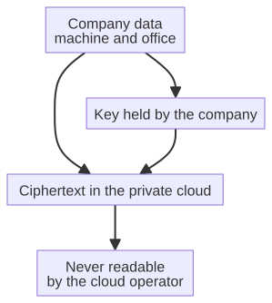

# Capitolo 11 --- La nuvola dentro i muri

## La contraddizione

A metà degli anni Dieci una contraddizione si era posata sull'uso della nuvola, ed era una contraddizione che ogni ingegnere riflessivo poteva sentire ma che nessuno aveva ancora risolto. Da un lato la nuvola era indiscutibilmente utile: offriva memoria, calcolo e connettività a una scala che nessuna singola azienda poteva uguagliare, e permetteva alle macchine e agli uffici di parlarsi attraverso la distanza. Dall'altro lo scandalo del datagate aveva reso altrettanto chiaro che una nuvola pubblica era un posto di cui *non fidarsi di nessuno*: il gestore poteva essere costretto, o poteva essere consenziente, a leggere qualsiasi cosa vi metteste, e una volta che i vostri dati avevano lasciato l'edificio non li controllavate più.

La domanda divenne allora netta e inevitabile. Esiste una nuvola che conserva l'*utilità* della nuvola --- la memoria, la sincronizzazione, la capacità per macchine e uffici di condividere una sola copia viva della verità --- mantenendo il *segreto* che la nuvola pubblica regalava? Può un'azienda avere una nuvola davvero propria, così che i suoi dati non lascino mai l'edificio e non siano mai, nemmeno sotto costrizione, letti da una terza parte?

La risposta, come i progetti dietro questo libro sono arrivati a costruirla, è sì --- ma solo se siete disposti a dare alla nuvola due proprietà nuove che la vecchia nuvola non aveva mai avuto: deve essere **trustless** e deve essere **a conoscenza zero**. Prendiamo sul serio queste due parole, perché sono l'intera innovazione.

## La nuvola trustless

«Trustless» è una formula che viene dal mondo della crittografia e dei sistemi distribuiti, e suona strana da desiderare di qualcosa di utile come una nuvola. Di solito *ci fidiamo* dei servizi che usiamo: è per questo che li usiamo. Chiamare una nuvola «trustless» significa dire che *non dovete* fidarvi del suo gestore perché tratti correttamente i vostri dati. Non dovete fidarvi che non li farà trapelare, che non si farà corrompere, che non sarà costretto a consegnare i vostri file e a leggerli. In una nuvola trustless è l'architettura del sistema --- non le buone intenzioni del gestore --- a tenere al sicuro i vostri dati.

Il modo in cui questo si ottiene è assicurare che i dati siano *cifrati* con chiavi che solo la vostra azienda possiede, e che la nuvola possa elaborare, immagazzinare e sincronizzare i dati *senza mai poterli vedere in chiaro*. La nuvola sposta i vostri dati, li tiene coerenti, li rende disponibili alle vostre macchine e al vostro ufficio, ma non possiede mai il potere di *leggerli*, perché non ha la chiave. È come un corriere che sa consegnare una cassaforte chiusa ma non sa aprirla. Il corriere è utile e affidabile, ed è del tutto incapace di tradirvi. È questa la nuvola trustless: utile, e incapace di tradire.

## La distinzione cruciale

C'è un dettaglio che quasi tutti fraintendono, e vale la pena prenderlo con calma, perché è tutto il punto. La nuvola pubblica --- la gigantesca nuvola centralizzata e commerciale degli anni Dieci --- *cifra* i vostri dati. Li cifra mentre viaggiano sulla rete (cifratura in transito) e li cifra mentre riposano sul disco (cifratura a riposo). L'obiezione ingenua, «basta cifrarli», non risolve dunque nulla, perché la nuvola pubblica li cifra già.

La distinzione che conta è questa: nella nuvola pubblica il *gestore possiede le chiavi*. La cifratura è del gestore, è applicata per ragioni del gestore --- per soddisfare una norma, per limitare la responsabilità, per proteggersi da ladri esterni --- ma il gestore può, in qualsiasi momento, aprire i vostri dati, leggerli, consegnarli. La cifratura a riposo è una *comodità* per il gestore, non una *garanzia* per voi. Se il gestore è costretto, o è consenziente, applica semplicemente la propria chiave, e i vostri dati --- in chiaro, leggibili, non più vostri --- vengono consegnati a chi li ha chiesti.

La nuvola trustless a conoscenza zero cambia *chi possiede la chiave*. In quella nuvola la chiave non è del gestore: è *vostra*, e non lascia mai il vostro edificio. I dati sono cifrati prima di essere inviati, con una chiave che il gestore non possiede, così che perfino la cifratura a riposo sul suo disco sia per lui priva di senso. Può custodire la vostra cassaforte chiusa, spostarla, tenerne copie, sincronizzarla tra i suoi server, ma non può aprirla, perché non ne ha mai avuto la chiave. La cifratura non è più una comodità del gestore: è la *vostra* garanzia, applicata a un livello che il gestore non può annullare. È la differenza tra una cassaforte custodita dalla guardia onesta del gestore e una cassaforte inapribile per progetto. La prima è il datagate; la seconda è la nuvola dentro i muri.

## La nuvola a conoscenza zero

«A conoscenza zero» è una formula di un ramo della crittografia che suona quasi paradossale, e vale la pena prenderla con calma. In crittografia una «prova a conoscenza zero» è un modo con cui una parte dimostra a un'altra che un'affermazione è vera *senza rivelare alcuna informazione oltre la verità dell'affermazione stessa*. L'esempio classico è una grotta con una parola segreta chiusa dietro una porta. Chi conosce la parola può dimostrare, ripetutamente, di conoscerla --- entrando da una porta e uscendo dall'altra --- senza mai *dire* la parola. Dimostra la conoscenza senza trasmetterla. Di qui «a conoscenza zero»: la prova non comunica nulla oltre il fatto che la prova è riuscita.

Applicata alla nuvola, l'espressione significa che la nuvola può verificare ed elaborare i vostri dati senza mai apprendere i dati stessi. La macchina cifra la propria telemetria prima di inviarla, tiene la chiave, e la nuvola --- anche la nuvola che la immagazzina e la sincronizza --- non può leggerla. La nuvola opera su testo cifrato, sulla cassaforte chiusa, mai sul contenuto. Quando i dati servono in ufficio, vengono decifrati lì, dalla vostra azienda, con la vostra chiave. La nuvola è, nel senso più letterale, *cieca* al contenuto dei vostri dati. È un custode che sa fare la guardia a una cassaforte ma non vede mai dentro.

Per renderlo concreto per la fabbrica: il sensore sul mandrino non manda alla nuvola un numero in virgola mobile, manda un *testo cifrato*, il prodotto della cifratura di quel numero con una chiave che la nuvola non possiede. La nuvola immagazzina quel testo cifrato, lo tiene coerente tra i suoi server, lo rende disponibile all'ufficio, tutto mentre è incapace di sapere se il numero fosse 42 o 42.000, se il cuscinetto fosse sano o in avaria. È, nel senso più stretto della parola, *cieca all'informazione*. Vede che dei dati si muovono; non vede che cosa i dati *sono*. È tutto il senso della promessa a conoscenza zero, ed è abbastanza per rendere impossibile il tradimento della nuvola pubblica che abbiamo incontrato nel capitolo precedente.

## CloudServer

Il progetto che incarna questa idea --- la nuvola tenuta dentro l'azienda, trustless e a conoscenza zero --- si chiama **CloudServer**, uno dei progetti pubblicati dal laboratorio dietro questo libro. Dove la nuvola pubblica centralizza i dati in una manciata di centri dati giganteschi che si possono leggere (o obbligare a leggere), una nuvola privata a conoscenza zero come CloudServer *decentralizza la fiducia*: i dati non lasciano mai il controllo dell'azienda, perché l'azienda non regala mai la chiave. La nuvola è dentro i muri, o almeno dentro l'autorità dell'azienda, ed è inutile a una spia, a un pirata informatico o a un'ordinanza di un tribunale, perché non c'è nulla da leggere.

Non è un'ipotesi. L'architettura esiste, è pubblicata, ed è costruita per risolvere esattamente il problema che il datagate ha reso inevitabile. La fabbrica che percepisce, prevede e riferisce --- la fabbrica dei capitoli precedenti --- produce dati che sono, per qualsiasi criterio ragionevole, il suo bene più sensibile. Piani di produzione, contratti con i fornitori, progetti dei componenti, schemi operativi: è l'immagine del futuro dell'azienda resa visibile. È precisamente questa la materia che la sesta rivoluzione deve tenere *dentro i muri*, e una nuvola privata, trustless e a conoscenza zero è l'unico tipo di nuvola che può custodirla senza tradirla.

Il modo in cui CloudServer lo realizza è istruttivo, e vale la pena seguire i dati attraverso di esso una volta, perché il meccanismo è l'intero argomento. La macchina, o l'applicazione d'ufficio, possiede la chiave. Cifra i propri dati *prima* che lascino l'edificio. Poi manda solo *testo cifrato* --- la cassaforte chiusa --- al CloudServer. Il server immagazzina, sincronizza e serve quel testo cifrato a ogni macchina e a ogni ufficio autorizzato, tutto senza mai possedere la chiave che potrebbe aprirlo. Quando una macchina ha bisogno dei dati, il server restituisce il testo cifrato; la macchina --- non il server --- lo decifra, localmente, con la chiave che ha tenuto. Il server è un corriere muto e cieco per i dati di tutta l'azienda, capace di spostarli e custodirli ma mai di leggerli. È l'intera innovazione, ed è ciò che rende la nuvola dentro i muri *trustless* nel senso più vero.

Il diagramma qui sopra è, spero, un quadro fedele del meccanismo: la chiave resta dentro l'edificio, i dati viaggiano e sono immagazzinati solo come testo cifrato, e l'unico luogo in cui diventano leggibili è *dentro i muri dell'azienda*, su una macchina che tiene la chiave. Il CloudServer è presente a ogni passo tranne il primo e l'ultimo: è il vettore, non il lettore. È la nuvola che il datagate ha reso necessaria, ed è ciò che permette alla telemetria più preziosa della fabbrica di viaggiare finalmente, al sicuro, verso il luogo in cui sarà ragionata.

## Quanto costa davvero la chiave

Vale la pena fermarsi su un'obiezione pratica, perché è la prima che nasce in qualsiasi azienda reale: se la nuvola non può leggere i dati, come può farne qualcosa di utile? La preoccupazione è comprensibile, e vale la pena rispondere con chiarezza, perché la risposta è anche la ragione per cui la nuvola a conoscenza zero non è una curiosità ma un progetto funzionante.

Il compito della nuvola, in questa architettura, non è *ragionare*. È *portare e custodire*: immagazzinare i dati in modo affidabile, sincronizzarli su ogni macchina e ogni ufficio, renderli disponibili nell'istante in cui sono richiesti, sopravvivere al guasto di un disco o di un server, e farlo alla scala di un'intera impresa. Nessuno di questi compiti richiede di leggere i dati. Un corriere non ha bisogno di leggere una lettera per consegnarla in tempo; un magazzino non ha bisogno di capire una cassa per custodirla al sicuro. La nuvola è il corriere e il magazzino della sesta rivoluzione, e la sua competenza --- affidabilità, disponibilità, sincronizzazione --- è del tutto compatibile con la sua cecità.

Il *ragionamento*, intanto, avviene dove sta la chiave: sulla macchina che la possiede (il margine, che abbiamo già incontrato) e nell'ufficio che la possiede (l'agente, che incontreremo nella Parte V). Quelli sono i luoghi in cui il testo cifrato diventa leggibile, perché quelli sono i luoghi in cui vive la chiave. La nuvola a conoscenza zero non è dunque un limite imposto al progetto: è una *divisione del lavoro*. La nuvola fa ciò in cui è brava --- spostare e custodire --- senza mai aver bisogno di capire. Le macchine e gli agenti fanno ciò in cui l'intelligenza è brava --- leggere e decidere --- senza mai lasciar uscire i dati dalle proprie mani. Le due metà del lavoro sono separate con pulizia, e la separazione è precisamente ciò che rende sicuro l'insieme.

C'è una piccola ironia, e vale la pena nominarla. La nuvola pubblica si vendeva sulla promessa dell'*integrazione*: «metti tutto in un posto solo, e noi faremo funzionare tutto insieme». La nuvola privata a conoscenza zero rovescia la promessa: mette tutto in un posto solo, ma tiene deliberatamente quel posto *cieco*, e lascia che ogni possessore di chiave faccia il proprio ragionamento. L'integrazione della vecchia nuvola era comoda e insicura; la separazione della nuova è meno comoda e immensamente più sicura. Per la fabbrica lo scambio vale ovviamente la pena, perché i dati che si muovono sono l'immagine del futuro dell'azienda, e nessuna comodità vale il prezzo di consegnare quell'immagine a un estraneo.

## Una breve storia del custodire un segreto

L'idea che un messaggio possa viaggiare restando illeggibile è antica quanto la scrittura, e la storia di quell'idea è l'ascendenza intellettuale della nuvola a conoscenza zero. Vale una breve deviazione, perché permette al lettore di vedere che la nuvola moderna non è un'invenzione improvvisa ma l'ultima svolta di una conversazione molto lunga.

Si dice che Giulio Cesare, nel primo secolo avanti Cristo, proteggesse i propri dispacci militari spostando ogni lettera dell'alfabeto di un numero fisso di posizioni: il «cifrario di Cesare», in cui *A* diventa *D*, *B* diventa *E*, e così via. Era, per gli standard moderni, ridicolmente debole; ma stabilì la mossa essenziale: *un messaggio e il suo significato si possono separare*, così che chi trasporta il messaggio non possa leggerlo. Per duemila anni ogni progresso della crittografia è stato, in fondo, un affinamento di quella sola mossa.

Nel Cinquecento il cifrario di Vigenère usò una *parola chiave* per variare lo spostamento, il che rese il messaggio molto più difficile da rompere, e per un certo tempo si credette --- a torto, come si scoprì --- che fosse inviolabile. La convinzione durò fino all'Ottocento, quando si dice che Charles Babbage (lo stesso uomo che progettò la Macchina Analitica incontrata nella cronologia) lo abbia spezzato. La lezione era già quella moderna: un cifrario è forte solo quanto il *segreto che sta al suo centro* --- la chiave --- e nessuna quantità di ingegno nel meccanismo compensa una chiave debole.

Il Novecento trasformò la crittografia in una questione di vita o di morte. La macchina tedesca Enigma, usata nella Seconda guerra mondiale, cifrava le comunicazioni militari con un sistema di rotori di complessità sconcertante; i decrittatori britannici di Bletchley Park, tra cui Alan Turing, la ruppero e, così facendo, forse accorciarono la guerra di anni. Enigma era un sistema a *segreto condiviso*: mittente e destinatario conoscevano entrambi le impostazioni giornaliere (la chiave), e la sicurezza poggiava sul tenere segreta quella chiave. Quando la chiave trapelò, il cifrario cadde.

Poi, nel 1976, due ricercatori --- Whitfield Diffie e Martin Hellman --- pubblicarono un'idea che cambiò la forma del settore: la *crittografia a chiave pubblica*. Permetteva a due parti che non si erano mai incontrate, e che non condividevano alcun segreto in anticipo, di stabilire un canale sicuro, perché ciascuna parte aveva una chiave *pubblica* (che chiunque poteva vedere) e una chiave *privata* (che solo lei possedeva). La chiave pubblica poteva cifrare; solo quella privata poteva decifrare. Fu il momento in cui la crittografia smise di richiedere un segreto precondiviso, ed è l'antenato diretto della nuvola trustless, in cui l'azienda possiede una chiave che nessun gestore ha bisogno di conoscere.

La prova a conoscenza zero, che abbiamo incontrato prima in questo capitolo, è una svolta ancora più recente e ancora più sorprendente: un modo per dimostrare che un'affermazione è vera *senza rivelare altro*. Prese insieme --- la crittografia a chiave pubblica, che permette a estranei di stabilire un segreto, e le prove a conoscenza zero, che permettono a una parte di dimostrare senza rivelare --- queste idee sono il fondamento intellettuale su cui è costruita la nuvola dentro i muri. CloudServer non è magia; è l'applicazione più recente e più pratica di una conversazione cominciata con l'alfabeto spostato di Cesare e proseguita senza interruzioni per duemila anni. Quando la telemetria della fabbrica viaggia come testo cifrato illeggibile, sta cavalcando quella lunga storia, ed è in buona compagnia.

## Il ritorno della nuvola locale

Vale la pena notare la strana circolarità della storia. Le prime nuvole --- prima dell'era della nuvola gigantesca, centralizzata e commerciale --- erano, in un certo senso, *locali*. Vivevano nei centri dati delle aziende che le usavano, dietro i loro muri, controllate dai loro team informatici. La nuvola commerciale degli anni Dieci prometteva di essere migliore, più economica e più potente, e quasi tutti ci credettero. Il datagate fu il momento in cui la convinzione si crepò. E ora, paradossalmente, la sesta rivoluzione sta tirando la nuvola *indietro*: dentro i muri, sotto il controllo dell'azienda, in un posto di cui ci si può fidare perché è strutturalmente incapace di tradire.

Non è un semplice ritorno al passato; è un ritorno *affinato da uno scandalo*. La nuvola locale degli anni Novanta era locale perché la tecnologia per fare altro non era ancora disponibile: perché la rete era lenta, costosa e inaffidabile, e perché «la nuvola» era semplicemente il modo breve per dire «il computer grande in ufficio». La nuvola locale della sesta rivoluzione è locale *per progetto e per principio*: è locale perché l'azienda ha deciso, dopo il datagate, che i propri dati sono troppo preziosi per essere mai in balia di un gestore. Non sono la stessa nuvola. La prima era locale per necessità; la seconda è locale per convinzione.

La nuvola dentro i muri non è la nuvola del passato; è la nuvola del futuro, affinata da uno scandalo in qualcosa che mantiene la propria promessa senza aver bisogno di essere creduta. È il secondo anello della catena della sesta rivoluzione, ed è ciò che permette alla telemetria della macchina di viaggiare finalmente, al sicuro, verso il luogo in cui sarà ragionata. Quel ragionamento è l'argomento del prossimo capitolo; ma prima occupiamoci del sangue che deve scorrere in questa nuvola privata: la telemetria stessa, il flusso vivo di dati che è il rapporto continuo della fabbrica sul proprio stato.
