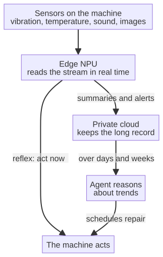

# Capitolo 12 --- La telemetria come sistema nervoso della fabbrica

## Il sangue della nuova macchina

Abbiamo parlato della macchina che pensa, della nuvola che custodisce il proprio segreto e dell'agente che un giorno ragionerà su tutto ciò che la macchina produce. Ma tra la macchina e l'agente --- tra il sensore sul mandrino e la mente in ufficio --- deve esserci un *flusso*. Deve esserci un flusso continuo di informazione che porti, in tempo reale, il rapporto su ciò che la macchina sta facendo e su come si sente. Questo flusso si chiama **telemetria**, ed è il sangue della nuova fabbrica. Senza di esso la macchina che pensa penserebbe nel vuoto; la nuvola che custodisce il segreto non avrebbe nulla da custodire; l'agente che dovrebbe ragionare non avrebbe nulla su cui ragionare. La telemetria è ciò che rende la fabbrica una cosa viva invece di una collezione di metallo inerte.

Capiamo bene la telemetria, perché oggi la parola si usa con leggerezza, e perché capirla è essenziale per capire l'intera catena. La telemetria è semplicemente *dato misurato in un luogo e riferito, automaticamente e di continuo, a un altro luogo*. La parola viene dal greco *tele*, «lontano», e *metron*, «misura»: la misura delle cose lontane. È nata nell'abitacolo di un aeroplano, dove gli strumenti riferivano al pilota lo stato dei motori in tempo reale, e da lì è passata all'informatica, dove è venuta a significare la raccolta e la trasmissione automatica dei dati operativi.

Vale la pena soffermarsi su quell'origine, perché la parola porta il proprio significato nelle ossa. La telemetria è nata, in effetti, dalla *paura*: la paura dell'astronauta o del pilota che deve fidarsi completamente di una macchina il cui sostegno vitale dipende da dati che non può vedere con i propri occhi. I razzi dei primi programmi spaziali, e in particolare il programma Apollo, furono tra i primi grandi utilizzatori di telemetria, perché un razzo è l'esempio estremo di una macchina il cui stato interno --- temperatura, pressione, portata del combustibile --- non si può osservare direttamente una volta che ha lasciato il suolo. L'unico modo per sapere che cosa stava facendo era *misurarlo in un luogo e riferirlo, di continuo, a un altro*. La fabbrica della sesta rivoluzione affronta una dipendenza identica, sebbene più silenziosa: non possiamo *vedere*, con i nostri occhi, se un mandrino sta per cedere; possiamo solo misurarne lo stato e riferirlo. La metafora non è decorativa: è strutturale. Anche la fabbrica deve fidarsi della propria telemetria.

## Che cosa riferisce la macchina

In reparto la telemetria che una macchina moderna può produrre è, in effetti, straordinariamente ricca, molto più dei pochi numeri che un vecchio PLC riferirebbe. Una macchina dotata della scheda intelligente dei capitoli precedenti può riferire di continuo:

- **Vibrazione e accelerazione**, in più direzioni, che rivelano la salute di cuscinetti, mandrini e parti in movimento. Un cuscinetto che comincia a sfaldarsi non cede con un urlo: cede con una *frequenza*, un piccolo disturbo periodico nel segnale di vibrazione che un orecchio umano non noterebbe mai ma che un sensore registra per intero.
- **Temperatura**, in più punti, che avverte di surriscaldamenti, attriti o cambiamenti dell'ambiente.
- **Corrente e tensione elettrica**, che rivelano il carico di un motore e, sottilmente, la qualità del taglio o della pressata. Un utensile che si sta smussando assorbe, quasi impercettibilmente, più corrente; la telemetria *vede* l'usura prima che il pezzo sia scartato.
- **Suono**, attraverso un microfono, che rivela cambiamenti nel timbro della macchina che precedono il guasto. È il dominio dell'*emissione acustica*: i «gemiti» ad alta frequenza che una macchina produce mentre una crepa cresce, inaudibili a un operaio ma inequivocabili per un microfono tarato sulla banda giusta.
- **Immagini**, attraverso una telecamera, che riferiscono --- come abbiamo visto nella parte precedente --- la qualità e la posizione di ogni pezzo.
- **Posizione, velocità e forza**, per qualsiasi macchina che si muove, che rivelano se sta operando dentro l'inviluppo previsto.
- **Detriti nei fluidi e nell'olio**, che rivelano l'usura dei componenti interni mentre particelle microscopiche vengono trasportate da un lubrificante, ciascuna una piccola registrazione di ciò che la macchina ha fatto.

Ciascuno di questi flussi, da solo, è un numero che cambia nel tempo. Insieme, sono una *storia*: la narrazione continua dello stato della macchina. Ed è qui che entra l'intelligenza della sesta rivoluzione: non nella *raccolta* della telemetria --- quella parte è meccanica ed economica --- ma nella sua *lettura*. La NPU sulla macchina legge il flusso non come un elenco di numeri ma come un *segnale di salute*, riconoscendo il momento in cui la storia passa da «bene» ad «attenzione». La nuvola riceve il flusso e lo custodisce, coerente e ricercabile, senza mai leggerlo. L'agente ragiona sul flusso e decide che cosa farne.

## Il costo e la diffusione dei sensori

C'è un fatto economico che rende possibile la sesta rivoluzione, e vale la pena nominarlo, perché le rivoluzioni sono possibili solo quando i componenti necessari sono diventati economici. Il sensore --- l'accelerometro, la termocoppia, il microfono --- è diventato, negli ultimi due decenni, straordinariamente poco costoso. Un moderno accelerometro MEMS, piccolo abbastanza da stare su un polpastrello, costa pochi centesimi in grandi volumi; un microfono per emissione acustica è parimenti economico; una telecamera per la visione artificiale è, con la stessa logica, ordinaria. È la stessa storia che ha reso possibile lo smartphone e che ha reso possibile la nuvola: i componenti che rendono accessibile la misura continua sono calati di prezzo più in fretta di quanto chiunque prevedesse, e la fabbrica ha semplicemente ereditato quell'economicità.

È per questo che la raccolta della telemetria è, come dicevamo, «meccanica ed economica». La parte difficile --- quella davvero difficile --- non è mai la *misura*: è la *lettura*. Cento sensori su una macchina non valgono nulla se qualcosa non sa dare un senso al flusso che producono. La sesta rivoluzione non vince aggiungendo più sensori; vince aggiungendo più *attenzione* ai dati che i sensori già producono. L'economicità della misura è un dato di partenza; l'intelligenza della lettura è l'intero compito.

## Il requisito del tempo reale

I capitoli precedenti hanno stabilito che la macchina deve percepire e agire *localmente*, in tempo reale, perché un viaggio verso la nuvola è troppo lento e fa trapelare riservatezza. La telemetria va dunque capita su due livelli, e aiuta tenerli separati.

Al **margine** --- sulla macchina stessa --- la telemetria più urgente è elaborata localmente e all'istante. Il segnale di vibrazione che dice «un cuscinetto sta per cedere» è letto sul posto, dalla NPU, perché la decisione che sostiene deve essere presa in microsecondi. Qui la telemetria è un riflesso.

Nella **nuvola** --- la nuvola privata a conoscenza zero tenuta dentro i muri --- la telemetria è raccolta, immagazzinata e resa ricercabile nel tempo. Qui non è un riflesso ma una *memoria*: il registro continuo della vita della macchina, su cui l'agente può ragionare per giorni, settimane e mesi. Qui il valore non è la velocità ma la *storia*: la capacità di vedere, in retrospettiva, come una macchina è invecchiata, se sta emergendo uno schema di guasti, come si confrontano due macchine su due linee.

I due livelli non sono in conflitto. Il margine elabora ciò che va deciso *adesso*; la nuvola ricorda ciò che va capito *nel tempo*. Entrambi sono telemetria. Entrambi alimentano la sesta rivoluzione. Il margine è il riflesso; la nuvola è la memoria. L'agente è la mente che legge entrambi.

## La lezione dell'Apollo 13

La parola «telemetria» è nata, come dicevamo, nell'abitacolo e nella sala di controllo, e la lezione più famosa sulla sua potenza arrivò nell'aprile 1970, quando la navicella Apollo 13 subì l'esplosione di un serbatoio di ossigeno mentre era in rotta verso la Luna. La storia è nota, ma di solito è raccontata come una storia di coraggio e improvvisazione. Vale la pena raccontarla, per un momento, come una storia di *telemetria*, perché è ciò che rese possibile il coraggio e l'improvvisazione.

Una volta che la navicella ebbe lasciato la Terra, l'equipaggio non poteva *vedere* il danno con i propri occhi; poteva vederlo solo attraverso gli strumenti e le letture riferite di continuo al centro di controllo a Houston. Quando avvenne l'esplosione, la telemetria disse ai controllori di volo ciò che non avrebbero mai potuto vedere da terra: quali sistemi stavano cedendo, con che velocità l'ossigeno usciva, che cosa facevano temperatura e pressione nei serbatoi. Fu la telemetria --- il rapporto continuo e onesto dello stato interno della macchina --- a permettere ai controllori di capire, in pochi minuti, che la missione non poteva atterrare sulla Luna e che il compito vero era diventato riportare l'equipaggio a casa.

E qui c'è la parte che conta per la fabbrica. I controllori non si limitarono a *leggere* la telemetria: *ragionarono* su di essa, e ragionarono con gli ingegneri che avevano costruito la macchina, finché seppero trasformare il flusso grezzo di numeri in un piano. Il famoso filtro per l'anidride carbonica improvvisato --- costruito nello spazio con nastro adesivo, cartone e un sacchetto di plastica --- fu l'*azione* all'estremità della telemetria: i dati resero visibile il problema, il ragionamento trasformò il problema in un piano, e il piano diventò un atto. Misurata in un luogo (la navicella), riferita di continuo a un altro (Houston), ragionata da un terzo (la squadra di volo) e infine messa in atto: è l'intera catena della sesta rivoluzione, compressa in una sola, disperata settimana del 1970.

La fabbrica non ha astronauti né Luna, ma ha, in miniatura, la stessa dipendenza. L'ingegnere che non può *vedere* il cuscinetto consumarsi può solo *misurarlo* e leggere il rapporto. La differenza è che la sesta rivoluzione mette il ragionamento *più vicino* ai dati --- sul chip, nella nuvola dentro i muri --- così che il piano e l'atto non debbano aspettare una stanza piena di controllori, e la macchina possa, nei sistemi più recenti, agire sulla propria telemetria senza alcun essere umano nel ciclo. L'Apollo 13 è l'antenato della macchina che pensa; solo che la macchina ha imparato a essere il proprio centro di controllo.

## Il problema del volume

C'è una difficoltà pratica che la descrizione romantica della telemetria tende a nascondere, e vale la pena affrontarla con onestà: i dati che una macchina moderna produce sono *enormi*. Un solo sensore di vibrazione, che campiona molte volte al secondo, produce milioni di letture in un giorno. Moltiplicate per una dozzina di sensori su una macchina, per cento macchine su una linea e per una flotta di stabilimenti, e il flusso diventa una piena: terabyte al giorno, in una grande operazione. Nessuna nuvola, per quanto privata, può semplicemente *tenere tutto per sempre*; e nessun essere umano, per quanto diligente, può leggere una piena.

È per questo che la telemetria della sesta rivoluzione non è un solo tipo di dato a una sola velocità, ma un progetto a *due livelli*, e vale la pena disegnarlo con chiarezza:

Al **margine** la macchina legge il proprio flusso a piena risoluzione, perché il riflesso deve essere istantaneo e il segnale grezzo va esaminato in ogni dettaglio. Nella **nuvola** la macchina manda *riassunti* --- storie ricampionate, caratteristiche estratte, allarmi e l'occasionale finestra a piena risoluzione intorno a un evento --- così che il registro lungo si conservi senza conservare ogni byte. Il margine legge la piena; la nuvola conserva la storia; l'agente ragiona sulla storia. È così che una fabbrica può osservare tutto senza affogare: il dato grezzo si consuma dove è prodotto, e solo il suo *significato* viene mandato avanti, cifrato, alla nuvola privata.

Questo progetto ha un secondo beneficio, più silenzioso, e vale la pena nominarlo. Il problema del volume è anche un problema di *riservatezza*: se tutto fosse spedito alla nuvola, tutto sarebbe a rischio. Riassumendo al margine, la macchina manda il *minimo* necessario --- l'allarme, la tendenza, la caratteristica estratta --- e tiene in locale i dati profondi, grezzi e intimi della propria operazione. La telemetria che viaggia non è dunque soltanto cifrata: è *ridotta*. La fabbrica condivide la storia, non la confessione grezza. E questo, in un mondo che ha imparato a diffidare della nuvola, è esattamente la forma giusta di fiducia.

## Il flusso come verità condivisa

C'è un'altra qualità che rende speciale questo flusso, e si lega direttamente alla nuvola privata del capitolo precedente. Nella fabbrica vecchia la telemetria era di solito *locale*: si mostrava sulla macchina, o si registrava in un file in una stanza, visibile solo a chi si trovava lì. La sesta rivoluzione rende la telemetria *condivisa*: sincronizzata di continuo, in tempo reale, in tutta l'azienda, verso ogni macchina, ufficio e agente che abbia diritto ad averla. È ciò che una nuvola privata realizza: una sola copia viva della telemetria della fabbrica, sempre coerente, sempre disponibile, mai fuori dal controllo dell'azienda.

C'è una formula del mondo dei database che descrive precisamente questa qualità, e vale la pena prenderla in prestito, perché nomina una lezione conquistata a caro prezzo. Si chiama **coerenza forte**: la garanzia che ogni lettore, in ogni momento, veda la *stessa* copia dei dati, che non ci sia una versione su una macchina e una versione diversa su un'altra, che si allontanano lentamente l'una dall'altra. Nella fabbrica vecchia due tecnici potevano guardare due macchine diverse e arrivare a due conclusioni diverse, perché la loro telemetria non era condivisa. La sesta rivoluzione elimina quella possibilità: con una nuvola privata a coerenza forte, il sensore sul mandrino, il modello nella nuvola e l'agente in ufficio guardano tutti --- e agiscono su --- la *stessa* verità viva. Non c'è altro modo di far funzionare una fabbrica che deve essere certa: non si può essere certi di una cosa che è diversa su ogni macchina che la osserva.

Questa telemetria condivisa e in tempo reale è il tessuto connettivo dell'intera catena. È ciò che permette al sensore sul mandrino, al modello nella nuvola privata e all'agente in ufficio di guardare tutti --- e agire su --- la *stessa* verità viva. È il sangue che scorre dalla macchina, attraverso la nuvola, all'ufficio, e ritorno. E ora, stabilito che cosa sia questo sangue e come scorra, possiamo passare alla domanda finale dell'intera catena: *chi lo legge, e come?* Perché il sangue, come in ogni corpo vivo, deve essere letto da una mente. Quella mente è l'argomento della prossima parte di questo libro, ed è il punto in cui la storia prende la svolta più sorprendente, perché la mente che legge la telemetria, nei sistemi più recenti, non è affatto un essere umano.
