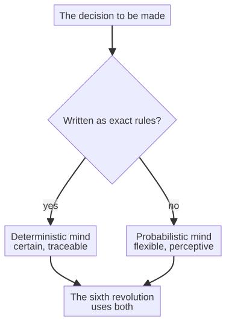

# Capitolo 13 --- Due tipi di mente

## La scelta che nessuno chiede

C'è una decisione che quasi tutti quelli che costruiscono la sesta rivoluzione prendono senza mai accorgersene, ed è la decisione più importante dell'intera storia. Non è «dobbiamo usare l'intelligenza artificiale?». È «quale *tipo* di intelligenza artificiale?». Ed è una scelta tra due filosofie dell'intelligenza fondamentalmente diverse, due tipi di mente, che non sono d'accordo su quasi nulla tranne che sui risultati esteriori.

Per capire la scelta, considerate l'esempio più semplice possibile: una macchina che deve decidere se un pezzo che sta ispezionando è buono o difettoso. Ci sono due modi per prendere quella decisione, e vengono da due mondi diversi.

## La prima mente: la mente che indovina

Il primo tipo di mente è quello che avete già incontrato, nel sensore sul mandrino. È la mente del modello *probabilistico*: la rete neurale che ha imparato, da migliaia di esempi, a *indovinare* la risposta più probabile. È l'intelligenza dell'era dell'apprendimento profondo: le si danno molti esempi di pezzi buoni e difettosi, e lei si aggiusta finché le sue ipotesi corrispondono alla realtà. Quando arriva un pezzo nuovo, non applica una regola: produce una *risposta probabile*, pesata su tutto ciò che ha visto.

Questa mente che indovina è un miracolo dell'età moderna, ed è straordinariamente brava nei compiti per cui è stata addestrata. Sa riconoscere un graffio, prevedere un guasto, leggere un codice a barre al buio. Eccelle dove le regole non si possono scrivere in modo esplicito ma la risposta giusta si può *mostrare*: nella percezione, nel riconoscimento di schemi, nel trattamento di dati disordinati e reali. È per questo che l'apprendimento profondo ha conquistato in una sola ondata il riconoscimento delle immagini, la traduzione e il linguaggio: in tutti questi campi non si possono scrivere le regole, ma si possono mostrare un milione di esempi.

Ma la mente che indovina ha un carattere che dobbiamo nominare con cura, perché quel carattere è l'intera differenza nella sesta rivoluzione. È **probabilistica**. Dà la sua ipotesi migliore, ma vi ha dato, fino a questo punto, un'ipotesi. Può sbagliare, anche quando suona sicura di sé. Porta dentro di sé, per sua stessa natura, un *elemento discrezionale*: i dati di addestramento contengono distorsioni, e l'inferenza è un'approssimazione appresa, non una certezza. Per riconoscere un graffio su una bottiglia un'ipotesi va benissimo. Per decidere se un impianto frenante di un'automobile è sicuro, un'ipotesi non è soltanto insufficiente: è inaccettabile.

## La seconda mente: la mente che calcola

C'è un secondo tipo di mente, ed è più antico del primo di oltre mezzo secolo. È la mente del calcolo *deterministico*. Non indovina: *calcola*. Non impara dagli esempi: applica regole fisse a ingressi dati e produce, ogni singola volta, *la stessa risposta con certezza matematica*. È la mente del compilatore, la mente che trasforma il vostro codice sorgente in istruzioni macchina esattamente una volta, ogni volta, per sempre, senza discrezionalità e senza distorsione, senza deriva e senza ipotesi.

Anche questa mente l'avete incontrata, anche se forse non l'avete chiamata «intelligenza». Quando compilate un programma, il compilatore applica regole fisse al vostro codice e produce un risultato fisso. Non può essere «sbagliato» nel modo in cui può esserlo un modello che indovina; può solo essere corretto o scorretto, e la sua correttezza è dimostrabile. Non ha opinioni. Non ha giornate storte. A parità di ingresso dà lo stesso risultato, con la stessa certezza con cui due più due fa quattro. Non è la mente che riconosce un volto o traduce una frase: quelle cose le sono impossibili. Ma è la mente che *garantisce*, e quella garanzia vale oro proprio nei luoghi in cui un'ipotesi sarebbe pericolosa.

## La linea tra le due

Le due menti non sono rivali nel senso consueto: sono *complementari*, ciascuna forte dove l'altra è debole. La mente che indovina è flessibile, creativa e indispensabile per la percezione e il linguaggio, ma non è certa. La mente che calcola è perfettamente certa, ma non è flessibile: fa solo ciò che le sue regole dettano, e le sue regole sono, per costruzione, complete e non ambigue.

La domanda decisiva è questa: **quale mente deve guidare le decisioni che contano di più?** Dove il risultato è una classificazione o un'ipotesi --- un graffio o una superficie liscia --- la mente che indovina non è soltanto adeguata: è l'unica che funziona. Ma dove il risultato deve essere *certo* --- dove un'ipotesi sbagliata ferisce qualcuno, fa perdere denaro o rompe la fiducia --- la mente che calcola è l'unica sicura.

Per capire perché la mente che calcola sia sicura, aiuta vedere che cosa significhi precisamente «certo» qui, perché la parola fa un lavoro enorme. Un sistema deterministico è un sistema il cui risultato è *pienamente determinato* dal suo ingresso e dalle sue regole, senza spazio per il caso, senza casualità incorporata nel processo e --- cosa cruciale --- senza spazio *avversario* di manovra. Una mente che indovina, al contrario, può essere portata fuori strada da ingressi simili ma non identici: un fenomeno che il mondo dell'apprendimento automatico chiama *esempi avversari*, un cambiamento minuscolo e impercettibile a un ingresso che può ribaltare un'ipotesi sicura in un errore sicuro. La mente che calcola non ha questa debolezza, perché le sue regole sono fisse e complete; non c'è fessura nella quale un ingresso possa cadere. Questo, più di qualsiasi discorso astratto sulla «certezza», è il motivo per cui la mente che calcola è l'unica a cui si possano affidare le decisioni che devono essere riconosciute come corrette.

## Le due tribù dell'intelligenza artificiale

I due tipi di mente non sono una metafora inventata per questo libro: sono le due grandi tribù dell'intelligenza artificiale, e la storia della loro rivalità è una delle più istruttive dell'intero settore. Vale la pena raccontarla brevemente, perché spiega come la sesta rivoluzione possa oggi fare ciò che nessuna delle due tribù sapeva fare da sola.

La prima tribù è la scuola **simbolica**, a volte chiamata «la buona vecchia intelligenza artificiale». Credeva che l'intelligenza fosse la manipolazione di simboli secondo regole esplicite: che se aveste potuto scrivere abbastanza logica, avreste catturato il pensiero stesso. Il suo grande risultato fu il *sistema esperto*: un programma che codificava la conoscenza di uno specialista umano come un insieme di regole se-allora. Negli anni Settanta e Ottanta si costruirono sistemi esperti per la medicina (MYCIN, per diagnosticare le infezioni), per la chimica (DENDRAL, per identificare molecole) e per gli affari (XCON, per configurare ordini di computer), e per un certo periodo furono la forma di intelligenza artificiale commercialmente più riuscita mai costruita. Erano, in sostanza, la mente che calcola: deterministici, a regole, verificabili e certi dentro il proprio dominio. La loro debolezza era altrettanto chiara: erano *fragili*. Funzionavano dentro l'insieme ristretto di regole che avevano ricevuto, e fallivano malamente fuori, perché il mondo reale è pieno di casi per cui nessuno ha scritto una regola. Quando il mercato dei sistemi esperti crollò alla fine degli anni Ottanta, si portò via la reputazione della prima tribù.

La seconda tribù è la scuola **connessionista**: le reti neurali. La sua convinzione era quasi opposta: che l'intelligenza non sia un insieme di regole scritte ma uno *schema appreso dagli esempi*, una rete di unità semplici che si aggiusta finché corrisponde al mondo. L'idea è più antica di quanto molti pensino: Frank Rosenblatt costruì nel 1958 il *percettrone*, una semplice macchina che impara, e fu accolto con enorme ottimismo. Ma il percettrone aveva limiti, e un famoso libro del 1969 di Marvin Minsky e Seymour Papert li espose con tale efficacia che la ricerca sulle reti neurali tacque per più di un decennio: l'«inverno dell'AI» della tribù connessionista. Ci volle fino agli anni Ottanta perché la *retropropagazione* desse alle reti neurali un modo per apprendere strutture profonde, e fino al 2012 perché la combinazione di grandi dati e chip veloci (il momento AlexNet incontrato nella cronologia) le rendesse all'improvviso spettacolarmente buone. Quella seconda tribù è la mente che indovina: flessibile, percettiva e probabilistica.

Per decenni le due tribù si combatterono, e ciascuna liquidò l'altra. I simbolici dicevano che i connessionisti non avevano teoria né garanzie; i connessionisti dicevano che i simbolici non avrebbero mai saputo gestire il disordine del mondo reale. Ciascuno aveva ragione sulla debolezza dell'altro ed era cieco sulla propria. L'intuizione silenziosa della sesta rivoluzione --- quella che questo capitolo vuole comunicare --- è che la lotta è sempre stata un errore. Le due tribù non sono rivali per lo stesso trono; sono due *strumenti diversi per due lavori diversi*, e la fabbrica che pensa ha bisogno di entrambi.

Il diagramma è l'intero argomento in un'immagine. Quando la decisione si può scrivere come regole esatte --- quando la specifica è completa e l'ingresso è ben definito --- la mente deterministica è lo strumento giusto, ed è *superiore*, perché è certa. Quando la decisione non si può scrivere come regole ma solo *mostrare* attraverso esempi --- riconoscimento, linguaggio, previsione --- la mente probabilistica è l'unico strumento che funziona. La fabbrica saggia non sceglie una tribù: chiede, per ogni decisione, quale strumento della tribù si adatti, e usa quello. È la sesta rivoluzione, ed è la soluzione di una discussione durata cinquant'anni.

## La posizione controversa

È qui che i progetti dietro questo libro prendono una posizione distintiva e, alcuni direbbero, controversa. Sostengono che molte più decisioni della fabbrica di quanto la maggior parte degli ingegneri ammetta possono --- e dovrebbero --- essere prese dalla mente *deterministica*, con regole fisse e specifiche esatte, invece che dalla mente che indovina. Sostengono che buona parte di ciò che chiamiamo con disinvoltura «intelligenza artificiale» sia, in realtà, perfettamente servita dal calcolo deterministico, e che ricorrere a un modello probabilistico dove la certezza è possibile non sia soltanto inutile ma *pericoloso*.

Non è un rifiuto luddista dell'apprendimento automatico. È, al contrario, la convinzione che la mente certa vada usata ovunque possa esserlo, così che la mente incerta resti riservata --- con parsimonia --- ai compiti in cui è l'unica a riuscire. Per capire fino in fondo questa posizione dobbiamo guardare al progetto che la incarna più compiutamente, una tecnologia che trasforma un programma compilato in una specifica eseguibile senza alcuna ipotesi. È l'argomento del prossimo capitolo.

## Che cosa compra davvero una garanzia

Vale la pena chiedersi, concretamente, quanto *valga* la garanzia della mente deterministica, perché «certezza» può suonare come una parola da filosofi finché non si vede che cosa accade quando manca. La storia dell'informatica ha lezioni che fanno riflettere, e due meritano di essere raccontate, perché mostrano, in sangue e denaro, perché la sesta rivoluzione non possa riposare su ipotesi dove serve certezza.

La prima è il **Therac-25**, una macchina per radioterapia controllata da computer, usata negli anni Ottanta. Era progettata per somministrare dosi precise di radiazioni ai malati di cancro, e si affidava al software per controllare il fascio. Una serie di errori di programmazione --- bug sottili e interagenti, del tipo che nessun singolo test avrebbe colto --- permise alla macchina, in certe sequenze di input dell'operatore, di somministrare dosi enormi. Diversi pazienti morirono o riportarono lesioni gravissime. Il software della macchina era, in un certo senso, «deterministico»: faceva esattamente ciò per cui era stato scritto. Ma non era *verificato*, e il suo determinismo produceva il risultato sbagliato con certezza perfetta. La lezione non è che il determinismo sia cattivo; è che il determinismo senza verifica è soltanto un modo affidabile di sbagliare.

La seconda è il razzo **Ariane 5**, esploso nel volo inaugurale del 1996, meno di un minuto dopo il lancio. La causa fu un overflow del software: un valore perfettamente sicuro nel più piccolo Ariane 4 superava l'intervallo di una variabile a 16 bit sul più potente Ariane 5, e l'errore che ne seguì mandò in crash il sistema di guida. Il codice era, ancora, deterministico; faceva esattamente ciò per cui era stato scritto. Ma era stato scritto per una macchina diversa, e nessuno aveva verificato che le ipotesi valessero ancora. Il razzo non fallì per un disturbo casuale: fallì perché un sistema deterministico, applicato fuori dal suo dominio verificato, è *certamente* sbagliato.

Queste storie sono la ragione per cui i domini della certificazione --- aviazione, medicina, energia nucleare --- non accettano «funziona nella dimostrazione». Esigono una *prova*: che il comportamento del software sia stato verificato contro la sua specifica, che ogni ipotesi sia documentata e che l'intera catena sia verificabile. È la disciplina che l'industria aeronautica chiama **DO-178C**, uno standard che governa come si sviluppa e si verifica il software di bordo e che richiede, tra l'altro, che i requisiti siano tracciabili fino al codice e ritorno. È uno standard costruito su una sola convinzione: un sistema che porta persone in volo deve essere *riconosciuto* corretto, non soltanto *probabilmente* corretto.

È precisamente ciò che la mente deterministica, usata bene, sa consegnare, e che la mente che indovina non sa. Un sistema deterministico costruito da una specifica verificata si può tracciare, passo per passo, dalla sorgente alla decisione, e l'intera catena si può controllare. Un modello probabilistico si può testare, e si può dimostrare accurato su un insieme di prova, ma non si può *dimostrare* corretto, perché il suo comportamento è, per costruzione, un'approssimazione appresa. Dove il costo di una risposta sbagliata si misura in vite o in patrimoni, la differenza tra «testato» e «dimostrato» è la differenza tra un prodotto e una passività. La garanzia non è un lusso: è la licenza di operare.

## Perché la mente che calcola si può dimostrare

C'è un'altra cosa che rende la mente che calcola degna del suo posto nella sesta rivoluzione, ed è una cosa che la mente che indovina non può mai fornire: una *prova*. Quando un sistema deterministico decide qualcosa, è possibile --- in principio, e spesso in pratica --- *dimostrare*, in modo rigoroso e completo, che la decisione è corretta. È la promessa della disciplina chiamata *verifica formale*: la macchina applica regole fisse a una specifica fissa, e l'intera catena di ragionamento si può controllare con una macchina, con la stessa certezza di una dimostrazione matematica. Nessuna ipotesi si può dimostrare; una prova sì.

È precisamente la qualità che i domini della certificazione esigono --- i domini che incontreremo nei capitoli seguenti, dove una decisione che deve essere certa deve anche essere *mostrata* certa. Un modello probabilistico può dirvi di essere sicuro al 99,9 per cento; non può dirvi *perché*, e non può dimostrare che lo 0,1 per cento restante non morderà. Un sistema deterministico sa fare entrambe le cose. La mente che calcola è, nel senso più stretto della parola, l'unica mente che può presentarsi davanti a un revisore --- a un valutatore ISO, a un esaminatore SOC 2, a un revisore HIPAA --- e dimostrare, passo per passo, che la sua decisione è corretta. Non è una curiosità tecnica: è tutta la garanzia.
