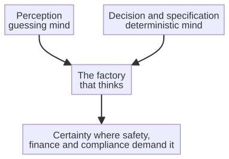

# Capitolo 15 --- Quando la certezza conta

## I luoghi in cui un'ipotesi è un delitto

Abbiamo ormai incontrato i due tipi di mente: la mente che indovina, flessibile ma certa di nulla, e la mente che calcola, certa ma incapace di improvvisare. Abbiamo visto che la mente che indovina è un miracolo per la percezione e per il linguaggio, e che la mente che calcola è l'unica scelta sicura dove una decisione deve essere *riconosciuta* corretta. La domanda a cui questo capitolo risponde è semplice e decisiva: **dove, in una fabbrica che pensa, la decisione deve essere certa?**

La risposta è «in più luoghi di quanto pensiate», ed è precisamente la concentrazione di questi luoghi a rendere la sesta rivoluzione distinta dalle precedenti. Nominiamo i domini, perché in ciascuno di essi un'ipotesi probabilistica non è soltanto inadeguata ma pericolosa, e in ciascuno di essi la mente deterministica --- la mente che sa *dimostrare* la propria decisione --- è l'unica accettabile.

## Il dominio della sicurezza

Considerate il sistema di controllo industriale che governa un braccio robotico che lavora accanto a un essere umano. Se la decisione di sicurezza di quel braccio è presa da un modello che indovina, allora è annidata nel modello una probabilità piccola ma non nulla che sbagli: che in un mattino con una luce insolita, o con una postura insolita, decida «sicuro» mentre la realtà è «pericolo», e un essere umano resti ferito. Quella probabilità non deve essere grande; deve solo essere maggiore di zero, e perfino una probabilità minima, applicata a milioni di decisioni in un'intera fabbrica, diventa un rischio reale.

Nei sistemi critici per la sicurezza una probabilità non nulla di un'ipotesi catastrofica non è accettabile. La decisione deve essere *certa*: sicura o non sicura, dimostrabilmente, ogni singola volta. È per questo che la mente deterministica --- la mente che calcola con regole fisse e produce una risposta garantita --- è l'unica a cui si possa affidare la sicurezza. È la stessa logica che governa l'industria aeronautica, dove il comportamento di un sistema deve essere dimostrabile a un'autorità che lo certifichi prima che un solo passeggero sia ammesso a bordo. La certezza non è un lusso in questi domini: è il prezzo d'ingresso.

Il mondo della certificazione nomina questo requisito con precisione, e i nomi vale la pena conoscerli. La sicurezza funzionale --- la sicurezza di un sistema *in conseguenza del suo comportamento corretto* --- è governata, nell'industria, da norme come la **ISO 26262** (automotive) e la **IEC 62443** (controllo e automazione industriale), che esigono, soprattutto, che il comportamento di un sistema sia *prevedibile, verificabile e dimostrabile*. Un modello probabilistico non le soddisfa: il suo comportamento, per natura, non è pienamente prevedibile e non si può dimostrare corretto. Un sistema deterministico sì. Non è una questione di gusto: è la condizione alla quale un sistema critico per la sicurezza è ammesso a operare.

## Che cosa significa un livello ASIL

Quando una norma parla di sicurezza funzionale, non parla in modo uniforme: classifica il rischio e chiede a ciascun livello una quantità diversa di prove. Nella **ISO 26262**, che governa l'elettronica delle automobili, i livelli si chiamano **ASIL**, da A a D, e crescono con la gravità del danno possibile, la frequenza con cui la situazione pericolosa può presentarsi e la possibilità che il conducente la eviti. ASIL A riguarda un rischio moderato; ASIL D riguarda il caso in cui un guasto può uccidere e non c'è modo di accorgersene in tempo. Nella **IEC 61508**, la norma generale da cui molte altre derivano, la scala si chiama **SIL**, da uno a quattro, e il principio è lo stesso: più alto il livello, più severi gli obblighi.

E qui sta il punto che riguarda questo libro. Ciò che cambia tra un livello basso e uno alto non è la quantità di intelligenza richiesta al sistema, ma la quantità di *prove* che il costruttore deve produrre: l'analisi dei modi di guasto, la tracciabilità dei requisiti, la copertura dei test, la qualifica degli strumenti usati per sviluppare. A un livello alto non basta che il sistema funzioni nelle prove; bisogna dimostrare *perché* funziona, e che cosa succede quando qualcosa si guasta. È un lavoro di documentazione e di architettura, non di algoritmi.

È esattamente qui che l'approccio deterministico smette di essere una preferenza filosofica e diventa un vantaggio economico misurabile. Un sistema la cui decisione deriva da una specifica compilata con regole fisse produce, quasi gratis, proprio gli artefatti che un valutatore chiede: la tracciabilità dalla regola al codice alla decisione, la ripetibilità del risultato, l'assenza di comportamenti non specificati. Un modello probabilistico, per quanto accurato, obbliga a costruire intorno a sé una cintura di protezione — monitor, limiti, ridondanze — che serve a compensare ciò che il modello non può promettere. La cintura funziona, ma costa, e costa soprattutto in quella valuta che nessun preventivo mostra: la fiducia di chi deve firmare.

## Il dominio della finanza

Il secondo dominio è quello finanziario e burocratico. Una fabbrica non è solo un luogo dove si fabbricano cose; è anche un luogo che emette fatture, riconcilia conti, riferisce alle autorità fiscali, gestisce contratti. In ciascuno di questi atti un'ipotesi non è soltanto inadeguata: è *passività*. Una fattura con una cifra sbagliata non è «probabilmente giusta»: è sbagliata, va corretta, e può portare sanzioni. Una clausola contrattuale interpretata male non è «probabilmente corretta»: è una controversia, una perdita, una causa.

Anche qui la mente deterministica è la scelta sicura, e anche qui compare in una forma particolarmente interessante. Poiché le regole della contabilità, della fiscalità e del diritto dei contratti sono --- a differenza delle regole della visione o del linguaggio --- *scritte ed esplicite*, si possono codificare ed eseguire in modo deterministico. Una decisione che segue regole fisse e verificabili non è un'ipotesi: è un calcolo che si può verificare, riprodurre e dimostrare corretto. È esattamente l'approccio deterministico che il laboratorio dietro questo libro applica al lato ufficio della fabbrica, ed è ciò che rende un agente affidabile con il denaro e con le parole su cui un'azienda non può permettersi di sbagliare. Il dominio finanziario è, in questo senso, la casa naturale della mente che calcola: le regole sono già scritte, quindi il compito non è *impararle* ma *applicarle* esattamente.

## Il dominio della conformità

Il terzo dominio è quello normativo: il mondo delle norme, delle certificazioni e delle verifiche. Le norme ISO, SOC 2, HIPAA e i loro cugini industriali non chiedono «la vostra decisione era probabilmente corretta?». Chiedono «potete *dimostrare* che la vostra decisione è corretta, ogni volta, e ricondurla alla sua fonte?». Un modello probabilistico non sa rispondere a nessuna di queste domande, perché un modello che indovina non ha una traccia dimostrabile. Un sistema deterministico sa rispondere a tutte, perché la sua decisione deriva da una specifica verificata attraverso regole fisse, e l'intera traccia --- dal codice sorgente alla decisione --- è trasparente e riproducibile.

Per una fabbrica in un settore regolato --- medico, finanziario, aerospaziale, energetico --- la conformità non è un modulo da compilare: è una condizione di esistenza. E l'unico tipo di intelligenza che sa soddisfare un'autorità di conformità è quella il cui comportamento è deterministico, tracciabile e dimostrabile. È per questo che la mente deterministica non è, in questi settori, una curiosità tecnica ma un *requisito*.

## La traccia verificabile

C'è un'altra cosa che un'autorità di conformità cerca davvero, e vale la pena nominarla, perché è la cosa concreta e fisica dietro la parola astratta «certezza». Un revisore non chiede «il vostro sistema è probabilmente corretto?»; chiede di *vedere la traccia*. Vuole seguire una singola decisione all'indietro, dalla risposta fino alla sua origine, e vuole vedere, a ogni passo, che quel passo era *determinato*: fisso, riproducibile e privo di discrezionalità.

È precisamente la traccia che la mente deterministica sa produrre, ed è la traccia descritta nel capitolo precedente. Corre, senza interruzioni, dal codice sorgente alla decisione: il codice sorgente produce l'assembly con la *compilazione* (un processo deterministico), e l'assembly guida la decisione --- che sia un'interfaccia utente, un'API generata o un verdetto calcolato --- attraverso una *trasformazione algoritmica fissa*. Ogni elemento si può ricondurre alla propria origine, e ogni passo si può riprodurre. Questa corrispondenza tra specifica e implementazione è, nel mondo della certificazione, l'intero requisito. Quando il front-end è derivato da un back-end verificato attraverso regole deterministiche, la corrispondenza tra ciò che è stato specificato e ciò che è stato costruito è *intrinseca e dimostrabile*: non una speranza, non il risultato di un test, ma una necessità logica. È ciò che cerca un esaminatore SOC 2 o un revisore HIPAA: non la fiducia di un modello, ma la sua *tracciabilità*.

## Il quarto dominio: il corpo stesso

C'è un quarto dominio, ed è quello in cui la posta è più alta di tutte: il corpo umano. La medicina moderna funziona su software il cui comportamento deve essere *certo*. Una pompa di infusione che somministra un farmaco a una velocità controllata con precisione; un pacemaker che dà il ritmo a un cuore; una pompa di insulina che decide, momento per momento, quanto ormone rilasciare; una macchina per radioterapia che punta un fascio. In ciascuno di questi casi un'ipotesi probabilistica non è una piccola imperfezione: è una minaccia diretta a una vita umana.

Considerate il pancreas artificiale, un sistema che legge di continuo il glucosio di una persona e decide automaticamente quanto insulina somministrare. È un'idea bellissima, ed è già reale, ma è anche un sistema in cui una decisione sbagliata può, in pochi minuti, mandare una persona in coma. Le decisioni che prende devono essere *certe* nella loro aritmetica, anche se la *misura* è probabilistica (il sensore è un'approssimazione appresa, e può sbagliare). L'arte di un sistema simile è precisamente l'arte della sesta rivoluzione: usare la mente che indovina per *percepire* (leggere il sensore) e la mente deterministica per *decidere* (calcolare la dose con regole fisse e verificate che non possono sbagliare). Le due menti, ciascuna al proprio posto, proteggono il corpo che si affida a loro.

È per questo che il mondo dei dispositivi medici è governato da norme severe quanto qualsiasi altra nell'ingegneria, e che un dispositivo che «funziona quasi sempre» non è affatto un dispositivo. Il regolatore non chiede se la macchina sia *probabilmente* sicura; chiede se la macchina sia *riconosciuta* sicura, su ogni ingresso che potrebbe mai ricevere. È il terreno di casa della mente deterministica, ed è per questo che, nella sesta rivoluzione, il corpo è uno dei luoghi in cui la certezza non è negoziabile.

## Una breve storia della certezza ingegneristica

L'esigenza di certezza nell'ingegneria è più antica dell'informatica, e la sua storia è una delle più istruttive dell'intera tecnologia. Prima che qualcuno scrivesse una riga di software, gli ingegneri stavano imparando --- spesso attraverso catastrofi --- che un sistema che porta persone in volo, o che regge un ponte, o che contiene una reazione nucleare, non si costruisce su «sembra che funzioni».

I fratelli Wright, nei primi anni del Novecento, sono un esempio piccolo ma eloquente: non costruirono soltanto una macchina volante, costruirono una *galleria del vento* per misurare, con precisione e ripetutamente, le forze sulle loro ali, così che il loro progetto poggiase sulla misura e non sulla speranza. Da quella cultura crebbe la disciplina della sicurezza aeronautica, che dopo una serie di incidenti terribili nel Novecento si indurì in un insieme di norme che non danno nulla per scontato ed esigono che tutto sia *dimostrato*. È la discendenza della DO-178C, la norma incontrata nel capitolo precedente, e dell'intera cultura della verifica che governa il volo ancora oggi.

L'informatica ereditò quella cultura e, all'inizio, non se ne mostrò all'altezza. I primi decenni del software furono una lunga lezione sul costo del determinismo *non verificato*: sistemi che facevano esattamente ciò per cui erano stati programmati, ed erano esattamente sbagliati. Da quelle lezioni crebbe il campo dei **metodi formali**: l'uso della dimostrazione matematica per mostrare che il comportamento di un programma corrisponde alla sua specifica, in ogni caso possibile. I metodi formali sono difficili e non si usano ovunque, ma esistono, e sono la ragione per cui il software di controllo di volo di un aereo moderno si può certificare e un sistema di pagamento moderno si può affidare a un miliardo di transazioni.

La lezione di questa storia, per la sesta rivoluzione, è che la certezza non è un *dono* della tecnologia: è una *disciplina* che va scelta. Un sistema deterministico non è automaticamente un sistema *corretto*: il Therac-25 e l'Ariane 5 erano entrambi deterministici, ed entrambi catastroficamente sbagliati. La certezza esige che il determinismo sia *verificato*: che le regole siano controllate, le ipotesi esaminate, l'intera catena dimostrata. Quando la sesta rivoluzione dice che una decisione deve essere certa, intende precisamente questo: non soltanto «la macchina farà la stessa cosa ogni volta», ma «è stato dimostrato che la macchina fa la cosa *giusta* ogni volta». È un'asticella più alta, ed è l'asticella che i domini della sicurezza, della finanza, della conformità e della medicina esigono tutti.

## L'intelligenza combinata

È importante, ancora una volta, insistere che questo capitolo non sostiene la *sostituzione* della mente che indovina. La mente che indovina resta indispensabile per la percezione, la previsione e il linguaggio: i compiti in cui la risposta giusta si può mostrare ma non scrivere. La fabbrica che pensa deve dunque portare *entrambe* le menti e schierare ciascuna dove è sicuro farlo:

Lo strato della percezione --- la telecamera che vede un graffio, il sensore di vibrazione che prevede un guasto --- è la mente che indovina, ed è perfetta per il suo compito. Ma lo strato che *decide* che cosa fare della percezione, che verifica la decisione, che la dimostra corretta e la riconduce alla fonte, è la mente deterministica. Le due sono combinate, ciascuna al proprio posto, ed è questa combinazione a rendere la fabbrica affidabile nei luoghi in cui la fiducia non è negoziabile.

## La linea onesta

Tracciamo la linea con onestà, perché l'onestà è tutta la virtù della mente deterministica. La mente deterministica è superiore ovunque la specifica sia *completa* e le regole *note*: dove potete compilare la decisione in regole fisse, o derivarla da una specifica compilata con una trasformazione esatta. In questi luoghi non è soltanto sicura: è la scelta migliore, perché è certa, tracciabile e dimostrabile. La mente che indovina è superiore ovunque il mondo sia disordinato e la risposta giusta si possa solo *imparare dagli esempi*: riconoscimento, traduzione, previsione. In questi luoghi nessun sistema deterministico potrebbe funzionare, e la mente che indovina è l'unica opzione.

La fabbrica che pensa non sceglie tra certezza e flessibilità: le *combina*. Indovina dove indovinare è l'unico modo di sapere, e calcola dove calcolare può essere certo. Ed è saggio sapere, prima di passare all'ufficio che metterà al lavoro entrambe le menti, esattamente dove passa la linea, perché una fabbrica che indovina sulle cose che devono essere certe è una fabbrica che costruisce sulla sabbia, per quanto intelligenti siano le sue macchine.
