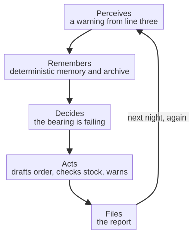

# Capitolo 16 --- L'ufficio a mezzanotte

## Le luci si spengono

C'è un tipo particolare di silenzio che cala su un ufficio di notte, quando l'ultima persona ha preso le ultime chiavi e la guardia ha completato il suo giro. I computer restano accesi; i server ronzano; la macchina del caffè, staccata per via del bollitore che non si trova mai, conserva il suo piccolo tepore. E in questo silenzio accade qualcosa che dieci anni fa sarebbe stato impossibile, e che resta invisibile alla maggior parte di chi lavora in ufficio di giorno. Il lavoro non si ferma. Smette soltanto di essere fatto da una persona.

È la visione che questo capitolo introduce, e vale la pena dirla chiaramente prima di entrare nel meccanismo, perché è il coronamento dell'intera catena che abbiamo assemblato. L'intelligenza che vive sulla macchina (Parte II), la riservatezza che tiene i dati dentro i muri (Parte III) e la certezza che governa le decisioni che devono essere certe (Parte IV): tutto questo si incontra qui, in ufficio, per rendere reale una possibilità unica e sorprendente: un ufficio che continua a lavorare dopo che le luci si sono spente, gestito da un agente che conosce l'azienda quanto qualsiasi dipendente, e che non dorme mai, non si stanca mai e non fa mai trapelare i vostri dati.

## La differenza tra uno strumento e un dipendente

Prima dell'agente, l'ufficio aveva già moltissimi strumenti. C'erano fogli di calcolo e videoscrittura, client di posta e database e, sempre più, script che automatizzavano piccoli compiti specifici. Una macro poteva formattare un rapporto. Uno script poteva spostare un file da una cartella a un'altra. Sono *strumenti*, e sono utili, ma sono strumenti nel senso stretto: fanno esattamente ciò che viene detto loro, su un documento o un file, e nulla più. Non hanno memoria dell'azienda, non capiscono che cosa il lavoro *significhi*, non sanno giudicare quando un compito è finito né adattarsi a un caso imprevisto.

L'agente è diverso nel genere, e la differenza vale la pena nominarla. Un agente non è uno strumento che fa una cosa; è un *lavoratore* a cui viene dato un *obiettivo* --- «prepara il rapporto mensile», «riconcilia queste fatture», «avvisa il responsabile che il cuscinetto della linea tre sta cedendo» --- e che capisce da solo la sequenza di passi necessari a raggiungerlo, usando gli strumenti che gli sono stati dati, controllando il proprio lavoro mentre procede e adattandosi quando qualcosa non va come previsto. È il tratto decisivo di ciò che si chiama sistema *agentico*: non si limita a eseguire un comando, ma *persegue un obiettivo con un certo grado di autonomia*, pianificando, agendo, osservando il risultato e correggendosi.

E, cosa cruciale, l'agente dietro questo libro non è un chatbot generico, comprato sugli scaffali, che risponde a domande in una finestrella. È un sistema self-hosted che fa girare la conoscenza della *vostra* azienda --- i documenti, i sistemi, la storia --- sul *vostro* hardware, tenendo quella conoscenza interamente dalla vostra parte del muro. È, nel senso più pieno, un dipendente che vive nel vostro edificio e non lascia mai la vostra sede.

## Perché l'ufficio è l'ultima frontiera

Vi chiederete perché, in un libro sulle macchine e sulle nuvole, dedichiamo un capitolo all'ufficio. La risposta è che l'ufficio è l'*ultimo anello* della catena, ed è anche --- forse sorprendentemente --- il luogo in cui la rivoluzione è più necessaria e più visibile. Per decenni la rivoluzione industriale ha trasformato il *reparto*: il lavoro fisico del fare le cose. Ma l'*ufficio* --- il lavoro del coordinare, documentare, calcolare e comunicare --- è stato lasciato quasi interamente agli esseri umani. Il contabile conta ancora; l'impiegato archivia ancora; il dirigente compone ancora; l'addetto agli acquisti scrive ancora email ai fornitori. Questo lavoro d'ufficio è enorme, ripetitivo e sempre più ricco di dati, e finora non ha avuto automazione che andasse oltre qualche macro.

La sesta rivoluzione lo raggiunge. Lo raggiunge non con un chatbot generico, ma con un agente *ancorato* alla fabbrica, che legge la telemetria che viene dalle macchine, i dati custoditi nella nuvola privata e le decisioni che devono essere certe, e che *porta a termine il lavoro che quelle cose richiedono*. L'agente è il punto in cui l'intelligenza della fabbrica diventa produttività dell'ufficio. La macchina percepisce; la nuvola custodisce il segreto; l'agente decide e agisce. E il lavoro su cui agisce è, spesso, lavoro d'ufficio: la contabilità, il legale, gli acquisti, il reporting, il servizio al cliente.

## Una curiosità: le fabbriche che già lavorano al buio

Prima di scendere più a fondo nell'ufficio a mezzanotte, vale la pena sapere che l'espressione non è del tutto nuova all'industria. Esiste nella produzione moderna un termine ben stabilito per uno stabilimento che gira tutta la notte senza un solo essere umano dentro: la fabbrica *lights-out*, la fabbrica senza luci. La parola viene dalle circostanze più letterali: in alcuni di questi stabilimenti l'aria è così pura e il processo così sigillato che tenere le luci accese sarebbe uno spreco; le macchine non hanno bisogno di vedere, quindi non hanno bisogno della luce, quindi non hanno bisogno delle persone che altrimenti avrebbero bisogno della luce per vedere. L'industria dei semiconduttori, in particolare, ha costruito intere camere bianche che funzionano senza persone, perché un essere umano in una camera bianca è esso stesso una fonte di contaminazione: cellule della pelle, fibre, il disturbo quieto di un respiro. La fabbrica ha imparato, decenni fa, a lavorare nel buio e nel silenzio, e a misurare la propria produzione non nei cambi di turno del personale ma nel flusso continuo di pezzi che escono da una linea.

È una curiosità che vale la pena tenere, perché fa due cose insieme. La prima è mostrare che «l'ufficio a mezzanotte» non è un sogno del futuro ma l'estensione logica di qualcosa che esiste già in reparto: un sistema che continua a produrre mentre le persone vanno a casa. La seconda è tracciare una distinzione che l'ufficio deve ora imparare a fare da sé. Una fabbrica senza luci lavora di notte perché il suo lavoro è fisico, sigillato e misurabile: le macchine non hanno bisogno di leggere i contratti privati di un'azienda né di rispondere all'email ansiosa di un cliente. L'ufficio non sa ancora come spegnersi, perché il suo lavoro non è sigillato: è pieno di contesto, di storia, dei fatti esatti e irripetibili di una particolare azienda. È precisamente ciò che l'agente cambia. L'ufficio può spegnersi finalmente, perché l'agente è il primo lavoratore che non ha bisogno di vedere la stanza per fare il lavoro: gli serve solo la conoscenza dell'azienda, custodita al sicuro, e un obiettivo che valga la pena perseguire.

## Il mare del lavoro d'ufficio

C'è un fatto che rende l'ufficio a mezzanotte grande quanto è davvero, ed è un fatto di *scala*, non soltanto di tecnologia. Il lavoro che accade in un ufficio --- coordinare, documentare, calcolare, comunicare --- è, nelle economie che lo hanno costruito, enormemente più grande del lavoro del reparto, ed è cresciuto senza sosta. Il termine stesso per il lavoratore d'ufficio è relativamente giovane: «colletto bianco» fu coniato alla fine dell'Ottocento per distinguere l'impiegato e il venditore, che lavoravano al chiuso in camicia e cravatta, dal lavoratore «colletto blu» dell'officina e del campo, che lavorava in tuta. Nei centoventi anni da quando quella parola è stata inventata, la forza lavoro d'ufficio è cresciuta di molti ordini di grandezza. Dove una fabbrica del 1920 poteva impiegare cento uomini alle macchine e una manciata di impiegati alle scrivanie, una fabbrica di oggi può impiegare cento uomini alle macchine e qualche centinaio di impiegati, calcolatori, archivisti, pianificatori e corrispondenti alle scrivanie; e il numero di questi ultimi continua a salire anche mentre i primi vengono meccanizzati.

È la grande ironia della storia della produttività del Novecento: mentre le macchine si assumevano il lavoro *fisico*, il lavoro *documentale* è cresciuto invece di ridursi. L'ufficio non si è ristretto per occupare lo spazio lasciato dalle macchine: è straripato. Il registro del contabile, un tempo tenuto in un unico volume rilegato, oggi si estende su sistemi, autorità di vigilanza e codici fiscali; l'archivio dell'impiegato, un tempo questione di inchiostro e indice, oggi si estende su documenti, versioni e le parole esatte di una conversazione avvenuta tre mesi fa; la scrittura del dirigente, un tempo una lettera, oggi si estende su rapporti, preventivi e il linguaggio preciso della conformità di una dozzina di giurisdizioni. È lavoro di carattere enorme, ripetitivo e sempre più ricco di dati, e per gran parte della sua storia non ha avuto automazione che andasse oltre qualche macro. La sesta rivoluzione lo raggiunge, perché l'agente è il primo lavoratore capace di leggere tutto quel mare di documentazione come lo leggerebbe un impiegato esperto, senza stancarsi, senza far trapelare nulla e senza dimenticare una sola parola.

## L'ufficio a mezzanotte, passo per passo

Per vedere che non si tratta soltanto di una visione ma di una sequenza --- una cosa reale che accade in ordine reale --- aiuta osservare la notte dell'agente disegnata come un piccolo flusso, così che il profilo del lavoro sia chiaro. Ciò che l'agente fa a mezzanotte non è una singola azione ma una catena, e la catena è la stessa che governa la macchina: percepisce, ricorda, decide, agisce, archivia.

Questo è l'ufficio a mezzanotte, disegnato in cinque passi. Non è fantascienza. È il completamento naturale della catena, e l'agente che esegue questo lavoro, con la sua memoria proprietaria e la sua sandbox, è l'argomento del prossimo capitolo. Ma prima di scendere nei dettagli dovremmo capire la forma dell'intera catena, il modo in cui la macchina, la nuvola, l'agente e l'ufficio si connettono in un ciclo continuo. Quella forma --- il grafo dell'«Industria 7.0» --- è l'argomento del capitolo dopo il prossimo. Per ora lasciamo che l'ufficio a mezzanotte resti come anticipazione di ciò che viene.

## Un esempio reale: il turno di notte che non finisce mai

Per rendere tutto concreto, osserviamo un ufficio preciso a mezzanotte. Non l'ufficio di una fabbrica, ma l'ufficio contabile di un produttore di medie dimensioni, il tipo di ufficio che esiste in quasi ogni paese con una fabbrica, e che è sempre stato, fino a oggi, il luogo in cui il lavoro del giorno sanguinava in silenzio nel giorno successivo. Per anni la contabile del turno serale arrivava alle sei di sera e faceva ciò che un ufficio fa alla fine della giornata: chiudeva i conti sugli ordini del giorno, riconciliava le fatture emesse con le spedizioni uscite dal magazzino, e abbozzava il rapporto che il dirigente avrebbe letto alle nove del mattino. Era lavoro vero, lavoro accurato, ed era interamente manuale. Se una spedizione era stata resa, o una fattura non corrispondeva al suo ordine, si fermava e inseguiva la discrepanza a mano: per telefono, per email, rileggendo le carte. Il lavoro non si fermava quando lei usciva; aspettava semplicemente che tornasse.

Ora lo stesso ufficio lavora a mezzanotte, e lavora senza di lei. L'agente riprende il filo esattamente come farebbe un impiegato esperto. Abbozza il rapporto di chiusura della giornata nella lingua e nello stile dell'azienda, e dove un essere umano avrebbe tirato a indovinare su una cifra mancante, lui *recupera* il contesto preciso e pertinente --- la fattura, la spedizione, la resa --- dall'archivio dell'azienda e dalla nuvola privata, con esattezza e senza riderivarlo. Dove un essere umano avrebbe fatto un foglio di calcolo a mano, l'agente sa pilotare la stessa libreria di fogli di calcolo che userebbe un impiegato esperto, costruendo la cartella con i dati, gli stili e il grafico su un'unica pagina A4, e consegnando il file finito. E dove la contabile del turno serale inseguiva una discrepanza al telefono fino alle dieci di sera, l'agente controlla il magazzino per il ricambio o la cifra mancante non con una query rigida, ma come farebbe un impiegato esperto: leggendo l'inventario, adattandosi all'imprevisto e avvertendo il dirigente con parole calme e piane. Fa tutto questo senza un essere umano nell'edificio, usando conoscenza che non ha mai lasciato l'azienda, e lo fa con la stessa affidabilità che governa la macchina. Il mattino dopo la contabile arriva alle nove; non *fa* il lavoro: *rivede* il lavoro dell'agente, e firma ciò che è corretto. È il turno di notte che non finisce mai, e non è fantascienza.

## I limiti dell'agente

Sarebbe disonesto dipingere l'agente d'ufficio come un lavoratore illimitato, e qui l'onestà vale più dell'entusiasmo, perché i limiti sono esattamente ciò che rende l'agente affidabile. L'agente dietro questo libro è un lavoratore potente, ma è un lavoratore *circoscritto*, e i confini sono deliberati.

Il primo limite è la sandbox. Le azioni dell'agente passano attraverso un perimetro vincolato costruito nell'architettura, così che una chiamata a uno strumento non possa uscire dall'ambito assegnato; le azioni sui file sono reversibili, grazie al versionamento; e all'agente non vengono date, per progetto, capacità di esecuzione di codice, precisamente perché non possa crearne né eseguirne. È un limite che un fornitore distratto chiamerebbe una funzione mancante, e un fornitore attento chiama la ragione per cui all'agente si può affidare lavoro aziendale vero.

Il secondo limite è la conoscenza. L'agente sa solo ciò che gli è stato dato --- i documenti dell'azienda, la sua storia, il suo archivio --- ed è buono quanto quel materiale. Un'azienda con un archivio disordinato nutre una memoria disordinata; un'azienda con un archivio chiaro ne nutre una chiara. L'agente è lo specchio dell'ordine dell'azienda, reso permanente e interrogabile, e non può sapere ciò che nessuno gli ha detto.

Il terzo limite è il giudizio. L'agente propone; non *risponde*. Sa abbozzare il rapporto, controllare le scorte e avvertire il dirigente, ma non può assumersi la responsabilità del risultato: quella, come insisterà la parte successiva del libro, resta umana. L'agente è il lavoratore che fa il fare; l'essere umano è colui che firma. E quella divisione non è una debolezza dell'agente: è la forma della fiducia.

## Perché l'ufficio fu l'ultimo a essere meccanizzato

C'è una domanda a cui vale la pena rispondere con chiarezza, perché rende la visione più limpida: perché, se il reparto è stato meccanizzato in centocinquant'anni, l'ufficio è arrivato così tardi alla rivoluzione? La risposta è che all'ufficio non mancavano gli strumenti: gli mancava il *contesto*. Per decenni l'ufficio è stato, semmai, più strumentato del reparto: fogli di calcolo, videoscrittura, database, sistemi di posta, sistemi gestionali che legavano la contabilità agli acquisti al magazzino. Ciò che non ha mai avuto è un lavoratore capace di *usare* davvero quegli strumenti come fa una persona esperta: leggere il contesto, ricordare la storia, giudicare quando un compito è finito e adattarsi al caso imprevisto. Una macro sa formattare un rapporto; uno script sa spostare un file da una cartella a un'altra; un sistema gestionale sa calcolare una fattura. Ma nessuno di loro sa *conoscere l'azienda*: i clienti, lo stile, la storia, le regole non scritte del modo in cui questa particolare azienda lavora. Nessuno sa giudicare che una fattura è sbagliata, o che un cliente merita un'eccezione, o che un rapporto va scritto in un modo particolare.

È precisamente ciò che l'agente cambia, ed è per questo che l'ufficio è stata l'ultima frontiera. La macchina è stata meccanizzata per prima perché il suo lavoro è *fisico, sigillato e misurabile*: un mandrino gira o non gira, e i sensori che lo osservano non hanno bisogno di capire l'azienda. L'ufficio è stato meccanizzato per ultimo perché il suo lavoro è *contestuale, storico e irripetibile*: dipende dal conoscere questa azienda, i suoi clienti, i suoi documenti e la sua storia, e nessuna quantità di scrittura di macro poteva fornire quella conoscenza. La sesta rivoluzione raggiunge l'ufficio finalmente non perché siano arrivati gli strumenti, ma perché è arrivato il *lavoratore*: un agente che conosce l'azienda, gira sul vostro hardware e non fa mai trapelare i vostri dati. E una volta che quel lavoratore esiste, l'ufficio a mezzanotte smette di essere un sogno e diventa, semplicemente, un ufficio che funziona.
