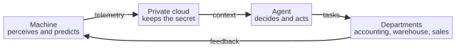

# Capitolo 18 --- La catena: macchina, nuvola e reparto

## Fare un passo indietro per vedere la forma

Abbiamo ormai attraversato, pezzo per pezzo, ogni componente della sesta rivoluzione industriale. Abbiamo incontrato la macchina che pensa su un chip, la nuvola che custodisce il proprio segreto e l'agente che conosce la vostra azienda e non dimentica mai. Presi singolarmente, ciascuno è impressionante. Ma la ragione per cui questo momento --- questa sesta rivoluzione --- è davvero distinto da ogni rivoluzione precedente è che i componenti non sono soltanto *presenti*: sono *collegati*, in un ciclo continuo in cui l'uscita di uno diventa l'ingresso del successivo, e l'ultimo torna al primo. Questo capitolo è il passo indietro che vi permette di vedere tutta la forma in una volta, perché vedere la forma è la differenza tra un mucchio di pezzi e una macchina sola.

Il ciclo ha quattro stadi, e vale la pena tenerli a mente insieme prima di espanderli:

La macchina percepisce il proprio mondo e produce telemetria. La nuvola privata riceve quella telemetria e la custodisce al sicuro, coerente e interrogabile. L'agente recupera il contesto preciso e pertinente dalla nuvola e dalla vostra base di conoscenza, decide che cosa fare e agisce. La sua azione è l'automazione del lavoro di un reparto: la contabilità, il magazzino, le vendite, l'assistenza. E il lavoro del reparto, a sua volta, genera nuovi requisiti e nuove azioni che tornano alla macchina e alla nuvola. Il ciclo è chiuso. La fabbrica è, nel senso più pieno della parola, *autocoordinata*.

## Una curiosità: la parola per un ciclo

Vale la pena fermarsi, in questo capitolo su un ciclo, a farci una domanda semplice: che cosa intendiamo davvero quando chiamiamo questa forma un «ciclo», e da dove viene la parola? Il termine che nomina con più precisione l'idea che stiamo usando è **cibernetica**, coniato nel 1948 dal matematico americano Norbert Wiener quando pubblicò un libro con quel titolo. La parola è più antica della disciplina: viene, immutata, dal greco antico *kubernan*, «governare una nave», «tenere il timone». Un *kubernetes* era il timoniere, colui che teneva un vascello sulla propria rotta leggendo continuamente la differenza tra dove la nave si trovava e dove intendeva andare, e correggendo quella differenza mentre il mare cambiava. È esattamente ciò che fa il nostro ciclo: legge di continuo la differenza tra lo stato della fabbrica e lo stato in cui la fabbrica vuole trovarsi, e corregge quella differenza --- attraverso la macchina, la nuvola, l'agente, i reparti --- finché il ciclo è chiuso.

La parola porta con sé, in silenzio, tutta una filosofia del controllo. Prima della cibernetica l'ingegneria pensava per lo più alle macchine come a cose che semplicemente *facevano* ciò che veniva detto, una volta. La cibernetica insegnò a un intero settore a pensare invece a macchine che *osservano, confrontano e correggono*: il servomeccanismo, il termostato, il regolatore di giri di una macchina a vapore, l'autista umano che tiene l'automobile in corsia guardando di continuo la strada e girando il volante di un millimetro. Il ciclo della sesta rivoluzione appartiene, in spirito, a quella tradizione. La fabbrica che pensa è una fabbrica che *si governa da sé*, e la parola per dirlo è quella che abbiamo usato fin dall'inizio, che lo sapessimo o no.

## L'ufficio che era già in via di connessione

Prima della sesta rivoluzione ci furono tentativi reali e documentati di fare esattamente ciò che questo ciclo fa: collegare le macchine di una fabbrica all'ufficio che la governa. Ed è onesto nominarli, perché mostrano insieme quanto il mercato fosse arrivato lontano e quanto ancora dovesse camminare. La discendenza comincia, sorprendentemente, dalla contabilità dei materiali. Negli anni Cinquanta e Sessanta un uomo di nome Joseph Orlicky, lavorando sul controllo delle scorte, diede origine all'**MRP** --- Material Requirements Planning, pianificazione dei fabbisogni di materiali --- un modo per calcolare, da una distinta base e da un programma di ciò che andava costruito, esattamente quali materiali servissero e quando. Negli anni Settanta la cosa crebbe in **MRP II**, Manufacturing Resource Planning, che portò la pianificazione, l'inventario e la determinazione dei costi della fabbrica sotto un unico calcolo integrato. E negli anni Ottanta e Novanta l'idea si estese oltre i muri della fabbrica nell'**ERP** --- Enterprise Resource Planning --- i grandi sistemi integrati che cercano di far funzionare un'intera azienda, dagli ordini ai salari, come un unico insieme coerente di numeri.

È il predecessore che dobbiamo nominare, perché la sesta rivoluzione è, in un certo senso, il *passo successivo* lungo la stessa strada. L'ERP fu una rivoluzione a sé: fu il primo software abbastanza ambizioso da trattare un'azienda come un sistema continuo invece che come un insieme di scrivanie. Ma aveva un limite strutturale che la sesta rivoluzione supera, e il limite vale la pena dichiararlo, perché è il limite che rende necessaria la nuvola interna. L'ERP classico collegava l'*ufficio* a se stesso: la contabilità agli acquisti al magazzino. Ciò che non collegava, e non poteva collegare, era la *macchina*: la realtà fisica del reparto, vista attraverso un chip su un mandrino, in tempo reale. Era un sistema d'ufficio che guardava verso l'interno, alle carte; la sesta rivoluzione è un sistema d'ufficio che guarda verso *l'esterno*, alla macchina, e poi di nuovo verso l'interno, in un ciclo. La catena che abbiamo disegnato è il matrimonio di quelle due discendenze: il calcolo integrato dell'ERP, finalmente unito alla percezione viva della macchina e alla memoria privata della nuvola.

## La direzione del ciclo

Non sorvoliamo sull'ordine di questi stadi, perché l'ordine ha significato. Il ciclo comincia dal *fisico* --- la macchina che percepisce --- perché la sesta rivoluzione riguarda fondamentalmente il portare l'intelligenza nel mondo fisico del fare le cose, non soltanto nel mondo della carta e dei dati. L'intelligenza non fluttua libera: è *ancorata* allo stato reale della fabbrica. Poi scorre *verso l'interno* --- alla nuvola privata, che la custodisce --- e poi *verso l'alto* --- all'agente, che ne ragiona, e ai reparti, che agiscono. È la direzione del valore: dalla realtà fisica della macchina, attraverso la memoria sicura della nuvola, al giudizio dell'agente, all'azione dell'ufficio.

Notate anche che questa è deliberatamente la direzione *opposta* al vecchio modello. Nel vecchio modello l'intelligenza viveva in una stanza piena di computer, e le macchine in reparto erano schiave-attuatrici stupide; l'intelligenza scendeva *in basso*, male, come un insieme di regole. Nella sesta rivoluzione l'intelligenza è *costruita dentro* la macchina e scorre *verso l'esterno*: attraverso una nuvola che l'azienda controlla, attraverso un agente che conosce l'azienda, per automatizzare il lavoro che finora era interamente umano. La direzione è invertita, e con essa l'intera economia della fabbrica.

## La parola chiave: la nuvola interna

C'è una formula nel diagramma che merita di essere ripetuta, perché è la formula che rende l'intero ciclo politicamente e tecnicamente possibile: la nuvola **interna**, privata. Ogni tentativo precedente di collegare le macchine di una fabbrica al suo ufficio passava attraverso una nuvola *pubblica*: i giganteschi centri dati centralizzati che il datagate ha dimostrato poter essere letti, o costretti a leggere, da una terza parte. È un accordo che nessuna azienda che tenga al proprio futuro può stringere, perché la telemetria che scorre dalla macchina è precisamente l'immagine del futuro dell'azienda resa visibile. Una nuvola pubblica trasformerebbe quel bene preziosissimo in dati di qualcun altro.

La nuvola interna, privata, a conoscenza zero --- la nuvola tenuta dentro i muri --- è ciò che permette al ciclo di chiudersi senza tradimento. Riceve la telemetria della macchina, la tiene coerente e interrogabile in tutta l'azienda, e permette all'agente di recuperare il contesto esatto e pertinente; e in tutto questo non ne apprende mai il contenuto, perché l'azienda tiene la chiave. Il ciclo può dunque girare di continuo, in sicurezza e in privato, ed è l'unico tipo di ciclo a cui un'azienda possa affidare il proprio futuro. È il tema della Parte III, ripetuto qui perché è la ragione per cui il ciclo è possibile.

## Il ciclo, misurato in dati

Per rendere concreto il ciclo, aiuta vedere esattamente che cosa vi scorre dentro, perché un ciclo non è un'astrazione: è un flusso di cose specifiche, che si muovono in una direzione specifica, a una velocità specifica. In fondo al ciclo la macchina percepisce, e ciò che manda *in alto* è telemetria: le letture dei suoi sensori, in tempo reale, cifrate mentre viaggiano e custodite al sicuro nella nuvola privata. Sono dati sullo stato fisico della fabbrica --- la temperatura di un mandrino, la vibrazione di un motore, l'energia che una macchina consuma --- raccolti non per sorvegliare la macchina ma per *prevederla*. Dalla nuvola ciò che scorre *verso l'alto* non sono dati grezzi ma contesto: l'agente non affoga in un flusso di numeri; recupera il contesto preciso e pertinente dalla nuvola e dalla base di conoscenza dell'azienda, e decide che cosa farne. E la sua decisione scorre *ancora verso l'alto*, come azione --- un compito automatizzato o una specifica --- verso il reparto, che la esegue.

Ora guardate il ciclo chiudersi, e notate ciò che scorre *indietro*. L'azione del reparto --- un ordine emesso, una fattura riconciliata, un fornitore avvertito --- genera nuovi requisiti e nuove azioni, e questi tornano *in basso* alla macchina e alla nuvola, informando il ciclo successivo di percezione, il ciclo successivo di memoria, il ciclo successivo di decisione e azione. Il ciclo non è una tubatura che porta dati in una direzione e si ferma; è un sistema chiuso in cui l'uscita di ogni stadio diventa l'ingresso del successivo, di continuo, senza che un essere umano passi a mano ogni pezzo di lavoro da una scrivania all'altra. È questo che significa «autocoordinato», concretamente: non una macchina a cui viene *detto* che cosa fare, ma un sistema il cui stesso risultato guida il proprio ingresso successivo, per sempre, finché il ciclo è chiuso.

## Perché il ciclo non è una piramide

C'è una distinzione sottile ma importante da tracciare, perché è la distinzione tra una macchina che si limita a *eseguire* e una macchina che *si autocoordina*. Una piramide è una gerarchia: gli ordini scendono dall'alto e i rapporti salgono dal basso, ma nulla in basso cambia ciò che sta in alto; la gerarchia è *stabile*, nel senso che l'alto decide sempre e il basso obbedisce sempre. Un ciclo, al contrario, non è stabile in quel modo: è *dinamico*; l'uscita del basso torna nell'alto e cambia ciò che l'alto deciderà dopo. È la differenza tra una fabbrica *comandata* e una fabbrica *autocoordinata*.

È per questo che il ciclo conta tanto, ed è il cuore del capitolo. Le sei rivoluzioni precedenti resero la macchina più potente, poi più connessa, poi più informatizzata, ma in nessun momento la macchina *si coordinò da sé*: in nessun momento la sua stessa uscita guidò il proprio ingresso successivo, di continuo, senza un essere umano nel ciclo. La sesta rivoluzione è la prima che lo fa.

## La latenza del ciclo

C'è una proprietà del ciclo facile da trascurare e che decide, in pratica, se funziona: la sua *velocità*, e il fatto che parti diverse debbano girare a velocità diverse. Un ciclo unico che provasse a far girare tutto alla velocità della parte più lenta sarebbe inutile; un ciclo che provasse a far girare tutto alla velocità della parte più veloce sarebbe insicuro. La sesta rivoluzione funziona perché abbina ogni decisione alla propria scala temporale.

Al **margine** il ciclo gira in microsecondi. La macchina che percepisce la propria vibrazione e vi agisce --- fermando un motore, correggendo una traiettoria, scartando un pezzo --- deve decidere nel tempo necessario a completare il compito fisico, spesso millesimi di secondo. È la scala del riflesso, ed è per questo che l'intelligenza deve vivere sulla macchina, sul chip, e non in una stanza.

Nella **nuvola** il ciclo gira in secondi e minuti. La telemetria è riassunta e inviata, la nuvola privata la immagazzina e la rende interrogabile, e l'agente recupera il contesto preciso e vi ragiona sopra. È la scala della memoria e del giudizio: abbastanza veloce da cogliere una tendenza, abbastanza lenta da pensare. Ed è per questo che la nuvola privata esiste come strato separato, con il proprio ritmo.

Nell'**ufficio** il ciclo gira in ore e giorni. L'agente abbozza l'ordine di manutenzione, il magazzino ordina il pezzo, la contabilità riconcilia la fattura, al cliente viene comunicata la data di consegna. È la scala del lavoro che un essere umano avrebbe fatto nell'arco di una giornata, ora finito durante la notte, ed è per questo che l'automazione dell'ufficio è la cima del ciclo e non il suo fondo.

L'arte della sesta rivoluzione, in termini ingegneristici, è *abbinare la decisione alla scala temporale*. Una decisione di sicurezza che deve essere presa in un millisecondo non può aspettare la nuvola; una decisione strategica che dovrebbe pesare un anno di storia non si può prendere al margine. Il ciclo funziona perché ogni strato gira alla velocità che la propria domanda esige --- riflesso, memoria, lavoro --- e perché gli strati sono collegati, così che un riflesso veloce e un giudizio lento possano restare parte dello stesso insieme.

## Il ciclo è la rivoluzione

Chiudiamo questo capitolo con l'idea che lo lega all'intero libro, perché è l'idea che il libro è costruito per comunicare. La sesta rivoluzione industriale non è la macchina, né la nuvola, né l'agente, né l'automazione dei reparti. È il *ciclo*: il flusso continuo e autocoordinato dalla macchina, attraverso la nuvola privata, attraverso l'agente, ai reparti, e ritorno. È il momento in cui la fabbrica diventa un unico sistema autocoordinato invece di un insieme di macchine intelligenti e uffici intelligenti che si trovano per caso uno accanto all'altro.

E c'è una dimensione umana del ciclo che non abbiamo ancora nominato, perché è la più importante. Il ciclo che abbiamo disegnato è un ciclo di *macchine e agenti*. Ma non è un ciclo che *sostituisce* l'essere umano: è un ciclo che lo *ricolloca*, promuovendolo da ultimo anello della catena ad architetto e direttore dell'insieme. La macchina percepisce; l'agente decide; l'essere umano *detiene l'autorità di porre il veto, di giudicare se la decisione meriti di essere messa in atto e di assumersi la responsabilità del risultato*. Il ciclo non è senza umani: è con umani elevati. Quell'elevazione --- quel passaggio dall'ultimo anello al direttore d'orchestra --- è il contenuto umano della sesta rivoluzione, ed è l'argomento della parte successiva di questo libro.

Per ora lasciamo stare il ciclo: la macchina, la nuvola, l'agente e il reparto, collegati in un unico sistema continuo e autocoordinato. Il prossimo capitolo aprirà il reparto e mostrerà che cosa fa davvero l'automazione alla contabilità, al magazzino, alle vendite e all'assistenza. E il capitolo dopo darà all'intero ciclo il suo nome e la sua forma: il grafo dell'«Industria 7.0».
