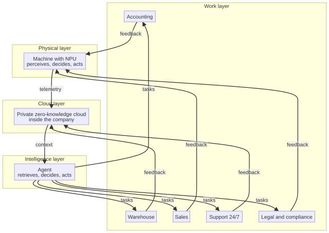

# Capitolo 20 --- Il grafo che connette tutto

## Il nome dell'insieme

Abbiamo attraversato, uno per uno, ogni componente della sesta rivoluzione. È il momento di dare all'insieme il suo nome e di mostrarlo come è davvero: non una linea, ma un *grafo*, un insieme di connessioni in cui ogni nodo alimenta ogni altro, in un tutto continuo e autocoordinato. È il grafo dell'**Industria 7.0**, ed è la forma del futuro che questo libro descrive dalla prima pagina. Il numero «7.0» non è arbitrario. Le rivoluzioni precedenti resero la macchina più potente, poi più connessa, poi più informatizzata. La settima, nella lettura che questo libro adotta, è quella in cui le macchine stesse diventano *periferiche di un'intelligenza artificiale interna*, e l'intelligenza --- agentica, connessa a una nuvola privata --- automatizza l'intera impresa, dalla macchina a ogni reparto.

Disegniamo il grafo con cura, perché il grafo è l'essenza dell'argomento e vederlo nell'insieme è la differenza tra capire la sesta rivoluzione ed esserne soltanto impressionati nei particolari.

## Il grafo

## Una curiosità: i sette ponti e il primo grafo

Prima di leggere il grafo vale la pena sapere che la parola «grafo», in questo senso --- un insieme di punti uniti da linee --- ha un'origine sorprendente e piuttosto giocosa, perché la matematica dei grafi non nacque dall'ingegneria ma da un enigma. Nella città prussiana di Königsberg nel Settecento (oggi Kaliningrad, sul fiume Pregel) c'era un fiume con due isole e sette ponti che collegavano le due rive e le due isole. I cittadini si divertivano con una domanda: si poteva fare una passeggiata che attraversasse ciascuno dei sette ponti esattamente una volta e tornasse al punto di partenza? Nel 1736 il matematico svizzero **Leonhard Euler** risolse la questione, e la risolse in negativo, con una dimostrazione così limpida che si insegna ancora oggi. Ma fu più della soluzione di un gioco da salotto: per rispondere, Euler dovette pensare le terre emerse come *punti* e i ponti come *linee*, e misurarli non per la loro lunghezza o il loro materiale ma puramente per *come erano connessi*. Così facendo inventò quella che oggi chiamiamo teoria dei grafi, e ci diede il vocabolario stesso di «nodi» e «archi» che stiamo usando per descrivere la fabbrica dell'Industria 7.0.

È una curiosità che vale la pena tenere, perché l'intuizione di Euler è esattamente l'intuizione da cui dipende il nostro grafo. Il grafo dell'Industria 7.0 non è in scala; non importa quanto sia «lunga» la connessione tra la macchina e la nuvola, né quanto sia «largo» il nodo del magazzino. Ciò che conta, come mostrò Euler, è puramente *come i nodi sono connessi*: quale nodo alimenta quale, in quale ordine, e come l'insieme si chiude in un ciclo. La macchina alimenta la nuvola; la nuvola alimenta l'agente; l'agente alimenta i reparti; i reparti alimentano a ritroso. È l'intero argomento, ridotto a connessioni. La potenza del grafo non sta nei nodi ma negli *archi* e, ancora più precisamente, nel fatto che gli archi, finalmente, *tornano indietro*.

## Leggere il grafo

Leggiamo il grafo dal basso verso l'alto, e poi vediamo come si chiude il ciclo.

In **basso** sta lo strato fisico: la macchina dotata del suo chip intelligente, il computer a scheda singola con la NPU che percepisce, decide e agisce su una scheda unica, senza ventola ed economica. È lo strato incontrato nella Parte II: la macchina che si è svegliata. È l'ancora dell'intero grafo, perché è il punto in cui l'intelligenza incontra il mondo fisico del fare le cose.

Verso l'alto scorre un flusso di **telemetria**, cifrata in tempo reale. Questo flusso non va a una nuvola pubblica; va, al livello successivo, alla **nuvola privata, trustless e a conoscenza zero tenuta dentro l'azienda**: la nuvola della Parte III, che riceve e custodisce i dati senza poterli mai leggere, perché l'azienda tiene la chiave. È la memoria del sistema, coerente e interrogabile in tutta l'azienda, e al sicuro da ogni terza parte.

Da quella nuvola l'agente --- l'**intelligenza agentica** della Parte V --- recupera il contesto preciso e pertinente, sia dalla nuvola sia dalla base di conoscenza dell'azienda. L'agente decide che cosa fare e agisce. E la sua azione è l'**automazione dei reparti**: contabilità, magazzino, vendite, marketing, assistenza clienti, legale e conformità. Sono i nodi in cima al grafo: il lavoro che la sesta rivoluzione finalmente automatizza, l'ufficio che continua a lavorare dopo che le luci si sono spente.

## Il ritorno del ciclo

Ora la parte cruciale, quella che lo rende un *grafo* e non soltanto una piramide. L'automazione dei reparti non chiude la storia: la *rimanda indietro*. La contabilità che riconcilia una fattura genera un nuovo requisito. Il magazzino che ordina un ricambio genera nuova telemetria. Le vendite che analizzano un mercato generano un nuovo piano. E tutti questi requisiti, questi ritorni e questi nuovi dati scorrono *di nuovo verso il basso*, alla macchina e alla nuvola, informando il ciclo successivo di percezione, il ciclo successivo di memoria, il ciclo successivo di decisione e azione. Il grafo è chiuso. Il sistema è autocoordinato.

È il «7.0» dell'Industria 7.0: non un nuovo tipo di macchina, ma una nuova *architettura* in cui le macchine diventano periferiche di un'intelligenza artificiale interna, e l'intelligenza --- agentica, connessa a una nuvola privata, conoscitrice dell'azienda --- automatizza l'intera impresa, in un ciclo continuo. La macchina pensa; la nuvola ricorda; l'agente decide; l'ufficio agisce; e l'atto torna indietro a informare il pensiero successivo. L'insieme è più della somma delle parti, perché l'insieme è un *ciclo*, e un ciclo conserva il proprio slancio.

## I due tipi di intelligenza nel grafo

Un'ultima lettura del grafo, perché si riallaccia alla Parte IV. Il grafo contiene entrambi i tipi di intelligenza che abbiamo incontrato --- la mente che indovina e la mente deterministica --- e colloca ciascuna dove è sicuro: la **percezione** in basso (la macchina che sente) è la mente che indovina, perfetta per percepire; la **decisione e la specifica** nell'agente e nella nuvola sono la mente deterministica, certa e tracciabile. Il grafo non è una singola intelligenza: è una *combinazione*, ciascuna mente al proprio posto, ed è questa combinazione a rendere l'insieme affidabile nei luoghi in cui la fiducia non è negoziabile.

## L'insieme in un solo respiro

Su un grafo aiuta leggerlo come un unico movimento, così che la forma non sia soltanto vista ma seguita. Leggiamo tutto, dalla macchina all'ufficio e ritorno, in un solo respiro. In basso, un mandrino in reparto porta un chip che percepisce il proprio mondo --- la temperatura del cuscinetto, la vibrazione del motore --- e prevede, da quella percezione, che il cuscinetto cederà. Quella previsione scorre, cifrata, a una nuvola privata, trustless e a conoscenza zero tenuta dentro l'azienda, che la riceve e la custodisce senza poterla mai leggere, perché l'azienda tiene la chiave. Da quella nuvola un agente recupera il contesto preciso e pertinente --- la storia della macchina, le note di manutenzione dell'azienda, le decisioni deterministiche che devono essere certe --- e decide che il cuscinetto sta davvero cedendo, ed emette un ordine per il ricambio. L'ordine scorre al magazzino, che ora lo sa automaticamente, alla contabilità, che riconcilia la fattura, e alle vendite e all'assistenza, che conoscono la data di consegna. E tutto questo --- l'ordine, la fattura, la consegna --- scorre *di nuovo verso il basso*, alla macchina e alla nuvola, informando il ciclo successivo di percezione, il ciclo successivo di memoria, il ciclo successivo di decisione e azione. Il grafo è chiuso. Il sistema è autocoordinato. L'insieme è più della somma delle parti, perché l'insieme è un *ciclo*.

## Perché 7.0 e non 6.0

Vale la pena rispondere con chiarezza alla domanda che il titolo del capitolo solleva: perché «7.0» e non un numero più vicino al resto della storia? La risposta è che il numero nomina un'*architettura*, non una macchina. Le rivoluzioni precedenti resero la macchina più potente, poi più connessa, poi più informatizzata, e ciascuno di quei passi si sarebbe potuto contare come «6.0» o «6.1», perché erano la stessa rivoluzione che diventava semplicemente più forte e più veloce. La settima, nella lettura che questo libro adotta, è una *cosa di genere diverso*: è la rivoluzione in cui le macchine stesse diventano *periferiche di un'intelligenza artificiale interna*, e l'intelligenza --- agentica, connessa a una nuvola privata, conoscitrice dell'azienda --- automatizza l'intera impresa, dalla macchina a ogni reparto. Non è che le macchine siano diventate più potenti; è che sono diventate *qualcosa di nuovo*: periferiche di un'intelligenza che pensa, connette e conosce. È un'architettura nuova, e merita un numero nuovo. Il «7.0» non è arbitrario: segna il momento in cui la fabbrica ha smesso di essere un insieme di macchine intelligenti che si trovano per caso una accanto all'altra ed è diventata un unico sistema autocoordinato.

## Perché un ciclo, e non una catena

La cosa più importante del grafo non è che abbia quattro strati, ma che si *chiuda*. E vale la pena capire perché la chiusura conti tanto, perché anche la fabbrica vecchia era una specie di grafo --- una *catena* --- e la differenza tra una catena e un ciclo è la differenza tra una fabbrica a cui si può solo dire che cosa fare e una fabbrica che sa pensare a ciò che sta facendo.

La fabbrica vecchia era una catena: la materia prima entrava da un capo e il prodotto finito usciva dall'altro, e ogni passo era un anello che passava il lavoro al successivo. La catena di montaggio di Taylor, incontrata nella cronologia, era l'espressione più pura della catena: una sequenza lineare di piccoli passi ripetibili, ciascuno che alimentava il successivo, nessuno che si voltava indietro. La catena era brillantemente efficiente in una cosa: *fare la stessa cosa, più in fretta*. Ma aveva una debolezza strutturale che nessuna quantità di efficienza poteva curare. Non sapeva *imparare*, perché in una catena nulla tornava mai indietro. L'uscita lasciava la fabbrica, e la fabbrica non sentiva mai che cosa le fosse accaduto. Un difetto scoperto da un cliente tre settimane dopo non poteva informare la macchina che l'aveva prodotto, perché la catena non aveva un arco che corresse all'indietro.

Il grafo dell'Industria 7.0 quell'arco ce l'ha. I reparti tornano alla macchina e alla nuvola, e quel ritorno cambia il ciclo successivo. Un difetto scoperto da un cliente diventa, attraverso l'agente, un nuovo requisito che raggiunge la macchina; uno schema nei registri di manutenzione diventa, attraverso lo stesso ciclo, una nuova previsione che evita un guasto futuro. Il grafo *impara dalla propria uscita*, e una catena non poteva mai farlo. È per questo che il ciclo, e non soltanto gli strati, è l'essenza della settima generazione: è la struttura che permette alla fabbrica di sentire se stessa pensare.

## La fragilità di una catena, la resilienza di un ciclo

C'è una seconda ragione, più silenziosa, per cui il ciclo batte la catena, e riguarda che cosa accade quando qualcosa va storto. Una catena è *fragile nel suo anello più debole*: se un solo passo della sequenza lineare si guasta, l'intero prodotto si ferma, perché non c'è altro percorso dalla materia prima al prodotto finito. È per questo che una linea di montaggio si arresta del tutto quando una stazione si inceppa: la catena non ha deviazioni, non ha ridondanze, non ha percorsi alternativi.

Un ciclo è più resiliente, per la stessa ragione per cui i ponti di Euler sono interessanti: conta *come le parti sono connesse*. Poiché il grafo dell'Industria 7.0 ha più archi --- i reparti alimentano sia la macchina sia la nuvola, la macchina alimenta la nuvola e ne riceve --- un guasto in un punto non ferma necessariamente tutto il sistema. L'agente sa aggirare un reparto guasto; la nuvola sa servire una macchina il cui vicino è fermo; la macchina sa agire localmente anche quando la nuvola è momentaneamente irraggiungibile. Il grafo non è *immune* al guasto, ma è *distribuito* rispetto ad esso, come una rete è più resiliente di una strada sola. Anche questo è l'eredità di Euler: la forma delle connessioni decide il comportamento dell'insieme, e un grafo con molti archi non è soltanto più potente di una catena: è più durevole.

## Il nome del laboratorio

Sarebbe disonesto non nominare il lavoro che sta dietro questo grafo. L'intera catena --- la macchina che pensa, la nuvola privata, l'intelligenza agentica, l'ufficio automatizzato --- è costruita, pubblicata e affinata da un piccolo laboratorio di ricerca, **AI Technology Graphene-Lab**, i cui progetti avete incontrato in tutto il libro: l'intelligenza su scheda singola, il CloudServer trustless e a conoscenza zero, l'intelligenza artificiale deterministica di UISupportBlazor e l'agentico AgentBridge che conosce la vostra azienda e non dimentica mai. Questo grafo è la loro visione della fabbrica della settima generazione, ed è la visione che questo libro descrive dalla prima pagina. La parte successiva del libro si volge al volto umano di questo grafo: il lavoratore che non viene sostituito ma promosso, e il lavoratore che, in un senso nuovo e letterale, entra finalmente in reparto. Per ora lasciamo stare il grafo: macchina, nuvola, agente e reparto, collegati in un unico insieme autocoordinato.
