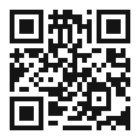

# Epilogo --- La fabbrica che sognava

## Il ritorno

Abbiamo cominciato questo viaggio nel prologo, alle quattro del mattino, in un reparto che dormiva ed era sveglio insieme: una macchina che sognava. Torniamo lì, ora che abbiamo capito che cosa stava sognando, così che il viaggio sia completo e il ciclo, finalmente, del tutto chiuso.

Il sensore sul mandrino sta ancora leggendo. La piccola scheda che lo contiene --- cervello ARM, NPU, senza ventola, economica --- sta ancora chiedendo alla macchina come si sente, e la macchina sta ancora rispondendo, nell'unico modo in cui una macchina sa rispondere, lasciando che si legga la forma della sua vibrazione. La vibrazione dice: *un cuscinetto vicino alla parte anteriore comincia a lamentarsi*. La piccola scheda la archivia non come un numero ma come un sentimento-con-un-numero, e lo manda nel buio.

Lo manda in una nuvola tenuta dall'altra parte di un muro che l'azienda possiede. I dati non lasciano l'edificio se non come un sussurro cifrato prima di essere pronunciato e decifrato solo dove deve essere udito. Arrivano, e da qualche parte nell'edificio una seconda intelligenza --- una che legge la telemetria dell'intero stabilimento da un anno --- si volta verso il nuovo suono. Una terza intelligenza, nell'ufficio al piano di sopra dove nessun operatore ha mai messo piede, si sveglia. Le è stato consegnato il lavoro che apparteneva a una persona precisa. Abbozza l'ordine di manutenzione. Controlla il magazzino per il cuscinetto. Compone il messaggio al responsabile di produzione nella lingua calma e piana che è la sua. Fa tutto questo prima che il sole abbia superato il tetto, e prima che qualsiasi essere umano sul pianeta abbia deciso che dovesse farlo.

## L'intera catena, vista intera

Ora che abbiamo attraversato l'intera catena, possiamo vedere che cosa la macchina stava sognando, e non è affatto un sogno. Sognava la sesta rivoluzione industriale, in miniatura: l'intero ciclo, chiuso in una sola notte, su una sola macchina.

La macchina pensa, su un chip --- capitolo 5, la macchina che percepisce, decide e agisce. La nuvola custodisce il proprio segreto, trustless e a conoscenza zero, dentro i muri --- capitolo 11, la nuvola dentro i muri. L'agente decide, conoscendo la vostra azienda e non dimenticando mai --- capitolo 17, l'agente che conosce la vostra azienda. L'ufficio si automatizza, a mezzanotte, attraverso i reparti --- capitoli 16 e 19. L'insieme si connette in un unico grafo autocoordinato --- capitolo 20, il grafo che connette tutto. L'umanoide entra in reparto per portare il lavoro che nessun corpo umano dovrebbe portare --- capitolo 21. E l'essere umano, promosso alla cima della catena, detiene il veto, formula il giudizio e si assume la responsabilità del risultato --- capitolo 22, dove l'essere umano serve ancora.

È moltissimo, compresso in una sola notte silenziosa su una sola macchina. Ma non è magia. È la somma dei componenti che abbiamo esaminato uno per uno, ed è, alla fine, un piano: chiuso un ciclo per volta, misurato mentre procede, esteso man mano che si dimostra. La macchina che sognava non è una meraviglia da ammirare; è una fabbrica da costruire, una sezione per volta.

## Lettera all'essere umano in cima alla catena

Se siete arrivati fin qui, siete, che lo sappiate o no, l'essere umano in cima alla catena. Siete colui a cui tutto questo libro è stato indirizzato: colui che starà accanto alla macchina che percepisce, alla nuvola che custodisce il proprio segreto e all'agente che conosce l'azienda, e che deterrà il veto, formulerà il giudizio e si assumerà la responsabilità del risultato. Vale la pena dire con chiarezza che cosa quel ruolo vi chiede, perché non è una cosa piccola e non è una cosa passiva.

Vi chiede di *restare svegli*. La grande tentazione di un sistema che funziona è smettere di guardarlo, e il grande pericolo di una macchina che di solito ha ragione è che nessuno controlli l'unica volta in cui sbaglia. La sesta rivoluzione non vi chiede di competere con la macchina: vi chiede di *testimoniarla*, e testimoniare è una disciplina. Vi chiede di *conoscere la differenza* tra la decisione che può essere un'ipotesi e la decisione che deve essere certa --- la distinzione della Parte IV --- e di insistere, sempre, perché le decisioni certe siano prese dalla mente certa. E vi chiede di *rispondere*: di firmare, in effetti, il risultato, e di portarne il costo se è sbagliato. Non è un peso da automatizzare. È il lavoro più alto che un essere umano possa fare, ed è il lavoro che tiene al sicuro l'intero ciclo.

La macchina farà il fare. La nuvola custodirà il segreto. L'agente ricorderà ciò che gli avete insegnato, e continuerà a lavorare dopo che le luci si sono spente. E voi --- l'essere umano in cima alla catena --- sarete colui che decide a che cosa serve tutto questo. È la promozione che la sesta rivoluzione offre, ed è offerta a ogni lavoratore disposto ad accettarla. Prendetela.

Ma prendetela sapendo che cosa state prendendo. La promozione ha un termine, e il termine non è scritto in nessun contratto: quando il ciclo saprà produrre le proprie condizioni, la mano che oggi firma non servirà più, e l'ultima firma dell'età industriale sarà quella di qualcuno che si accomiata senza sapere di essere l'ultimo. Sulla spiaggia la palma è già cresciuta, il cocco è già aperto, il sigaro aspetta. Che quel posto sia un premio o una gabbia comoda dipende da ciò che faremo del tempo che la macchina ci lascia, e quel tempo non si compra, non si fattura e non compare in nessun conto di ritorno dell'investimento. È l'unica merce che questa rivoluzione non ha reso più economica.

## La porta

Resta una cosa da dire, ed è la ragione per cui questo libro esiste. La sesta rivoluzione industriale non è una teoria: è una pratica, e la pratica viene costruita, pubblicata e affinata proprio ora da un piccolo laboratorio di ricerca --- AI Technology Graphene-Lab --- i cui progetti avete incontrato in queste pagine: l'intelligenza su scheda singola, la nuvola trustless e a conoscenza zero, l'intelligenza artificiale deterministica che trasforma un programma compilato in una garanzia e l'agente agentico che conosce la vostra azienda e non dimentica mai. Questo libro è, in parte, un giro di quella pratica; ed è un giro con una porta aperta.

Il codice QR che segue conduce a un canale Telegram, dove il lavoro viene mostrato, non soltanto raccontato: dove la macchina che pensa, la nuvola che custodisce il proprio segreto, l'agente che conosce la vostra azienda e l'umanoide che entra in reparto vengono dimostrati come sono, in tempo reale. Se siete arrivati fin qui e desiderate vedere il futuro che questo libro descrive --- non come promessa, ma come realtà funzionante e pubblicata --- la porta è qui. Lasciate un po' di spazio intorno, e varcatela quando siete pronti. La fabbrica che sognava sta già sognando; il resto è soltanto imparare la sua lingua, e poi unirsi al coro.

*La sesta rivoluzione industriale --- L'ultima rivoluzione industriale che coinvolgerà gli esseri umani.*
