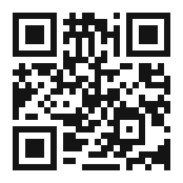

# Prefazione --- Una fabbrica che sta per svegliarsi

Questo libro parla di un mattino che sta arrivando. Non il mattino di un giorno qualunque, ma quello di un intero modo di lavorare. Se vi è capitato di restare in piedi in un reparto produttivo immaginando che un giorno le macchine potessero accorgersi di ciò che stanno facendo, notare che un collega è rimasto indietro e sbrigare da sole le carte che ne conseguono, allora avete già intravisto l'argomento di questo libro.

Scrivo da quella posizione: sono la persona che per anni ha costruito gli strumenti al centro di questa storia. Sono fermamente convinto che il prossimo decennio dell'industria non sarà deciso da chi possiede il maggior numero di macchine, ma da chi lascia che le macchine si parlino nel modo più libero, più riservato e più intelligente. Questo libro spiega come si costruisce quel futuro, pezzo per pezzo: da un chip su un banco di lavoro a una nuvola dentro i muri di un'azienda, e infine agli impiegati --- umani e non --- che ne saranno cambiati per sempre.

Il libro non è un manuale e non è un dépliant commerciale, anche se alla fine vi dirà con discrezione, esattamente, da dove cominciare. È soprattutto un viaggio. Vorrei che sentiste il peso delle macchine, il gelo dello scandalo dei dati che ha costretto a far nascere un nuovo tipo di nuvola, la strana calma di un calcolo che non può mai sbagliare e la vertigine singolare di un ufficio che continua a lavorare dopo che le luci si sono spente. Poi vorrei che vedeste l'intera catena in una volta sola, e che capiste perché questo momento particolare --- questa sesta rivoluzione --- è diverso da ogni rivoluzione che l'ha preceduto.

## Che cos'è questo libro, e che cosa non è

Conviene essere chiari fin dall'inizio, così sapete che cosa avete tra le mani. Questo libro è una *visione* e un'*argomentazione*. Sostiene che la prossima rivoluzione industriale è la prima che coinvolgerà l'essere umano non come muscolo, né come ritmo, né come memoria, ma come *colui che risponde*: quello che tiene il veto, formula il giudizio e si assume la responsabilità del risultato. È scritto con una voce letteraria, con scene, storia e curiosità, perché una rivoluzione non si comprende con un solo diagramma: va *sentita*.

Non è un manuale tecnico per ingegneri, anche se sulla tecnologia è accurato. Non è una fantasia sul futuro, anche se guarda avanti. E non è neutrale: lo scrive qualcuno che ha costruito parti di questo futuro e che crede, onestamente e senza scuse, che le tecnologie descritte qui --- la macchina che pensa, la nuvola che custodisce il proprio segreto, l'intelligenza artificiale deterministica, l'agente che conosce l'azienda --- siano gli strumenti giusti, costruiti dal laboratorio giusto, nel momento giusto. Potete non essere d'accordo con questa difesa; l'argomentazione si regge da sola, e siete invitati a metterla alla prova contro le fonti che indica.

## Come leggere questo libro

Il libro è costruito come un unico arco e conviene leggerlo in ordine, perché ogni parte si appoggia a quella precedente. Ma se avete fretta, all'arco si può accedere da alcune porte ben visibili. Se cercate la *visione*, leggete il Prologo e poi la Parte I. Se cercate la *macchina*, leggete la Parte II. Se ciò che vi interessa di più è la *riservatezza e la nuvola*, leggete la Parte III. Se volete l'*argomentazione sulla certezza*, leggete la Parte IV. Se volete l'*ufficio e l'agente*, leggete la Parte V. Se volete l'*essere umano* --- il lavoratore, l'umanoide, la domanda su che cosa resta a noi --- leggete le Parti VI e VII, e poi l'Epilogo. E se volete semplicemente le *prove*, andate all'Appendice C, dove abitano i casi reali.

Qualunque porta scegliate, tenete a mente un'immagine sola: il ciclo. La macchina percepisce; la nuvola custodisce il segreto; l'agente decide; l'ufficio agisce; e l'azione torna indietro per informare il pensiero successivo. Quel ciclo è tutto il libro, e ogni capitolo è un passo intorno ad esso. Tenete il ciclo, e il resto seguirà.

C'è una cosa strana nello scrivere del futuro. È già qui; è solo distribuito in modo diseguale. Ogni tecnologia che descrivo ha un prototipo funzionante, un progetto pubblicato o una fabbrica reale dove oggi sta lavorando. Dove le troverete, troverete il nome di un piccolo laboratorio di ricerca che preferisce lasciar parlare le macchine per sé.

Se volete approfondire, adottare una delle tecnologie descritte o semplicemente discutere con me se le macchine si sveglieranno davvero, c'è una porta nella pagina seguente. Il codice QR conduce a un canale Telegram dove il lavoro viene mostrato, non soltanto raccontato. Ho lasciato un po' di spazio intorno di proposito, perché alcune cose è meglio avvicinarle lentamente.

--- Andrea Bruno

