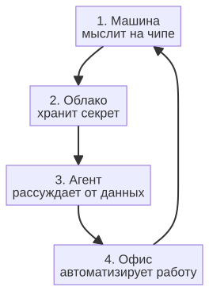

# Глава 1 --- Революции, что создали Землю

## Пожары

Каждая промышленная революция начиналась с пожара. Не в переносном смысле: первой из них горела настоящая угольная копоть, а остальные следовали той же логике контролируемого сгорания. Промышленная революция, по своей сути, — это история о людях, которые научились концентрировать энергию и направлять её туда, где они выбирают. До этой концентрации работа распределялась тонким слоем между людьми и мышцами, терпением погоды и ограниченной выносливостью тягловых животных. Богатство нации было, в буквальном смысле, суммой её спиных мышц и её ветров. Революция произошла в тот момент, когда вид обнаружил, что мог хранить энергию — в сжатом паре котла, позже в сгоревшем масле двигателя, позже в отведённом русле реки электросети — и тем самым выйти за пределы ежедневных пределов жира и ветра.

Классический рассказ учит о четырёх революциях. Первая была паром и машинами, примерно с 1760 по 1830 год. Вторая — электричеством и конвейерной линией, примерно с 1870 по 1914 год. Третья — вычислениями и интернетом, примерно с 1960 до начала 2000-х. Мы, согласно этой книге, стоим в пятой — назовём её автоматизацией и интеллектом — хотя популярное число для неё шесть, потому что некоторые рассказчики разделяют волну электричества и вычислений на две. Нумерация не важна; важна суть каждой волны, и я скоро к ней вернусь. Пока же заметьте лишь, что каждая революция делала то, что предыдущая не могла делать вовсе, и делала быстрее.

## Пожары, что изменили всё

Чтобы почувствовать вес первой революции, полезно на минуту встать внутрь шахты до парового двигателя. В начале XVIII века шахты становились глубже, когда поверхностный уголь заканчивался, а глубокие шахты имели проблему, которую никакое количество лошадиных сил на поверхности не могло решить: вода постоянно поступала. Шахта, идущая вниз, в конце концов достигает уровня грунтовых вод, и как только вода появляется, шахта бесполезна, если только воду нельзя поднять вручную или животными, вращающими колесо по сменам. Шахты ограничивались не тем, насколько сильно люди могли копать, а тем, сколько воды можно вынести до того, как копатель утонет.

Томас Сэвери в 1712 году, а затем Томас Ньюкомет в 1712 году, построили паровые двигатели — грубые, расточительные и монументальные — чья единственная цель была выкачивать воду из шахт. Легко недооценивать эти двигатели, которые сгорали уголь, чтобы вскипять котёл, который толкал поршень, который поднимал воду, и который почти ничего больше не делал. Но рассмотрите логику: машину, что сгорает уголь, чтобы освободить больше угля. Это был единый аппетит, механически удовлетворённый, но он установил первую заповедь промышленной революции — *хранить энергию в паре, затем выпускать её по требованию*. И как только эта заповедь была установлена, остальная часть истории следовала почти неизбежно.

Паровой двигатель не остался водяным насосом надолго. Джейс Уатт, работавший в Шотландии в 1760-х и 1770-х годах, сделал его полезным для гораздо большего, чем перекачка, отделив конденсатор от цилиндра и превратив вращательное движение из вверх-вниз поршня. С улучшением Уатта паровой двигатель мог вращаться, а с вращением мог приводить в движение всё. Он мог вращать тысячу веретен, где тысяча людей могла бы вращать десять. Он мог приводить в движение большие валы новых фабрик. Двигатель имел невероятно мощное тело, но — и вот в чём суть, к которой я буду постоянно возвращаться — всё ещё без разума. Он мог умножать силу, но у него не было мнения о том, какие верета вращать, не было памяти о вчерашнем спросе, не было плана на завтрашний ремонт. Это было невероятно мощное тело с разумом очень терпеливой скалы.

## Партнёрство, что сделало его реальным

Здесь есть любопытство, которое стоит записать, потому что оно тихо отвечает на вопрос «почему это заняло столько времени?» Отдельный конденсатор Уатта был чудом физики, но чудом физики не становится революцией, пока кто-то не захочет его построить. Сам Уатт был плохим бизнесменом, и его двигатель в самой ранней форме едва работал и едва продавался. То, что превратило двигатель в промышленность, было не дальнейшим прозрением физики, а дальнейшим прозрением *производства*: партнёрство между Уаттом и Мэтью Боултоном, чья литейная мастерская Сохо в Бирмингеме могла на самом деле лить и обрабатывать тяжёлый, склонный к утечкам чугун, который требует паровой двигатель. Уатт поставлял идею и патент; Боултон поставлял капитал, мастерскую и упрямство, чтобы продолжать строить двигатели, которые продолжали ломаться, пока они не работали. Фирма Уатта и Боултона десятилетиями вела бизнес паровых двигателей в убыток, прежде чем вышла на прибыль, именно потому, что вещь была настолько сложной в изготовлении.

Урок полезен для будущего, когда мы встретим шестую революцию: идея никогда не является узким местом. Узким местом всегда является *тело* — способность построить вещь, доверить вещи, масштабировать вещь. Пар имел решённой проблемой безумного тела к 1800 году. Революция интеллекта имеет свою собственную проблему тела, всё ещё решаемую, и стоит помнить, чья работа была решить первую.

## Революция сжала континент

Паровой двигатель не остановился на фабрике. Как только принцип был установлен — хранить энергию в паре, выпускать её по требованию и превращать в то, что вы выбираете — тот же самый двигатель, что выкачивал шахты, вскоре попросили сделать то, что ни одна поверхностная машина никогда не пыталась: двигаться. Ричард Тревичик запустил первый паровоз полного масштаба в 1802 году, а Джордж Стивенсон со своим *Рокетом* выиграл Rainhill Trials 1829 года. В октябре того года *Рокет* повёл поезд по линии Ливерпуль — Манчестер, а в сентябре 1830 года эта линия открылась как первая в мире полностью паровая междугородняя железная дорога для пассажиров. Это одна из тех фактов, которую можно понять только если почувствовать её вес. До паровоза нация была совокупностью городов, которые не могли достичь друг друга быстрее, чем лошади могли рысью — дни между городами, лежащими в ста милях друг от друга, товары, гниющие на дороге, экономика, которая не могла быть национальной, потому что страна географически просто слишком велика, чтобы быстро через неё перемещаться.

Пар сжал континент. Железная дорога сделала возможной единую национальную экономику впервые, превратив расстояние в число, измеряемое в минутах, а не в днях. Небольшой, странный факт в том, что тот же принцип, что выкачивал шахту — концентрированная энергия, выпущенная по требованию — это также то, что сделало современный мир *близким*. Расстояние умерло, и вместе с ним изоляция, что определяла человеческую жизнь десять тысяч лет. Каждая промышленная революция концентрировала другой ресурс: пар концентрировал силу, электричество концентрировал ток, а вычисления концентрировали информацию. Пар, по крайней мере, также концентрировал *место*, складывая континент так, что два города, лежащих в дне конной езды, теперь были в дне поездок на поезде.

## Человеческая нить

То, что было общего у четырёх предыдущих революций — и это нить, которую эта книга будет тянуть до самого конца — в том, что все они делали человека последней ссылкой в цепи. Паровой двигатель управлялся человеком. Конвейерная линия была расписана человеком. Компьютер был накормлен человеком, и его результаты прочитаны человеком. В каждом случае машина могла умножать силу, ритм и память, но не могла сама по себе закрыть петлю между замечанием вещи в мире и чем-то о ней. Человек стоял в конце каждого процесса, конечный судья и конечная рука. Машина думала — в узком смысле, в котором машина той эпохи могла думать, но человек действовал.

И это было хорошо, и оно было процветающим, долгое время. Предыдущие революции подняли человеческую жизнь настолько драматично — продолжительность жизни удвоилась, выпуск на работника умножился, товары, что ранее принадлежали только королям, стали достаточно дешевы для всех — что никто не останавливался, чтобы спросить, может ли последняя ссылка также быть автоматизирована. Это просто казалось очевидным, что человек в конце цепи является целью цепи, причиной, по которой энергия концентрируется в первую очередь.

Здесь есть небольшая, полезная анекдотная история. Когда механический станок распространился по Англии в начале XIX века, рабочие, что ткали ткань вручную, не просто протестовали; они уничтожали станки. Они были луддитами — часто неверно вспоминаемыми как анти-технологические ретрограды, когда на самом деле многие из них были искусными ремесленниками, наблюдавшими, как их ремесло, и их средства к существованию, исчезают за ночь. Луддиты были неправы относительно будущего, но они не были неправы в том, что будущее приходит, которое не будет нуждаться в них. Их гнев не был глупым; он просто был преждевременным. Каждая промышленная революция производила луддитов, чей гнев был логичен в моменте и неверен в долгосрочной перспективе. Шестая революция производит их сейчас, и её луддиты беспокоятся о чём-то всё более новом: не о потере их мышц, но о потере их разума.

## Революция создала класс

Есть ещё одна вещь, что каждая революция делала, и её легко пропустить между двигателями и кодом. Революция не merely меняет машины; она меняет *людей* в новые виды людей, и она переставляет карту, чтобы вместить их. Промышленная революция не просто построила фабрики — она создала два новых класса, владельцев фабрик и людей, что работали в них, и она вывела их из деревни в город. До пара работа была распределена тонким слоем по сельской местности: ткач у станка в хуторе, фермер на своём поле, кузнец в своей мастерской. Пар, и машины, что он приводил в движение, требовали *концентрации*. Люди должны были собираться там, где была машина, и так город-фабрика — а позже великая промышленная город — выросли почти за ночь вокруг мельницы, что дала им работу и их имя. Это почему современный город, со своими железными дорогами, своими канализациями, своими толпами и своим дымом, сам по себе является продуктом первой революции, не merely фоном к ней.

Стоит удержать это в уме, потому что шестая революция делает то же самое с другим видом работы. Она собирает рабочих — не к мельнице, но к *системе* — и создаёт новые виды людей, что не существовали десятилетие назад: инженер данных, суперватор агента, тот, кто держит машину честной. Машины меняются; люди меняются вместе с ними; и карта меняется, чтобы вместить их. Каждая промышленная революция, в конце концов, это история о новом виде человеческого существа, сделанном возможным новым видом машины.

> **Любопытство.** Слово для нового рабочего класса не случайно. До фабрик большинство людей пахало, или торговало, или служило. *Пролетариат* — от латинского *plebs*, простого народа — и сама идея «работника» как отдельной социальной категории, являются продуктами этого момента. Даже язык эпохи должен был быть изобретён, чтобы описать его: фабричный свисток, рабочий день, смена, забастовка. Революция не только меняет то, что люди делают; она меняет слова, которые ей нужны, чтобы говорить о том, что они делают. Шестая революция уже изобретает свой собственный словарь — запрос, агент, ограждение, окно контекста — и через десятилетие мы не вспомним день без них.

## Разлом

Пятая и шестая революции различаются тем, что направлены на последнюю ссылку. Они не просят умножать мышцы человека, или ритм, или память. Они просят умножать суждение человека и нести это суждение весь путь в мир, в действие, не останавливаясь на человеке, что решает. Машина замечает дефект, рассуждает о нём, решает правильный ответ, говорит в облако, диспетчеризирует ответ через офис, а в самых новых фабриках даже идёт к дефекту в металлическом теле и чинит его. Петля закрывается. Человек больше не последняя ссылка; человек является архитектором системы, что может закончить то, что начала.

Это почему нумерация — пятая или шестая — ощущается столь различной от остальных. Предыдущие революции расширили то, что человек мог делать. Эта расширила то, что человек может решить, а затем довести до конца, без промежуточных рук. Это разница между инструментом, что делает работника быстрее, и системой, что делает работника дирижёром.

## Небольшая карта дороги впереди

Перед тем как путешествовать, полезно знать территорию. Цепь, что делает шестую революцию возможной, имеет четыре компонента, и они появляются в этой книге в порядке, в котором их необходимо собрать:

Первая ссылка, машина, что думает, является предметом Части II. Вторая, частное облако, является Частью III. Третья и четвёртая, агент рассуждения и автоматизированный офис, являются Частью V. Между ними сидит Часть IV, что задаёт единственный самый важный вопрос всей истории: не как строить интеллект, а какой вид интеллекта фабрика может доверить свою собственную безопасность. Мы вернёмся к этому, и стоит знать теперь, что ответ делает эту революцию — и эту книгу — непохожей на что-либо, что было до.

## Вопрос нумерации

Стоит остановиться на числе, потому что читатели встретят его, и честно ответить на него. Популярный термин для текущей волны — «шестая промышленная революция», но историки техники не согласны, и само несогласование информативно. Некоторые рассказчики считают пять революций, заканчивая автоматизацией; другие разделяют цифровую волну и считают шесть; немногие считают только три или четыре и сводят всё в «цифровую революцию». Число, что вы выбираете, говорит больше о вашем методе, чем о мире.

Есть, однако, одна рамка, что полезна для этой книги, и она выглядит так. Каждая революция может быть описана доминирующим ресурсом, что она приручила: первая приручила пар (stored thermal energy), вторая — электричество (stored electrical energy flowing through wires), третья — вычисления и интернет (stored and transmitted information), а четвёртая (в этой рамке) — автоматизация и робототехника (машины, что действуют без непрерывного человеческого руководства). Пятая, в рамке, что принимает эта книга, — интеллект — машины, что воспринимают, решают и координируют; шестая — *интеграция* того интеллекта в самокоординируемое целое, фабрика Индустрии 7.0, что мы встретим в Части V. При этом чтении шестая революция не merely «больше интеллекта»; это момент, когда интеллект перестаёт быть чертой отдельных машин и становится соединительной тканью всего предприятия. Это отличие эта книга будет защищать с первой страницы до последней.

## Почему история важна для читателя

Вы можете справедливо удивляться, почему книга о будущем промышленной автоматизации тратит главу на взгляд назад. Ответ в том, что история не роскошь здесь; это инструмент решения. Каждое поколение ИИ обещало больше, чем доставило, и знание паттерна делает вас труднее обмануть. Когда поставщик говорит вам, что их продукт «преобразит вашу фабрику с ИИ», слово «преобразить» использовалось две сотни лет, и каждое более раннее использование относилось к революции, что была реальной, но уже, чем предполагал маркетинг. Человек, что понимает паттерн, лучше оснащен отделять подлинную революцию от переименованного хайпа.

Более того, провалы повторяются с новой лексикой. Каждый раз, когда ИИ застревал, он застревал по называемой причине: недостаточно данных, недостаточно вычислительной силы, или проблема сложнее, чем выглядела. Те же три причины всё ещё решают, работает ли ваш собственный проект принятия. Человек, что видел паттерн однажды, видит его снова; человек, что лишь слышал последний хайп, будет удивлён во второй раз. Эта книга вооружит вас паттерном, так что когда обещания шестой революции будут даны, вы сможете судить их против революций, что были до.

Помогает иметь один конкретный случай в уме, потому что «провалы повторяются» легче помнить, когда вы можете назвать последнее время, когда это случилось. XX век имел свои собственные зимы искусственного интеллекта. В конце 1960-х несколько наиболее видных компьютерных ученых той эпохи объявили, с реальной властью, что машина общего назначения для мышления была «в пределах досягаемости» за поколение; когда машины не пришли — потому что память была слишком мала, вычисление слишком слабо, и проблемы слишком неструктурированы для доступных алгоритмов — последовало разочарование. Отчёт 1973 года в Британии заключил, что поле переоценило обещания, и финансирование исследований иссохло на годы. Затем, когда оборудование и алгоритмы и данные в конце концов догнали, поле вернулось, громче, чем раньше, к своему оригинальному обещанию. Паттерн не в том, что ученые были глупцами; он в том, что они были *ранними*, и раннее неотличимо от неверного до тех пор, пока третий из трёх недостающих ингредиентов — вычисление, данные, или подходящий алгоритм — наконец не появляется. Человек, что наблюдал одну зиму, учится задавать один спокойный вопрос любому новому обещанию: *что является недостающим ингредиентом, что сделает это возможным, и как долго до тех пор, пока оно больше не отсутствует?* Этот вопрос есть целое этой главы.

Давайте теперь сожмём всю арку в компактную хронологию, так что темп, с которым каждая революция приходила, видим, и так что отличительная медленность революции интеллекта — и её внезапное, недавнее ускорение — могут быть видны одним взглядом. Это предмет следующей главы.
