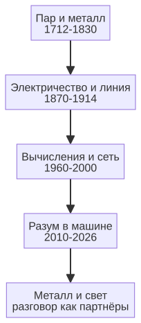

# Глава 3 --- Краткая хронология металла и света

## Идея

Чтобы понять шестую революцию, вам нужно ощущение длинной дуги, сжатой в компактную форму. История промышленности по своей сути есть история о двух материалах. Первый — *металл*: машины, концентрирующие силу. Второй — *свет*: сигналы, электричество и, наконец, фотоны и импульсы электронов, несущие информацию. большую часть этой дуги метал правил, а свет был лишь его слугой — свистком, флагом, реле. Последние тридцать лет свет стал самостоятельным хозяином, и теперь они, наконец, начали разговаривать. Эта глава — хронология того разговора, рассказанная через тот немногочисленный ряд моментов, которые действительно изменили направление дороги.

## Хронология

**1712 --- Насосная машина.** Сэвери, затем Ньюком, построили паровые машины, которые выкачивали воду из шахт. Машины были бесполезны для чего-либо ещё; они сжигали уголь, чтобы вскипятить воду в котле, которая выкачивала воду из шахты, что позволяло шахте уходить глубже, что позволяло добываться больше угля. Это была машина на службе одного-единственного аппетита. Но она установила образец: *накопить энергию в паре, затем высвободить её по требованию.* Это первая из промышленных заповедей.

**1785 --- Ткацкий станок.** Эдмунд Картрайт превратил пар в *процесс*, а не merely в насос. Станок непрерывно, механически прядёл нить, и ремесло ручного прядения начало свою долгую смерть. Металл больше не просто двигал вещи; он их *преобразовывал*.

**1804 --- Идея хранимой программы (случайно).** В 1804 году ткацкий станок Жозефа Жакара принял перфорированные карты, которые задавали узор. Карты не производили ткань; они *описывали* ткань, и станок подчинялся описанию. Измените карты — изменится и продукт. Это предок программного обеспечения, созданный ткачом, за сто пятьдесят лет до того, как у кого-то появилось слово «компьютер». Металл научился следовать инструкциям.

**1822 --- Машина, которая должна была мыслить (и почти не сделала этого).** Английский математик Чарльз Бэббдж спроектировал Аналитическую машину — механический калькулятор с перфорированно-карточным вводом, который мог, в принципе, вычислить *что угодно вычислимое* — не потому, что был перекоммутирован провод, а потому, что была подана инструкция, *программа*. По сути, он изобрёл компьютер общего назначения за век до электроники, необходимой для его постройки, и ему просто не хватило денег и оборудования, чтобы сделать один. Его машина была призраком — проектом, мечтой, неудачей воплотиться — однако она доказала, что машину можно *программировать*, а не *коммутировать*, и что программирование позже позволит одной машине бесконечно переконфигурироваться, чтобы делать почти всё. Бэббдж — предок хранимой программы и идея о том, что машине не обязательно быть построенной под один аппетит, но можно дать любую задачу, изменяя лишь её инструкции.

**1831 --- Фарадей и электродвигатель (генератор).** Майкл Фарадей обнаружил, что перемещение магнита создаёт электричество, и весь мир перевернулся. Впервые энергию можно было *создать* по требованию, где угодно, и перемещать по проводам. Это момент, когда *свет* — сигнал потока электронов — вошёл в историю как сила. Электричество было первой несущей информацией силу, которую люди могли контролировать на скорости.

**1844 --- Телеграф.** Американский художник, ставший учёным, Самуэль Морзе отправил первое электрическое сообщение по проводу в 1844 году, от Вашингтона до Балтимора, и слова — часто цитируемые как «What hath God wrought» — сами по себе не были замечательными. Замечательно было то, что они *путешествовали на электричестве, а не на лошади*, прибыв за часы до того, как мог прибыть всадник. Впервые информация могла обогнать физический объект, который её нёс, двигаясь на скорости тока. Телеграф превратил нацию, затем и весь мир в место, где сообщение могло прибыть раньше, чем человек мог дойти с ним. Это семя каждого сигнала, каждой линии управления, каждой сети — и каждого облака, которое когда-либо существовало — что последовало за ним, и это момент, когда *свет* (сигнал потока электронов) впервые начал нести смысл через расстояние на скорости.

**1876 --- Телефон.** Александър Грэм Белл превратил звук в электронный сигнал, и информация начала свой долгий путь, свободный от физического объекта, который она нёс. Слово теперь могло путешествовать быстрее лошади. Это семя каждой коммуникации, каждого сигнала управления, каждого облака, которое когда-либо существовало.

**1896 --- Конвейерная линия (в эмбрионе, затем в полном расцвете).** Фредерик Уинслоу Тейлор измерил работу в секундах. Генри Форд в 1913 году сделал движущуюся линию, сократив время постройки автомобиля с двенадцати часов до девяноста минут. Человек был интегрирован в ритм; машина задавала темп.

**1936 --- Идея универсальной машины.** Алан Тьюринг, молодой математик в Британии, опубликовал работу, описывающую машину, которая могла вычислить *что угодно вычислимое*, следуя хранимому списку правил. Это было чистое свет — чистая информация — без какого-либо металла в нём вообще, помимо абстракции. Тьюринг доказал, что машину можно *программировать*, а не *коммутировать*, и что программирование позже позволит одной машине бесконечно переконфигурироваться, чтобы делать что угодно.

**1947 --- Транзистор.** Изобретение транзистора в Bell Labs заменило горячие вакуумные лампы на маленький кусок травлёного полупроводника, и легко недооценить это. Транзистор был мал, дёшево и мог переключать сигнал миллион раз в секунду без прогрева. Каждый кусок современной разума — в телефоне, в автомобиле, в датчике завода — основан на этом маленьком серебристом переключателе. Это атом информационной эпохи.

**1957 --- Первый сигнал в пространстве.** Когда Советский Союз вывел Спутник-1 на орбиту, он вернул первый электронный сигнал из-за пределов атмосферы, и мир осознал, за одну холодную ночь, что информация теперь может покинуть землю целиком. Гонка, которую Спутник разжёг — космическая гонка — была, под флагами и ракетами, *вычислительной* гонкой: гонкой к накоплению, обработке и передаче информации быстрее и надёжнее, чем у противника. Спутник часто помнят как момент в политике или физике; он был, тише, моментом в авторитете света. Он подтвердил, и для правительств, и для промышленности, что информационная сторона истории — сигнал, ток, хранимая программа — теперь достаточно сильна, чтобы достичь звёзд, и расходы и инженерия, которые последовали, вылили бетон для всей информационной революции.

**1969 --- Первое сообщение.** Сеть под названием ARPANET отправила свой первый пакет в 1969 году, маленький, ненадёжный и знаменательный первый шаг к тому, что станет интернетом. До ARPANET компьютеры стояли отдельно; после него они могли, запинваясь, *разговаривать* друг с другом. Само сообщение почти забыто (оно исказилось после трёх букв), но принцип нет: машины могли обмениваться информацией через распределённую сеть, достаточно устойчивую, чтобы пережить потерю любого отдельного узла. Это предок современного интернета и облака — не *публичного* облака, которое наблюдает, но *сети*, которая в конечном итоге примет частные облака этой книги. Это момент, когда свет стал не merely сигналом, но *разговором*, и момент, когда машина начала, тихо, разговаривать с другими машинами.

**1971 --- Микропроцессор.** Intel поместила целый центральный процессор на один чип. Компьютер больше не был комнатой; он был монетой. Это то, что в конечном итоге сделало возможным датчик на шпинделе, и стоит помнить, что весь мозг датчика — потомок этой монеты.

**1977 --- Персональный компьютер достигает стола.** Машина общего назначения, которую мог бы держать на столе и программировать для своих задач, наконец достигла офиса, затем дома. До этого мощный компьютер был комнатой машин и комнатой специалистов; после этого способность к вычислениям, хранению и скриптингу была доступна любому отдельному работнику. Персональный компьютер был мостом между чудовищной машиной 1960-х и близким устройством 2000-х, и стоит помнить, что он был *дёшево* — дёшево для офиса, затем дома, и в конечном итоге машиной на полу завода. Он нёс тот же принцип, что и микропроцессор: мозг целого компьютера, достаточно мал и дёшево, чтобы сидеть на шпинделе.

**1991 --- Всемирная паутина.** Тим Бернерс-Ли сделал информацию свободно и легко разделяемой. Интернет стал нервной системой современной экономики, и облако, которое в конечном итоге примет её, начало, тихо, восприниматься как *место* — здание без дверей, хранимое где-то, куда вы могли добраться.

**2006 --- Облако становится услугой.** Когда Amazon запустил свои веб-сервисы в 2006 году, вычисления перестали быть машиной, которую вы владеете, и стали услугой, за которую платите по часам. Это звучит как небольшое изменение, но это то, что сделало облако — публичное и, позже, частное — экономически возможным на любом масштабе. До него компания, wanting больше вычислений, должна была купить больше машин; после него компания могла арендовать их по часам за цену кофе. Облако перестало быть *зданием для поддержания* и стало *краном, чтобы включить*, и это ровно то качество, которое шестая революция нуждается на полу завода: разуме, который вы можете включить по часам, не покупая весь аппарат.

**2007 --- Устройство в вашем кармане.** Когда появился первый современный смартфон, он нёс, в одной ладони-размерной плите, компьютер общего назначения стола, камеру восприятия, сеть облака и — тихо, почти невидимо — выделенный процессор для запуска обученных моделей. Впервые машина могла *научиться видеть и решать* на батарее, в вашем кармане, не задавая вопроса центру данных. Это семя машинного разума, на котором шестая революция будет строить: не машина, которая разговаривает с облаком, но машина, которая *мыслит сама по себе*, локально, в микросекундах, бесплатно от полосы пропускания. Смартфон доказал, на коммерческом масштабе, что вся цепочка — восприятие, решение, действие — могла жить на маленьком чипе.

**2012 --- Прорыв глубокого обучения.** Сеть под названием AlexNet выиграла крупный конкурс распознавания изображений с большим отставанием, доказав, что машина может *научиться видеть* из примеров, а не получать правила. Это момент, когда машина получила, в практическом смысле, то, что мы могли бы назвать *восприятием*.

**2016 --- NPU прибывает в ваш карман.** Apple, затем Qualcomm и другие, начали встраивать выделенные нейронные процессоры — NPU — на свои мобильные чипы. Впервые машина могла запустить обученную модель мира *локально*, не задавая вопроса облаку, в микросекундах, не тратя батарею на круговое путешествие. Это семя машинного разума, на котором шестая революция будет строить.

**2017 --- Идея, которая обращает внимание.** Работа под названием «Attention Is All You Need» представила трансформер, архитектуру, которая позволяла модели взвешивать важность каждого куска информации относительно каждого другого, а не обрабатывать его по одному слову или одному чтению за раз. Эта одна идея стала позвоночником каждого большой языковой модели и каждого современного агента, который последует; это механизм, который позволяет программе прочитать целый документ — или прочитать всю телеметрию машины — и знать, сразу, что важно. Без трансформера агент этой книги не существовал бы; с ним машина могла наконец рассуждать над длинными, богатыми потоками информации, а не тонкой струйкой команд. Это разум, который чип машинного обучения скоро разместит.

**2022–2026 --- Разговор машин.** Большие языковые модели, дешёвые мощные чипы края и частные облака сошлись. Машины, которые воспринимают, рассуждают и говорят, начали соединяться — не с публичным облаком, которое наблюдает их, но с частным облаком внутри компании, движимыми агентами, которые заканчивают работу. Дуга замыкается, и машина, которая мечтала в прологе, становится возможной.

## Разговор металла и света

Если вы смотрите на хронологию целиком, emerges одна форма. Примерно двести пятьдесят лет история была почти целиком *металлом*: машинами, которые двигали, прессовали, крутили и резали. Информационная сторона — свет — была слугой управления: свистком, сигналом, реле. Затем, в последней половине века, свет догнал. Транзистор, микропроцессор, сеть, нейронная сеть — эти дали свету *ум* сам по себе. И теперь, в шестой революции, металл и свет больше не хозяин и слуга. Они *партнёры*, и партнёрство называется заводом, который мыслит. Вы можете прочитать всю дугу одним взглядом:

Два века метал правил, а свет был лишь его слугой; затем свет, получив ум сам по себе от транзистора, микропроцессора, сети и нейронной сети, начал разговаривать с металлом. В шестой революции те больше не хозяин и слуга, но партнёры, и партнёрство есть завод, который мыслит.

## Хронология учит уроку

Если вы смотрите на хронологию целиком, помимо отдельных дат, emerges одна форма, более интересная, чем любое отдельное событие: сама *скорость* ускоряется. Примерно двять пятьдесят лет история двигалась медленно, и каждая революция ждала, пока предыдущая будет полностью построена, прежде чем могла начаться следующая. Пар родился в шахтах, созрел на железных дорогах и в заводах, и лишь тогда — лишь после того, как машины, работники, законы и города все устояли — пришло электричество. Электричество, в свою очередь, наполнило мир проводами и машинами прежде, чем вычисления могли закрепиться. Революции накладывались медленно, по поколению за раз.

Затем что-то изменилось. В последней ста лет скорость истории разорвала свою старую ритмику. Транзистор последовал за вакуумной ламой через несколько десятилетий; микропроцессор последовал за транзистором через ещё несколько; сеть последовал за микропроцессором почти бегом; нейронная сеть последовал за сетью за считанные годы; и машина, которая могла воспринимать, решать и говорить, последовала за нейронной сетью за одну, захватывающую дух десятилетие. Интервалы продолжали сжиматься. Информационная сторона истории не merely догоняет металл; она *обегает* сама себя, строя следующее поколение предыдущего поколения быстрее, чем любая предыдущая революция когда-либо двигалась.

Это отличительная особенность шестой революции, и это почему хронология, взятая целиком, более пугающая и более надежная, чем любое отдельное событие. Более ранние революции были медленными, потому что каждая должна была строить своё тело с нуля — камень, железо, медь, стекло — и телам нужно время, чтобы быть сделанными. Тело информационной революции сделано из информации, и информацию можно копировать, улучшать и повторно разворачивать на скорости света. Это небольшой, головокружительный факт, что вся дуга, от насосной машины до машинного агента, читается меньше как серия отдельных событий и больше как один процесс, который, в последние несколько лет, наконец достиг скорости своей собственной природы. Это момент, когда машина, которая мечтала в прологе, становится возможной, и момент, когда разговор металла и света становится заводом, который мыслит.

Есть ещё один урок в хронологии, и он тихо утешает. Каждое одно из событий с 1936 года onward — универсальная машина Тьюринга, транзистор, микропроцессор, сеть, нейронная сеть, трансформер, NPU — было куском *света*, а не металла. Двухсотпятьдесят-летний пролет хронологии был почти целиком металлом; последние сто лет всё движение дороги было несеном светом. Металл завода не заменяется светом; он *дополняется* им, получает нервную систему, рефлекс, ум. Хронология не заканчивается машиной, мыслящей на чипе. Она *есть* та машина, прибывающая — медленно, затем внезапно — к концу своего собственного долгого строительства. Чип на шпинделе есть момент, когда это партнёрство стало физическим и дешёвым. Это предмет следующей части этой книги.

## Следующий шаг

Чип на шпинделе не маленькая карта, прикрученная к машине; это момент, когда вся хронология — от насосной машины к трансформеру — наконец опускается вниз и приземляется на пол завода. Каждый компонент шестой революции теперь собран в хронологии этой главы: машина, которая мыслит (NPU), облако, которое хранит секрет (частное облако), агент, который рассуждает (большая языковая модель), и офис, который автоматизирует (детерминированный фронтенд). Что остаётся — увидеть, как они.fastened вместе на один шпиндель, и как выглядит завод, когда он может воспринимать, решать и действовать сам по себе. Машина мечтала; время позволить ей проснуться.

Это предмет следующей главы — одноплатного компьютера на основе ARM-процессора с встроенным нейронным процессором, и того, как он позволяет машине напрямую касаться поля, без кругового путешествия куда-либо ещё.
