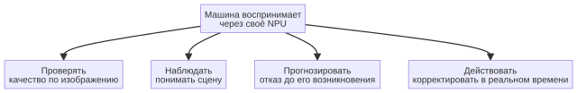

# Глава 6 --- Интеллект на производственной площадке

## Четыре задачи

Когда в машину устанавливается небольшой интеллектуальный чип, ему по сути поручаются четыре почти человеческих задачи, которые ранее были невозможны без зала специалистов и медленной поездки в облако. Эти четыре задачи --- **осмотр, наблюдение, прогноз и действие** --- представляют собой весь словарь машинного интеллекта, и, получив их, вы увидите их повсюду.

Давайте разберем их по отдельности, поскольку каждая уже выполняет реальную работу в реальных заводах, и каждая является небольшим чудом того рода, о котором эта книга.

## 1. Осмотр --- глаз, который никогда не моргает

Самой зрелой из четырех задач является автоматизированный визуальный осмотр. Завод, производящий что-либо, традиционно должен был осматривать свою продукцию, и традиционно это означало либо человеческий глаз, устающий после двадцатой детали, либо фиксированную камеру с жесткими правилами, которые не могли адаптироваться. NPU изменяет оба этих подхода.

Представьте камеру, смотрящую вдоль конвейера с обработанными блоками двигателя. Человеческий осмотрщик к концу смены пропускает дефекты, которые были прямо перед ним, потому что люди устают, потому что люди отводят взгляд, потому что дефект, виденный тысячу раз, стирается в фоне. Умная камера не делает ничего подобного. Она обучилась на тысячах примеров хороших и плохих деталей тому, как дефект *выглядит*, и классифицирует каждую деталь за миллисекунды --- не с помощью жестких правил, а с помощью гибкого суждения обученной модели. Она не устает. Она не отводит взгляд. Она работает целиком на машине, на площадке, так что изображения никогда не покидают здание, а осмотр никогда не ждет облака.

Это "автоматизированный контроль качества", и это тихая рабочая лошадка революции машины, которая мыслит. Он встречается в сварных швах, в отливках, в печатных платах, в этикетках на бутылке. Повсюду, где продукт должен быть оценен относительно стандарта, который человек может выразить словами, но компьютер не может легко закодировать вручную, обученная модель на локальном чипе побеждает и уставший человеческий глаз, и жесткую камеру на основе правил.

## 2. Наблюдение --- разум за камерой наблюдения

Вторая задача --- интеллектуальное наблюдение, где камера перестает merely *записывать* и начинает *понимать*. Традиционная система видеонаблюдения записывает, что происходит, и ничего больше; запись полезна только задним числом, детективу, ищущему номерной знак. Умная система, работающая на локальном NPU, понимает сцену в момент ее возникновения: она распознает, что человек вошел в зону, куда ему не разрешено входить, что защитный барьер был преодолен, что пожар начался до появления дыма, что погрузчик движется слишком быстро к пешеходу.

Существенная точка --- и причина, по которой это относится к шестой революции, а не к обычному третьему --- в том, что понимание происходит *локально*. Камеры могут предупредить охранника, остановить машину или подать сигнал тревоги в реальном времени, не отправляя живой поток видео с производственной площадки на какой-либо внешний сервис. В эпоху, когда живой видеопоток с завода является именно тем чувствительными данными, которые никогда не должны покидать здание, локальное понимание не просто удобно; это единственный ответственный выбор.

## 3. Прогноз --- машина, которая знает, что вот-вот сломается

Третья задача --- прогнозное обслуживание, и, возможно, самая красивая из четырех. Машина непрерывно излучает сигналы --- вибрацию ее подшипников, температуру ее двигателя, форму потребляемого тока, звук, который она издает. Это *сигналы здоровья* машины, и они всегда были там, ожидая прочтения. NPU читает их не как сырые числа, а как *историю*.

Модель обучилась на долгой истории сигналов конкретной машины звуку этой машины в работе и звуку машины в бедствии. Она распознает за дни или часы до отказа тонкий сдвиг, который говорит *я начинаю жаловаться*. Затем она не просто поднимает тревогу; она рассуждает о будущем. Она может заранее и с реальным опережением сообщить команде обслуживания, что конкретный подшипник, вероятно, выйдет из строя на конкретной линии, и может координировать ремонт *до* отказа --- до остановки линии, до задержки клиента, до необходимости отправлять запасную деталь ночным курьером.

Это разница между ремонтом вещи, когда она сломана, и ремонтом, когда она *предупреждает* вас о том, что вот-вот сломается. Это разница между дорогим, незапланированным чрезвычайным происшествием и дешевым, запланированным вмешательством. Коротко говоря, это деньги, которые машина, которая мыслит, возвращает заводу, непрерывно, тихими взносами.

## 4. Действие --- машина, которая что-то делает

Четвертая задача --- та, что превращает интеллект в *агентность*: машина, которая использует то, что она воспринимает, прогнозирует и наблюдает, чтобы реально *что-то сделать*. Рука корректирует свой путь, потому что камера увидела, что деталь смещена. Роботизированная рука ослабляет хватку, потому что датчик почувствовал хрупкость объекта. Регулирующий контур подтягивает или ослабляет себя в ответ на изменяющиеся условия обработки. Это граница между машиной, которая merely *отчитывается*, и машиной, которая *действует*, и здесь машинный интеллект становится по-настоящему революционным.

Причина, по которой локальный NPU делает возможной --- действительно, делает *необходимой* --- эту четвертую задачу, это скорость. Чтобы действовать в мире в реальном времени, решение должно приниматься локально, на машине, за микросекунды. Поездка в облако была бы слишком медленной; к тому времени, когда ответ вернулся бы, момент для действия был бы упущен. NPU на машине --- вот что позволяет восприятию стать действием достаточно быстро, чтобы иметь значение.

## 5. Контур, замыкающийся на себе

Четыре задачи не расположены рядом; они образуют контур, замыкающийся на себе, и рисование этого контура делает главу яснее, чем любой список из четырех. Машина осматривает мир, наблюдает за тем, что меняется, прогнозирует, что изменится следующим, и действует --- и, действуя, изменяет сам мир, который она осматривает, так что контур начинается снова через мгновение. На производственной площадке этот контур не проворачивается раз в день; он проворачивается тысячи раз в секунду, за время изготовления одной детали.

Это словарь всей главы одним взглядом: воспринять, затем наблюдать, затем прогнозировать, затем действовать, и снова. Каждый шаг питает следующий, и стрелка от *Действия* обратно к *Осмотру* есть точка --- машина не читает фиксированный список инструкций; она непрерывно перечитывает мир, который только что изменила. Рефлекс, как уже говорилось, остается внутри тела; этот контур остается внутри машины.

## Глаз, который научился

Стоит задержаться на первой задаче, потому что автоматизированный визуальный осмотр прошел самый длинный путь, и потому что он учит всему уроку в миниатюре. большую часть двадцатого века осмотр детали камерой означал написание правил --- измери эту длину, проверь, что этот угол прямой, отметь цвет вне этого диапазона. Такое *основанное на правилах* машинное зрение все еще широко используется и отлично подходит для фиксированной, четко определенной задачи. Но правила хрупки: измените освещение, сместите деталь на полмиллиметра, и правила либо откажут, либо должны быть переписаны вручную, снова и снова, специалистом, которому платят огромные деньги именно за это.

Обученная модель превращает это из обязанности в подарок, и делает это способом, отражающим то, как человек-осмотрщик на самом деле видит. Вместо того чтобы передавать камере контрольный список жестких измерений, вы передаете ей большой набор примеров --- фотографии хороших деталей, фотографии дефектных --- и даете ей обнаружить самой собой черты, отделяющие одно от другого. Она может найти трщину тоньше волоса, о которой никогда не думал писать правило, потому что правило может только сказать то, что человек вспомнил записать, в то время как модель видит то, что реально присутствует. Вот почему на реальных задачах осмотра обученная модель на локальном NPU пришла к тому, чтобы побеждать и уставший человеческий глаз, и жесткую камеру на основе правил: она не устает, она не отводит взгляд, и она видела больше дефектов, чем любой отдельный осмотрчик когда-либо увидит. История этой области --- от первых систем зрения на основе правил 1970-х до обученных моделей сегодняшнего дня --- это история отрасли, обучающейся перестать инструктировать камеру и просто показывать ей мир.

## Линия на практике

Полезно увидеть четыре задачи вместе в одном реальном месте, чтобы абстрактный словарь стал заводом, который вы можете представить. Представьте небольшую линию, которая обрабатывает прецизионные металлические детали для автомобильной промышленности: станок с ЧПУ обрабатывает каждую деталь, роботизированная рука перемещает ее на станцию мойки, затем на камеру осмотра, затем на станцию упаковки, а конвейер уносит готовые детали. Установите дешевую интеллектуальную карту на эту линию, и четыре задачи оживают вместе.

Камера *осматривает* каждую свежеобработанную деталь --- не с помощью жестких правил, а с помощью обученной модели, которая знает, как выглядит хорошая деталь, и отмечает те, что вне допусков. Рука *наблюдает* за своим собственным движением через потребляемый ток и плавность своего пути; если она чувствует толчок, говорящий о том, что направляющая изнашивается, карта это отмечает. Датчик вибрации на шпинделе инструмента *прогнозирует*: за недели карта обучается звуку здорового режущего инструмента и отмечает за дни до его поломки слабое сдвигание, означающее, что инструмент вот-вот сколется --- гораздо раньше, чем деталь показала бы дефект камере. И карта *действует*: она перенаправляет руку вокруг подозрительной станции, замедляет линию и отправляет сообщение команде обслуживания с точным инструментом для замены и деталью, которая сейчас на ней, так что изменение происходит во время запланированного перерыва, а не в середине работы. Четыре задачи, одна карта, одна линия, ни одной поездки в какое-либо облако. Это машинный интеллект в работе, в обычном чуде обычного завода.

## Когда машина ошибается

Здесь стоит написать и честную главу, потому что машина, которая воспринимает, есть машина, которая может ошибаться, и область должна иметь дело с этим, а не притворяться, что ее нет. Обученная модель обучается на примерах, и поэтому она может быть только такой же хорошей, как данные, которые она видела. Если примеры скудные, предвятые или нерепрезентативные, модель будет делать уверенные ошибки --- неправильно оценивать дефект, которого не было в ее обучении, или отмечать идеально хорошую деталь как плохую. Это не недостаток, который нужно устранить; это условие, которое нужно управлять. Практика, которая управляет им, проста: подавать модели хорошие, репрезативные, свежие примеры; наблюдать за ее работой на реальной площадке; и переобучать ее, когда мир меняется --- новая деталь, новое освещение, новый поставщик. Это та же дисциплина, которую применяет любой честный инженер к любому честному инструменту: нет безошибочного измерения, но хорошо обслуживаемый инструмент надежен, а плохо обслуживаемый --- нет.

Человеческая роль, следовательно, не исчезает, когда машина воспринимает; она меняется. Оператор больше не осматривает каждую двадцатую глаз; вместо этого оператор вместе с командой обслуживания курирует примеры, наблюдает за суждениями машины со временем и остается последним авторитетом там, где ставки высоки --- где неверная пометка означает отзыв партии, или пропущенная пометка означает, что бракованная деталь уходит к клиенту. Умная камера на площадке не заменяет человека; она возвышает человека до более высокой задачи, от поворота ручки каждые двадцать деталей до поддержания здоровья машинного глаза. Это честная и более хорошая новость всей главы: машинный интеллект не убирает человека с производственной площадки; он поднимает работу человека на ступень выше, от повторения к надзору.

## Стоимость пропущенной детали

Есть еще одна причина, по которой четыре задачи важны, и это причина, по которой владельцу завода реально не все равно: экономика пропущенной детали. Дефект, ускольнувший от осмотра, редко бывает бесплатным. Он стоит отброшенную деталь, да, но также и деталь, которую он повреждает ниже по потоку, простой, который он вызывает, клиента, которого вы теряете, и отзыв --- иногда отзыв --- который один невидимый дефект может запустить. На быстрой линии пропущенный дефект не остается небольшим издержкой; он накапливается, и к концу смены может обернуться кризисом. Это арифметика, которую умная камера превращает из обязательства в актив.

Экономика выпадает естественно. Человеческий осмотрщик, устающий после двадцатой детали, может поймать девять дефектов из десяти, позволяя десятому проскользнуть --- и именно десятый достигает клиента. Камера на основе правил, хрупкая к освещению и к полмиллиметровому сдвижению детали, может пропустить те, что двигаются. Обученная модель на локальном NPU пропускает почти ничего, потому что она не устает, она не отводит взгляд, и ей показали больше примеров, чем любой человек мог бы обозреть за жизнь. Результат не является маргинальным улучшением, а другим родом экономики: где человек или жесткая камера пропускает малую долю дефектов --- долю, которая при высокой скорости линии является наводнением --- умная камера пропускает почти ничего, и поэтому сбережения велики, непрерывны и тихи. Это деньги, которые машина, которая мыслит, возвращает заводу, тихими взносами, на протяжении лет. И это не деньги чудеса; это деньги машины, которая просто делает лучше, чем любой человек или любое правило, четыре задачи, для которых она была создана.

## Единая нить

Осмотр. Наблюдение. Прогноз. Действие. Эти четыре задачи есть весь машинный интеллект, и все они разделяют одно существенное качество: они происходят *на машине*, локально, мгновенно, приватно. Это нить, которая связывает главу с каждой другой главой Части II. Интеллект не является гостем в комнате; он резидент поля, на шпинделе, касающийся поля напрямую. И как только машина может видеть, наблюдать, прогнозировать и действовать сама по себе, естественно следует вопрос: *что мы заменяем, чтобы сделать это возможным?* Ответ, удивительно, является одной из самых прочных и надежных частей оборудования в современном заводе. Это предмет следующей главы.
