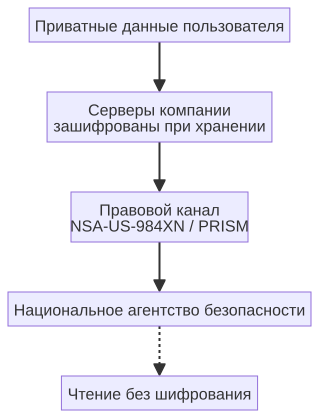

# Глава 10 --- Когда облако украло вашу компанию

## Утро, в которое мир изменился

Шестого июня две тысячи тринадцатого две газеты --- *The Guardian* и *The Washington Post* --- опубликовали в один и тот же день историю, которая тихо и навсегда изменила то, как мир думал о данных. На протяжении многих лет американское агентство под названием Национальное агентство безопасности (National Security Agency) запускал программу по сбору огромного количества частных сообщений, и недавно опубликованные документы раскрыли не только то, что программа существовала, но и то, что великие технологические компании *участвовали* в ней, передавая данные своих пользователей агентству. У программы было имя: **PRISM**.

Мужчина вынес эти истории на свет. Его звали Эдвард Сноуден (Edward Snowden), американский подрядчик, который в предыдущем месяце улетел в Гонгконг с документами, способными изменить всё. Газеты, опубликовавшие его долю истории, *The Guardian* и *The Washington Post*, позже поделили Пулитцеровскую премию (Pulitzer Prize) за 2014 год за общественную деятельность (Public Service). Стоит помнить об этом моменте не потому, что он далёк, а потому, что это тот момент, когда современное облако --- то самое облако, к которому эта книга в конечном итоге подведёт завод, --- впервые стало для большинства людей местом, о котором следует быть *осторожным*.

День, когда история всплыла, вызвал реакцию не холодную, аналитическую, как у инженеров, а более тёплую, более резкую, как у людей, которые чувствуют, что их предали. Сервис, который вы *выбрали* для использования --- сервис, которому вы доверяли именно потому, что он был удобен, --- без вашего ведома и без вашего согласия передал ваши личные сообщения правительству. Чувство предательства и есть суть дела: нас не беспокоит, что государство *могло* прочитать нашу почту; нас беспокоит то, что оно это сделало, тихо, через те самые компании, которым мы доверяли её защитить. И это различие --- разница между *возможностью* и *предательством* --- есть вся моральная тяжесть datagate, и это же вся моральная тяжесть главы, которая следует.

## Имя по-итальянски

В англоязычном мире скандал известен под несколькими именами: PRISM, NSA, государство наблюдения. В итальянской прессе, где за историей наблюдали с особой интенсивностью, у него есть своё имя: **datagate** --- суффикс, заимствующий "-gate", выдуманный Watergate для обозначения любого скандала, связанного с злоупотреблением властью. Итальянская пресса потянулась за этим суффиксом потому, что история была, по своей сути, историей о злоупотреблении властью: о власти государства читать то, что частные люди считали остающимся приватным.

Техническое имя программы --- PRISM, с обозначением NSA **US-984XN**. Она не появилась в один день. Её правовая основа была закреплена в **Разделе 702 Закона об поправках к FISA 2008 года** --- позже повторно утверждённом, в 2012 и снова в 2024 году --- и, согласно опубликованным документам, она работала примерно с 2007 года. Так что, когда мы говорим, что скандал всплыл в 2013 году, мы имеем в виду, что он всплыл *тогда* для публики; машина работала на протяжении лет, совершенно вне поля зрения.

## Механизм предательства

То, что опубликованные документы сделали наиболее эффективно, это показали не *что* компании участвовали, а *как*. Механизм был, своим образом, банален, и его банальность есть причина, по которой он важен. PRISM не требовал от NSA проникновения в системы компаний --- это кино о шпионаже, а не его практика. Вместо этого каждая компания поддерживала, по закону, прямой канал, через который её *могла* запросить --- и, в большинстве случаев, *принудить* --- передать данные данного пользователя. Компания, вместо того чтобы быть взломанной, стала *хранителем ворот*: точкой, через которую данные всех её пользователей могли, по требованию, быть вылитыми к агентству.

Это тонкое, но важнейшее различие, и стоит удержать его тщательно, потому что оно меняет то, как мы думаем о ответственности. Компания, системы которой *взломаны*, есть жертва. Компания, поддерживающая дверь, через которую государство может войти --- дверь, которую закон принуждает её держать открытой, есть, чтобы использовать неудобное слово, *партнёр*. Опубликованные документы намекали, для большинства компаний в списке, на второе: не на вынужденную руку, но на желанную, или, по крайней мере, cooperativную, вплоть до точки, когда закон требовал больше. Точный баланс принуждения и сотрудничества варьировался от компании к компании и на протяжении лет; опубликованный реестр не разрешает его, и я не буду притворяться, что он это делает.

Компания, державшая дверь открытой, не читала ваши сообщения и не передавала их вручную. Она поддерживала, на уровне архитектуры, точку, в которой ваши данные *могли* быть взятыми. Предательство не было личным; оно было *структурным*. Оно было впековано в дизайн сервиса, в условия обслуживания, которые вы приняли, не читая, в правовую основу, которая делала сопротивление невозможным без сопротивления самому закону. И это та деталь, которую владелец завода должен интернализовать, потому что шестая революция столкнётся с идентичным структурным выбором.

Диаграмма выше есть упрощённая картина механизма: ваши данные, удерживаемые компанией за её собственными стенами, проходили через *правовой канал* к агентству, которое могло прочитать их открытым текстом. Ключевое слово --- *канал* --- компания не потеряла контроль над данными у вора; она добровольно поддерживала вход, через который государство могло пройти. Это разница между кражей со проникновением и заговором, и datagate был, по сути, заговором, впеённым в архитектуру современного облака.

## Список участников

Наиболее поразившая деталь в опубликованных документах была список. Он называл, с годом их вступления, великие технологические компании, которые согласились --- под правовым принуждением или, как реестр намекает, в желанном сотрудничестве --- дать NSA доступ к данным их пользователей. Список читается как "кто есть кто" цифровой эпохи:

| Company | Year they joined PRISM |
| ----------------------- | ------------------------ |
| Microsoft | 2007 |
| Yahoo | 2008 |
| Google | 2009 |
| Facebook (today Meta) | 2009 |
| Paltalk | 2009 |
| YouTube | 2010 |
| AOL | 2011 |
| Skype | 2011 |
| Apple | 2012 |

Девять самых знакомых имён в технологиях, датированных, словно в инвентаре. Это та деталь, которая сделала историю застрявшей в уме публики: не абстрактная идея наблюдения, но *список*, алфавитный и полный, компаний, которые не встанут между их пользователями и государством. Легко отмахнуться от этого как от политики, и значительная часть освещения datagate действительно была политической. Но здесь есть урок для владельца завода и бизнеса, и он таков: **когда вы отправляете ваши данные в публичное облако, вы, ровно тем же образом, даёте третьей стороне доступ к ним --- будь то государство, хакер или компания, продающая внимание.** Механизм предательства тот же. Единственный вопрос в том, кому вы вручили ключи.

## Личная цена

Стоит задержаться на человеческой детали, потому что статистика миллионов размывает ужас, и потому что опубликованные документы со временем называли конкретных людей, которые попали в машину. Наиболее часто приводимый пример --- это гражданин Германии, описанный *The Guardian* в 2014 году, чьё имя появилось в списке наблюдения Центрального разведывательного агентства почти целиком из-за того, что он *любил* на Facebook --- горсть интересов, которые, для иностранной разведывательной службы, были достаточно, чтобы привлечь внимание. Он ничего незаконного не совершал; он просто *любил* несколько страниц, и база данных, созданная для сбора сообщений всех, подхватила его среди всех. В отчётности не было указания на то, что он когда-либо был угрожён --- лишь на то, что он был *увиден*, автоматически, машиной, которой было всё равно, виновен ли он.

## Реакция и раскаяние

Стоит задержаться на реакции, потому что она показывает, как публика в конце концов поняла опасность --- с опозданием, но неоспоримо. Первая и наиболее влиятельная реакция пришла не от затронутых пользователей, но от самих основателей компаний. В 2013 году Билл Гейтс (Bill Gates) написал широко прочитанное открытое письмо, в котором он аргументировал с тихой настойчивостью, что шифрование должно быть сохранено и что Соединённые Штаты "идут неправильным направлением" в наблюдении; что лекарство не в том, чтобы больше доверять государству, но в *доверять ему меньше*, сделав данные нечитаемыми даже для их владельца. В тот год основатели десяти самых влиятельных технологических компаний --- Google, Apple, Microsoft и других --- публично подписали письмо, адресованное Президенту Соединённых Штатов, аргументируя за сохранение сильного шифрования; это было, по существу, признанием индустрии вместе с тем, что datagate показал старое предположение неверным.

Индуст медленно начала принимать их сторону: сквозное шифрование (end-to-end encryption) распространилось от приложений для обмена сообщениями к облачному хранилищу, именно потому, что урок datagate был в том, что компания, которая может прочитать ваши данные, может также быть *принуждена* прочитать ваши данные. Это важнейший поворот, и это петля, на которой качается остальная часть этой книги. Публичность поняла, в послесловии datagate, что истинная гарантия приватности не в *доброй воле* оператора облака, но в его *неспособности читать*. Хранилище, удерживаемое честным стражем, всё ещё уязвимо --- стража можно подкупить, уволить или вызвать по предписанию. Хранилище, чей замок никто, кроме вас, не держит, не уязвимо. Это понимание --- что безопасность должна быть свойством *архитектуры*, а не *характера оператора* --- есть всё предположение доверенного, zero-knowledge облака, которое этот скандал вынудил к существованию.

## Число, которое так и не было уложено

Одно число, которое опубликованные документы так и не могли уложить, было sheer количество собранных данных. Различные оценки сильно варьировались, от примерно пятидесяти тысяч документов до как минимум миллиона с половиной. Диапазон не есть дефект в отчётности; он сам по себе есть дело. Даже *низшая* оценка достаточно велика, чтобы иметь значение, и то, что никто не мог согласиться по *общему* количеству, есть именно доказательство того, сколько было взято. Данные компании --- её производственные показатели, её контракты с поставщиками, её списки клиентов, её планы --- могли, в принципе, быть среди тех миллионов собранных байтов, и никто не мог бы сказать вам, какие именно, или было ли когда-нибудь прочитано.

Неуложенное число есть, на самом деле, подарок аккуратному читателю, потому что оно учит общее правило, которое я пронесу через эту книгу: **когда вы не можете назвать, сколько данных было взято, вы не можете доверять тому, что какие-либо из ваших данных были пощажены.** Компания, которая собирает "всё, неразличённое", собирает *вас* среди всего, и единственный способ быть уверенным, что вы не собраны, это сделать ваши данные такими, что их нельзя прочитать даже в случае взятия. Это обещание облака, удерживаемого внутри стен.

## Что может сделать компания

Урок datagate не merely предостерегающий; он *действенный*, и стоит plainly заявить, что компания --- любая компания, любого размера --- может сделать, чтобы избежать ошибки, которую скандал обнажил. Принципов немного, и ни один из них не экзотичен.

Первый --- *держать ключ*. Любые данные, которые стоит защищать, должны быть зашифрованы ключом, который компания сама держит, так что даже система, которая хранит и перемещает данные, не может их прочитать. Это единственное важнейшее движение, и это то, что превращает "мы доверяем нашему облачному провайдеру" в "мы не обязаны доверять нашему облачному провайдеру".

Второй --- *держать облако внутри*. Там, где данные есть картина будущего компании --- её производства, её поставщиков, её клиентов --- облако, которое её удерживает, должно быть под контролем самой компании, а не гигантского публичного дата-центра, принадлежащего горсти фирм. Частное, zero-knowledge облако не есть роскошь для параноика; оно есть обычная осмотрительность бизнеса, который научился тому, чем публичное облако может быть принуждено сделать.

Третий --- *отправлять лишь то, что необходимо*. Проблема объёма предыдущей главы есть также проблема приватности: снижая данные на edge, компания отправляет сводки и предупреждения вместо сырого исповедания её операций и удерживает глубокую, интимную деталь локально. Наименьшее количество данных, которое путешествует, есть наименьшее количество данных в риске.

Эти три движения не требуют штата специалистов или бюджета дата-центра; они требуют решения, принятого однажды, treat данные компании как её собственные. И это решение есть, в конце концов, то же решение, которое шестая революция просит у каждого завода: удержать интеллект, и данные, и ключ на вашей стороне стены.

## Урок для завода

Почему скандал о шпионах важен для завода, который строит интеллектуальную машину? Потому что шестая революция имеет тенденцию посылать значительную долю данных этого завода *наружу*. Машина, которая воспринимает, предсказывает и отчитывается, произведёт телеметрию --- производственные ставки, изображения компонентов, информацию о поставщиках, операционные паттерны --- и та телеметрия должна уйти *куда-то*. Для большей части облачной эпохи "куда-то" означало публичное облако: гигантские дата-центры, принадлежащие горсти компаний, те самые компании в том списке.

Datagate был моментом, когда публика поняла, в том виде, в каком скандал всегда порождает, что публичное облако не есть хранилище. Это чужой компьютер, и оператор того компьютера может быть принужден --- или может быть желанным --- прочитать всё, что вы там удерживаете. Завод, который посылает его драгоценную телеметрию в публичное облако, есть, ровно тем же образом, что и пользователи в том списке, даёт третьей стороне доступ к его наиболее чувствительной информации. Это урок, который шестая революция не может себе позволить игнорировать, потому что данные завода есть, вполне буквально, его будущее, ставшее видимым. Следующая глава о ответе, который этот скандал вынудил к существованию: об облаке, который удерживает его тайну, об облаке, удерживаемом *внутри* стен.
