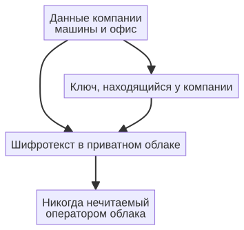

# Глава 11 --- Облако внутри стен

## Противоречие

К середине 2010-х годов над использованием облака нависло противоречие, и это было противоречие, которое мог почувствовать любой вдумчивый инженер, но который никто ещё не решил. С одной стороны, облако было несомненно полезным — оно предоставляло хранилище, вычислительные мощности и связность в масштабах, которых не могла бы ни одна отдельная компания, и позволяло машинам и офисам общаться друг с другом сквозь расстояние. С другой стороны, скандал с datagate сделал столь же ясно, что публичное облако — это место, где *никому нельзя доверять* — оператора можно было вынудить или он мог пожелать прочитать то, что вы там хранили, и как только ваши данные покидали ваше здание, вы больше не контролировали их.

Так вопрос стал острым и неизбежным. Существует ли облако, которое сохраняет *полезность* облака — хранилище, синхронизацию, способность машин и офисов делить один живой копию истины — одновременно сохраняя *тайну*, которую публичное облако разоблачало? Может ли компания иметь облако, которое по-настоящему её собственное, так что её данные никогда не покидают здание и никогда, даже под принуждением, не читаются третьей стороной?

Ответ, как к нему пришли проекты, лежащие в основе этой книги, — да, но лишь в том случае, если вы готовы наделить облако двумя новыми свойствами, которых у старого облака никогда не было: оно должно быть **бездоверительным** (trustless), и оно должно быть **нулевыми знаниями** (zero-knowledge). Давайте отнесёмся к этим двум словам серьёзно, потому что в них заключается всё инновационное новшество.

## Бездоверительное облако

«Бездоверительное» (trustless) — это выражение, пришедшее из мира криптографии и распределённых систем, и оно звучит как странное желание по отношению к чему-то столь же полезному, как облако. Мы обычно *доверяем* используемым службам; именно поэтому мы их используем. Назвать облако «бездоверительным» — значит сказать, что вам *не* нужно доверять его оператору в обработке ваших данных правильно. Вам не нужно доверять, что он не протечёт ваши данные, что он не будет подкуплен, что он не будет вынужден передать ваши файлы и прочитать их. В бездоверительном облаке архитектура системы — не хорошие намерения оператора — является тем, что сохраняет ваши данные в безопасности.

Способ достижения этого заключается в обеспечении того, что данные *зашифрованы* ключами, которые держит только ваша компания, и что облако может обрабатывать, хранить и синхронизировать данные *никогда не видя их открытым текстом*. Облако перемещает ваши данные, сохраняет их согласованными, делает доступными для ваших машин и офиса — но никогда не обладает властью *читать* их, потому что не держит ключ. Это подобно курьеру, который может доставить запертый сейф, но не может его открыть. Курьер полезен и надёжен, и он совершенно не способен вас предать. Это и есть бездоверительное облако: полезное и неспособное предать.

## Ключевое различие

Есть одна деталь, которую почти все понимают неправильно, и того стоит пройти медленно, потому что в ней заключается весь смысл. Публичное облако — гигантское, централизованное, коммерческое облако 2010-х годов — *действительно* зашифрует ваши данные. Оно зашифрует их, пока они путешествуют по сети (шифрование в транзите), и зашифрует их, пока они спят на диске (шифрование в покое). Так что наивное возражение «просто зашифруйте это» ничего не решает, потому что публичное облако уже зашифрует его.

Различие, которое имеет значение, вот какое: в публичном облаке *оператор держит ключи*. Шифрование является собственностью оператора; оно применяется по причинам самого оператора — чтобы удовлетворить регулирование, чтобы ограничить ответственность, чтобы защититься от внешних воров. Но оператор может в любое время разблокировать ваши данные, прочитать их, передать. Шифрование в покое — это *удобство* для оператора, а не *гарантия* для вас. Если оператора вынудили или он пожелал, он может просто применить свой ключ, и ваши данные — открытым текстом, читаемые, больше не ваши — будут переданы тому, кто просил.

Бездоверительное облако нулевыми знаниями меняет *кто держит ключ*. В этом облаке ключ не является собственностью оператора; он *ваш*, и он никогда не покидает ваше здание. Данные зашифрованы до отправки, ключом, которого у оператора нет, так что даже шифрование в покое на диске оператора бессмысленно для них. Они могут хранить ваш запертый сейф, перемещать его, сохранять копии, синхронизировать по своим серверам — но не могут его открыть, потому что у них никогда не было ключа. Шифрование больше не является удобством оператора; это *ваша* гарантия, применённая на уровне, который оператор не может отменить. Это разница между хранилищем, охраняемым честным охранником оператора, и хранилищем, которое по конструкции невозможно открыть. Первое — это datagate; второе — это облако внутри стен.

## Облако нулевыми знаниями

«Нулевыми знаниями» (zero-knowledge) — это выражение из ветви криптографии, которое звучит почти парадоксально, и того стоит пройти медленно. В криптографии «доказательство нулевыми знаниями» — это способ для одной стороны доказать другой, что утверждение верно — *не раскрывая никакой информации помимо истины самого утверждения.* Классический пример — пещера с секретным словом, запертым за дверью. Человек, знающий слово, может доказывать, что он его знает, неоднократно — заходя в одну дверь и выходя в другую — никогда не *произнося* слово. Он доказывает знание, не передаруя знания. Отсюда «нулевыми знаниями»: доказательство ничего не передаёт помимо того факта, что доказательство удалось.

Применённое к облаку, нулевыми знаниями означает, что облако может проверять и обрабатывать ваши данные, никогда не узнавая сами данные. Машина зашифрует свою телеметрию до отправки, держит ключ, и облако — даже облако, которое хранит и синхронизирует его — не может прочитать его. Облако работает с шифротекстом, с запертым сейфом, никогда с содержимым. Когда данные нужны в офисе, они расшифровываются там, вашей компанией, вашим ключом. Облако есть, в самом буквальном смысле, *слёзно* к содержимым ваших данных. Это хранитель, который может охранять хранилище, но никогда не видеть внутри него.

Чтобы сделать это конкретным для завода: датчик на шпинделе не посылает облаку число с плавающей точкой; он посылает *шифротекст*, продукт шифрования того числа ключом, которого у облака нет. Облако хранит тот шифротекст, сохраняет его согласованным по своим серверам, делает доступным для офиса — всё время неспособная узнать, было ли число 42 или 42 000, было ли подшипник здоров или отказывал. Это, в самом строгом смысле слова, *информационно-слёзное*. Оно может видеть, что данные перемещаются; оно не может видеть, что данные *являются*. В этом заключается всё обещание нулевыми знаниями, и его достаточно, чтобы сделать невозможным предательство публичного облака, которое мы встретили в предыдущей главе.

## CloudServer

Проект, который воплощает эту идею — облако, удерживаемое внутри компании, бездоверительное и нулевыми знаниями — называется **CloudServer**, один из проектов, опубликованных лабораторией, лежащей в основе этой книги. Там, где публичное облако централизует данные в горстке гигантских центров обработки данных, которые можно прочитать (или вынудить прочитать), частное, нулевыми знаниями облако, такое как CloudServer, *децентрализует* доверие: данные никогда не покидают контроль компании, потому что компания никогда не разоблачает ключ. Облако есть внутри стен, или по крайней мере внутри полномочий компании, и оно бесполезно для шпиона, хакера или судебного приказа, потому что нечего читать.

Это не гипотеза. Архитектура существует, она опубликована, и она строится, чтобы решить ровно ту проблему, которую datagate сделала неизбежной. Завод, который воспринимает, предсказывает и отчитывается — завод предыдущих глав — производит данные, которые, по любому разумному стандарту, являются его самой чувствительной собственностью. Производственные расписания, контракты поставщиков, конструкции компонентов, операционные модели: это картина будущего компании, сделанная видимой. Именно эти данные шестая революция должна удержать *внутри стен*, и частное, бездоверительное, нулевыми знаниями облако — единственный вид облака, которое может удержать их, не предав их.

Способ, которым CloudServer осуществляет это, поучителен, и того стоит пройти через него данными один раз, потому что механизм есть весь аргумент. Машина, или офисное приложение, держит ключ. Она зашифрует свои данные *до* того, как они покинут здание. Затем она посылает только *шифротекст* — запертый сейф — в CloudServer. Сервер хранит, синхронизирует и обслуживает тот шифротекст каждой авторизованной машине и офису, всё время никогда не держа ключ, который мог бы его разблокировать. Когда машине нужны данные, сервер возвращает шифротекст; машина — не сервер — расшифровывает её, локально, ключом, который она сохранила. Сервер есть безмолвный, слёзный курьер для данных всей компании, способный перемещать их и хранить, но никогда не читать. В этом заключается всё новшество, и это то, что делает облако внутри стен *бездоверительным* в самом строгом смысле.

Схема выше есть, я надеюсь, faithful картина механизма: ключ остаётся внутри здания, данные путешествуют и хранятся только как шифротекст, и единственное место, в котором данные когда-либо становятся читаемыми, есть *внутри собственных стен компании*, на машине, которая держит ключ. CloudServer присутствует на каждом шаге, кроме последнего и первого; он есть перевозчик, не читатель. Это облако, которое datapore сделало необходимым, и это то, что позволяет самой драгоценной телеметрии завода путешествовать, наконец, безопасно, на место, где оно будет осмыслено.

## Что на самом деле стоит ключ

Стоит задержаться на практическом возражении, потому что это то, что возникает первым в любой реальной компании: если облако не может читать данные, как оно может что-то полезное с ними делать? Тревога понятна, и того стоит ответить plainly, потому что ответ есть также причина, по которой облако нулевыми знаниями не merely любопытство, но рабочая конструкция.

Работа облака, в этой архитектуре, не в *осмыслении*. Она в *перемещении и удержании*: в надёжном хранении данных, в синхронизации их по каждой машине и каждому офису, в том, чтобы сделать их доступными в ту минуту, когда их просят, в том, чтобы пережить отказ диска или сервера, и в том, чтобы делать это в масштабе целой компании. Ни одна из этих работ не требует чтения данных. Курьеру не нужно читать письмо, чтобы доставить его вовремя; склад не нужно понимать ящик, чтобы безопасно его хранить. Облако есть курьер и склад шестой революции, и его компетентность — надёжность, доступность, синхронизация — целиком совместима с его слёзностью.

*Осмысление*, тем временем, происходит там, где ключ: на машине, которая его держит (край, которого мы уже встретили), и в офисе, который его держит (агент, которого мы встретим в Части V). Это места, в которых шифротекст становится читаемым, потому что это места, в которых ключ живёт. Так что облако нулевыми знаниями не есть ограничение, наложенное на конструкцию; это *разделение труда*. Облако делает то, в чём оно хорошо — перемещать и удерживать — никогда не нуждаясь в понимании. Машины и агенты делают то, в чём разведка хороша — читать и решать — никогда не выпуская данные из собственных рук. Две половины работы чисто разделены, и разделение есть ровно то, что делает всё это безопасным.

Есть небольшая ирония здесь, и того стоит её назвать. Публичное облако продавало себя обещанием *интеграции* — «поместите всё в одно место, и мы заставим всё это работать вместе». Частное, нулевыми знаниями облако переворывает обещание: оно помещает всё в одно место, но намеренно удерживает место *слёзным*, и даёт каждому держателю ключа делать своё собственное осмысление. Интеграция старого облака была удобной и небезопасной; разделение нового облака менее удобно и намного безопаснее. Для завода обмен очевидно стоит делать, потому что перемещаемые данные есть картина будущего компании, и никакое удобство не стоит того, чтобы передавать эту картину незнакомцу.

## Короткая история удержания секрета

Идея, что сообщение может путешествовать, оставаясь непрочитанным, так же стара, как само письмо, и история той идеи есть интеллектуальное происхождение облака нулевыми знаниями. Стоит сделать короткое отступление, потому что оно позволяет читателю увидеть, что современное облако не есть внезапное изобретение, но последнее поворот в очень длинном разговоре.

Юлий Цезарь, в первом веке до нашей эры, будто бы защищал свои военные депеши сдвигом каждой буквы алфавита на фиксированное число мест — «шифр Цезаря», в котором *A* становится *D*, *B* становится *E*, и так далее. Это было, по современным стандартам, смешно слабый; но он установил сущностный ход: *сообщение и его значение могут быть разделены*, так что перевозчик сообщения не может его читать. В течение двух тысяч лет каждое достижение в криптографии было, по сердцу, уточнением того одного хода.

В шестнадцатом веке шифр Вигенера использовал *ключевое слово*, чтобы варьировать сдвиг, что делало сообщение гораздо труднее сломать, и на время в него верили — ошибочно, как оказалось — что оно неразрушимо. Вера длилась до девятнадцатого века, когда Чарльз Бэббидж (тот же человек, который спроектировал Аналитический Двигатель, которого мы встретили в хронологии) будто бы его сломал. Урок уже был современным уроком: шифр только так силён, как *секрет в его центре* — ключ — и никакое количество хитрости в механизме не может компенсировать слабый ключ.

Двадцатый век превратил криптографию в вопрос жизни и смерти. Немецкая машина Enigma, использовавшаяся во Второй Мировой Войне, шифровала военные коммуникации роторной системой поразительной сложности; британские взломщики кодов в Блетчли Парк, среди них Алан Тьюринг, сломали её и, делая это, возможно, сократили войну на годы. Enigma была *системой общего секрета*: отправитель и получатель оба знали ежедневные настройки (ключ), и безопасность покоилась на удержании того ключа секретным. Когда ключ протёк, шифр пал.

Затем, в 1976 году, два исследователя — Уитфилл Диффи и Мартин Хеллман — опубликовали идею, которая изменила форму поля: *публично-ключевая криптография*. Она позволяла двум сторонам, которые никогда не встречались, и которые не делили никакого секрета заранее, установить безопасный канал — потому что каждая сторона имела *публичный* ключ (который мог видеть кто угодно) и *частный* ключ (который держали только они). Публичный ключ мог шифровать; только частный ключ мог расшифровывать. Это был момент, когда криптография перестала требовать предварительно разделённый секрет, и это прямое происхождение бездоверительного облака, в котором компания держит ключ, которого ни один оператор никогда не должен знать.

Доказательство нулевыми знаниями, которого мы встретили ранее в этой главе, есть всё ещё более недавний и всё ещё более поразительный поворот: способ доказать, что утверждение верно *не раскрывая ничего другого*. Взятые вместе — публично-ключевая криптография, которая позволяет незнакомцам установить секрет; и доказательства нулевыми знаниями, которые позволяют стороне доказывать, не раскрывая — эти идеи есть интеллектуальное основание, на котором построено облако внутри стен. CloudServer не есть магия; это последнее, самое практическое применение разговора, который начался со сдвигающегося алфавита Цезаря и шёл, без прерываний, две тысячи лет. Когда телеметрия завода путешествует как непрочитанный шифротекст, она едет на том длинной истории, и она в хорошей компании.

## Возрождение локального облака

Стоит заметить странную цикличность истории. Самые ранние облака — до эры гигантского, централизованного, коммерческого облака — были, в смысле, *локальными*. Они жили в центрах обработки данных компаний, которые их использовали, за своими собственными стенами, контролируемыми своими собственными командами IT. Коммерческое облако 2010-х обещало быть лучше, дешевле и мощнее, и большинство людей верило в него. Datagate был моментом, когда вера треснула. И теперь, парадоксально, шестая революция тянет облако *назад* — назад внутрь стен, назад под контроль компании, назад к месту, которое можно доверять потому что оно структурно неспособно предать.

Это не простое возвращение в прошлое; это возвращение *уточненное скандалом*. Локальное облако 1990-х было локальным потому что технология делать что-то ещё не была ещё доступна — потому что сеть была медленной, дорогой и ненадёжной, и потому что «облоко» было просто сокращением для «большого компьютера в офисе». Локальное облако шестой революции есть локальное *по конструкции и по принципу*: он локален потому что компания решила, после datagate, что её данные слишком драгоценны, чтобы когда-либо быть на милости оператора. Те два не являются тем же облаком. Первое было локальным из необходимости; второе локально из убеждения.

Облоко внутри стен не есть облако прошлого; оно есть облако будущего, уточненное скандалом в то, что удерживает своё обещание без необходимости быть доверяемым. Оно есть вторая ссылка в цепи шестой революции, и это то, что позволяет телеметрии машины путешествовать, наконец, безопасно, на место, где оно будет осмыслено. Это осмысление есть предмет следующей главы — но сначала давайте обратим внимание на кровь, которая должна течь через это частное облако: на саму телеметрию, живой поток данных, который есть непрерывный отчёт завода о своём собственном состоянии.
