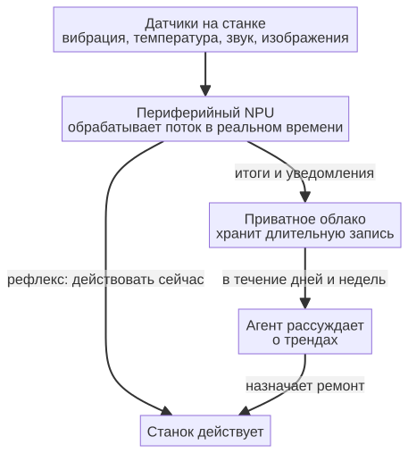

# Глава 12 --- Телеметрия как нервная система завода

## Кровь новой машины

Мы говорили о машине, которая мыслит, о облаке, хранящем её тайну, и об агенте, который однажды начнёт рассуждать обо всём, что производит машина. Но между машиной и агентом — между датчиком на шпинделе и разумом в кабинете — должен быть *поток*. Должно быть непрерывное течение информации, которое в реальном времени передаёт отчёт о том, что машина делает и как она себя чувствует. Этот поток называется **телеметрией**, и это кровь нового завода. Без него машина, которая мыслит, мыслила бы в вакууме; облако, хранящее тайну, имело бы нечего хранить; агент, который должен рассуждать, имел бы нечего обсуждать. Телеметрия делает завод живой системой, а не совокупностью инертного металла.

Давайте поймём телеметрию правильно, потому что это слово nowadays бросают наветрено, и потому что понимание её необходимо для понимания всей цепи. Телеметрия — это просто *данные, измеренные в одном месте и автоматически, непрерывно передаваемые в другое*. Слово происходит от греческого *tele*, «далеко», и *metron*, «мера» — измерение далёких вещей. Оно родилось в кабине самолёта, где приборы передавали состояние двигателей пилоту в реальном времени, и оттуда перекочевало в вычисления, где стало означать автоматическое сбор и передацию оперативных данных.

Стоит задержаться на этом происхождении, потому что слово несёт своё значение в своих костях. Телеметрия, по сути, родилась из *страха* — страха астронавта или пилота, который должен полностью доверять машине, чьё поддержание жизни зависит от данных, которые он не может видеть своими глазами. Ракеты ранней космической программы, особенно программа «Аполлон», были среди первых крупномасштабных пользователей телеметрии, потому что ракета — это крайний пример машины, внутреннее состояние которой — температура, давление, расход топлива — нельзя наблюдать напрямую, как только она покинула землю. Единственный способ узнать, что она делала, — это *измерить её в одном месте и передавать, непрерывно, в другое*. Завод шестой революции сталкивается с идентичной, albeit более тихой, зависимостью: мы не можем *видеть* глазами, собирается ли шпиндель выйти из строя; мы можем лишь измерить его состояние и передать его. Метафора не декоративна; она структурна. Завод тоже должен доверять своей телеметрии.

## Что сообщает машина

На производственном полу телеметрия, которую может производить современная машина, на самом деле удивительно богата — намного богаче, чем горстка чисел, которую когда-либо передавала старая ПЛК. Машина, оснащённая интеллектуальной картой из предыдущих глав, может передавать непрерывно:

- **Вибрацию и ускорение** в нескольких направлениях, раскрывая состояние подшипников, шпинделей и движущихся деталей. Подшипник, начинающий разбиваться, не выходит из строя с криком; он выходит из строя с *частотой*, небольшим периодическим возмущением в сигнале вибрации, которое человеческое ухо никогда не заметит, но которое датчик записывает полностью.
- **Температуру** в нескольких точках, предупреждая о перегреве, трении или изменении окружающей среды.
- **Электрический ток и напряжение**, раскрывая нагрузку на двигатель и, тонко, качество реза или прессовки. Режущий инструмент, становящийся тупым,.draws, почти незамеченно, больше тока; телеметрия *видит* износ до того, как деталь будет списана.
- **Звук** через микрофон, раскрывая изменения тембра машины, предшествующие отказу. Это область *акустической эмиссии*: высокочастотные «стонания», которые делает машина, когда трещина растёт, неслышимые для рабочего, но безошибочные для микрофона, настроенного на нужную полосу.
- **Изображения** через камеру, передающие — как мы видели в предыдущей части — качество и положение каждой детали.
- **Позицию, скорость и силу** для любой машины, которая движется, раскрывая, работает ли она внутри заданного диапазона.
- **Жидкость и масляные загрязнения**, раскрывая износ внутренних компонентов, когда микроскопические частицы переносятся через смазку, каждая частица — небольшая запись о том, что машина делала.

Каждый из этих потоков сам по себе — число, меняющееся со временем. Вместе они — *история*: непрерывное повествование о состоянии машины. И здесь вступает интеллектуальность шестой революции, не в *сборе* телеметрии — эта часть механическая и дешёвая — но в её *чтении*. NPU на машине читает поток не как список чисел, а как *сигнал здоровья*, распознавая момент, когда история меняется с «хорошо» на «предупреждение». Облако получает поток и сохраняет его, согласованным и доступным для поиска, никогда не читая его. Агент рассуждает над потоком и решает, что с ним делать.

## Стоимость и повсеместность измерения

Существует один экономический факт, который делает шестую революцию возможной, и его стоит назвать, потому что революции возможны лишь тогда, когда необходимые компоненты становятся дешёвыми. Датчик — акселерометр, термопара, микрофон — за последние два десятилетия стал поразительно дешёвым. Современный MEMS-акселерометр, достаточно маленький, чтобы поместиться на кончике пальца, стоит копейки при массовом производстве; микрофон для акустической эмиссии likewise дешёв; камера для машинного зрения, по той же логике, обыденна. Это та же история, которая сделала возможной смартфон и которая сделала возможной облако: компоненты, делающие непрерывное измерение доступным, упали в цене быстрее, чем кто-либо предсказывал, и завод просто унаследовал эту дешёвость.

Вот почему сбор телеметрии, как мы говорили, «механический и дешёвый». Трудная часть — та часть, которая действительно трудна — никогда не является *измерением*; это *чтение*. Сто датчиков на машине бесполезны, если что-то не сможет осмыслить поток, который они производят. Шестая революция побеждает не добавлением больше датчиков; она побеждает добавлением больше *внимания* к данным, которые уже производят датчики. Дешёвость измерения дана; интеллектуальность чтения — это вся задача.

## Требование реального времени

Предыдущие главы установили, что машина должна воспринимать и действовать *локально*, в реальном времени, потому что круговое путешествие в облако слишком медленно и утекает приватность. Следовательно, телеметрию нужно понимать на двух уровнях, и полезно держать их раздельно.

На **краю** — на самой машине — наиболее срочная телеметрия обрабатывается локально и мгновенно. Сигал вибрации, который говорит «подшипник вот-вот выйдет из строя», читается на месте, NPU, потому что решение, которое он поддерживает, должно быть принято за микросекунды. Здесь телеметрия — рефлекс.

На **облаке** — приватном, облаке с нулевым знанием, хранящемся внутри стен — телеметрия собирается, сохраняется и становится доступной для поиска со временем. Здесь это не рефлекс, а *память*: непрерывная запись о жизни машины, которую агент может рассуждать над днями, неделями и месяцами. Здесь ценность не в скорости, а в *истории*: способности видеть, задним числом, как машина старела, выходит ли из строя закономерность, как сравниваются две машины на двух линиях.

Два уровня не конфликтуют. Край обрабатывает то, что должно быть решено *сейчас*; облако помнит то, что должно быть понято *со временем*. Оба являются телеметрией. Оба питают шестую революцию. Край — это рефлекс; облако — это память. Агент — это разум, который читает оба.

## Урок Аполлона-13

Слово «телеметрия», как мы говорили, родилось в кабине и в комнате управления, и самое знаменитое уроки в его силе пришло в апреле 1970 года, когда космический аппарат «Аполлон-13» suffered взрыв в кислородном баке по пути к Луне. История хорошо известна, но обычно рассказывается как история мужества и импровизации. Стоит рассказать её на минуту как историю о *телеметрии*, потому что именно она сделала возможными мужество и импровизацию.

Как только аппарат покинул Землю, экипаж не мог *видеть* повреждение своими глазами; они могли лишь видеть его через приборы и показания, которые передавались непрерывно в Центр управления полётами в Хьюстоне. Когда произошёл взрыв, телеметрия сообщила контролёрам полёта то, что они никогда не могли бы увидеть с земли: какие системы выходят из строя, как быстро истекает кислород, что происходит с температурой и давлением в баках. Именно телеметрия — непрерывный, честный отчёт о внутреннем состоянии машины — позволила контролёрам понять за минуты, что миссия не сможет сесть на Луну и что реальная задача стала доставкой экипажа домой.

И вот часть, которая важна для завода. Контролёры не просто *читали* телеметрию; они *рассуждали* над ней, и рассуждали с инженерами, которые построили машину, пока не смогли превратить сырой поток чисел в план. Знаменитый импровизированный фильтр диоксида углерода — собранный, в пространстве, из скотча, картона и пластикового пакета — был *действием* в дальнем конце телеметрии: данные сделали проблему видимой, рассуждение превратило проблему в план, и план стал действием. Измеренный в одном месте (аппарате), непрерывно переданный в другое (Хьюстоне), рассуждаемый третьим (командой полёта), и наконец предпринятый — это вся цепь шестой революции, сжатая в одну отчаянную неделю в 1970 году.

У завода нет астронавтов и нет Луны, но у него есть, в миниатюре, та же зависимость. Инженер, который не может *видеть* износ подшипника, может лишь *измерить* его и прочитать отчёт. Разница в том, что шестая революция помещает рассуждение *ближе* к данным — на чип, в облако внутри стен — так что план и действие не должны ждать комнаты, полной контролёров, и машина может, в новейших системах, действовать на свою телеметрию вообще без человека в контуре. Аполлон-13 — это предок машины, которая мыслит; просто машина научилась быть своим собственным Центром управления полётами.

## Проблема объёма

Существует практическая сложность, которую романтическое описание телеметрии склонна скрывать, и её стоит встретить честно: данные, которые производит современная машина, *огромны*. Один датчик вибрации, семплирующий много раз в секунду, производит миллионы показаний в день. Умножьте это на дюжина датчиков на машине, сто машин на линии и флот заводов, и поток становится наводнением — терабайты в день в крупной операции. Никакое облако, как бы приватное, не может просто *хранить всё навсегда*; и никакой человек, как бы дiligентный, не сможет прочитать наводнение.

Вот почему телеметрия шестой революции — это не один размер данных на одной скорости, а *двухуровневый* дизайн, и стоит нарисовать его plainly:

На **краю** машина читает свой собственный поток на полном разрешении, потому что рефлекс должен быть мгновенным, и сырой сигнал должен быть исследован во всех деталях. На **облаке** машина отправляет *суммаризации* — даунсамплированные истории, извлечённые признаки, предупреждения и случайные окна полного разрешения вокруг события — так что длинная запись сохраняется без сохранения каждого байта. Край читает наводнение; облако сохраняет историю; агент рассуждает над историей. Так завод может наблюдать за всем, не утопая в нём: сырые данные потребляются там, где они производятся, и лишь их *значение* отправляется дальше, зашифрованным, в приватное облако.

Этот дизайн имеет вторую, более тихую выгоду, и её стоит назвать. Проблема объёма — это также *приватная* проблема: если бы всё отправлялось в облако, всё было бы под риском. Суммаризируя на краю, машина отправляет *минимум*, который нужен — предупреждение, тренд, извлечённый признак — и сохраняет глубокую, сырую, интимные данные своей собственной операции локально. Телеметрия, которая путешествует, следовательно, не merely зашифрована; она *сокращена*. Завод делится историей, не сырым исповеданием. И это, в мире, который научился недоверять облаку, именно правильная форма доверия.

## Поток как общая истина

Существует ещё одно качество, который делает этот поток особенным, и оно напрямую связано с приватным облаком предыдущей главы. В старом заводе телеметрия обычно была *локальной*: она отображалась на машине или регистрировалась в файл в комнате, видимая лишь тому, кто случайно там был. Шестая революция делает телеметрию *общей* — непрерывно синхронизируемой, в реальном времени, по всей компании, ко каждой машине, кабинету и агенту, у которого есть на неё право. Это то, чего достигает приватное облако: одна живая копия телеметрии завода, всегда согласованная, всегда доступная, никогда не выходящая из-под контроля компании.

Существует фраза из мира баз данных, которая описывает именно это качество, и её стоит позаимствовать, потому что она называет трудноодержимый урок. Она называется **сильной согласованностью**: гарантией того, что каждый читатель, в каждый момент, видит *ту же самую* копию данных — что нет версии на одной машине и другой версии на другой, медленно расходящихся. В старом заводе два техника могли смотреть на две разные машины и прийти к двум разным заключениям, потому что их телеметрия не была общей. Шестая революция устраняет эту возможность: с приватным, сильно согласованным облаком, датчик на шпинделе, модель в облаке и агент в кабинете все смотрят на — и действуют на — *ту же самую* живую истину. Нет другого способа управлять заводом, который должен быть уверенным; вы не можете быть уверенными в вещи, которая разная на каждой машине, которая её наблюдает.

Эта общая, телеметрия реального времени — это соединительная ткань всей цепи. Именно она позволяет датчику на шпинделе, модели в приватном облаке и агенту в кабинете все смотреть на — и действовать на — *ту же самую* живую истину. Это кровь, которая течёт от машины, через облако, в кабинет и снова обратно. И теперь, когда мы установили, что это кровь и как она течёт, мы можем обратиться к финальному вопросу всей цепи: *кто её читает и как?* Кровь, как и в любом живом теле, должна быть прочитана разумом. Этот разум — предмет следующей части этой книги, и именно здесь история делает своё самое неожиданное поворот, потому что разум, который читает телеметрию, не, в новейших системах, человек вообще.
