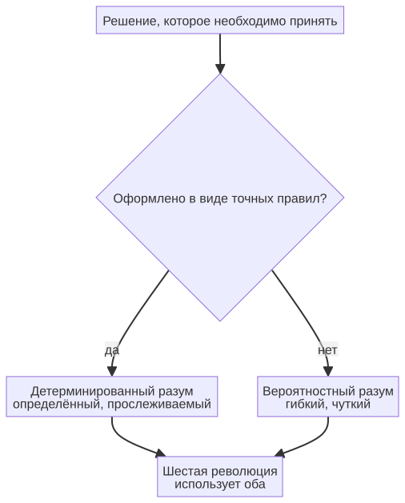

# Глава 13 --- Два вида ума

## Выбор, который никто не просит

Существует решение, которое принимает почти каждый, строящий шестую революцию, не замечая этого никогда, и оно является самым важным решением во всей истории. Это не вопрос «следует ли нам использовать ИИ». Это вопрос «какой *вид* ИИ?» И это выбор между двумя принципиально разными философиями разума, двумя видами ума, которые согласны почти ни в чём, кроме их внешних результатов.

Чтобы понять выбор, рассмотрим простейший возможный пример: машину, которая должна решить, является ли деталь, которую она осматривает, хорошей или дефектной. Есть два способа принять это решение, и они исходят из двух разных миров.

## Первый вид ума: Ум-гадатель

Первый вид ума — это тот, с которым вы уже встретились, в датчике на шпинделе. Это ум *вероятностной* модели — нейронной сети, которая обучилась, на тысячах примеров, *гадать* наиболее вероятный ответ. Это разум эпохи глубокого обучения: его питают множеством примеров хороших и дефектных деталей, и он подстраивает себя до тех пор, пока его догадки не совпадут с реальностью. Когда прибывает новая деталь, он не применяет правило; он производит *вероятный ответ*, взвешенный всем тем, что он видел.

Этот ум-гадатель — чудо современной эпохи, и он поразительно хорош в задачах, для которых он был обучен. Он может распознавать царапину, предсказывать отказ, читать штрих-код в темноте. Он преуспевает там, где правила нельзя записать явно, но правильный ответ можно *показать* — в восприятии, в распознавании образов, в обработке беспорядочных, реальных данных. Именно поэтому глубокое обучение покорило распознавание изображений, перевод и язык одним махом: во всех этих областях вы не можете записать правила, но можете показать миллион примеров.

Но у ума-гадателя есть характер, который мы должны назвать тщательно, потому что именно этот характер есть вся разница в шестой революции. Он **вероятностный**. Он даёт свою лучшую догадку, но до этой точки он дал вам лишь догадку. Он может ошибаться, даже когда звучит уверенно. В нём от природы заложён *элемент дискреции*: обучающие данные содержат предубеждения, а вывод является обученным приближением, а не достоверностью. Для распознавания царапины на бутылке догадка вполне приемлема. Для решения, является ли тормозная система автомобиля безопасной, догадка не просто недостаточна; она неприемлема.

## Второй вид ума: Ум-вычислитель

Существует второй вид ума, и он старше первого более чем на полвека. Это ум *детерминированного* вычисления. Он не гадает; он *вычисляет*. Он не обучается на примерах; он применяет фиксированные правила к заданным входам и производит каждый раз, *один и тот же ответ с математической достоверностью*. Это ум компилятора, ум, который превращает ваш исходный код в машинные инструкции ровно один раз, каждый раз, навсегда, без дискреции и без предубеждения, без дрейфа и без догадки.

Вы встречали и этот ум, хотя, возможно, не называли его «разумом». Когда вы компилируете программу, компилятор применяет фиксированные правила к вашему коду и производит фиксированный результат. Он не может быть «ошибочным» в том смысле, в каком может быть ошибочным гадающая модель; он может быть лишь правильным или неправильным, и его правильность доказуема. У него нет мнений. У него нет плохого дня. При том же входе он даёт тот же выход с той же достоверностью, что и удваивание двух, дающее четыре. Это не тот ум, который распознаёт лицо или переводит предложение — эти задачи для него невозможны. Но это тот ум, который *гарантирует*, и эта гарантия стоит её веса в золото ровно в тех местах, где догадка была бы опасна.

## Линия между ними

Два вида ума не являются соперниками в обычном смысле; они *дополняемы*, каждый силён там, где слаб другой. Ум-гадатель гибок, креативен и незаменим для восприятия и языка, но он не достоверен. Ум-вычислитель абсолютно достоверен, но он не гибок — он делает лишь то, что диктуют его правила, и его правила, по конструкции, полны и неоднозначны.

Решающий вопрос таков: **какой ум должен управлять решениями, которые наиболее важны?** Там, где исход — классификация или догадка — царапина или гладкая поверхность, ум-гадатель не просто адекватен; он единственный, который работает. Но там, где исход должен быть *достоверным* — где неверная догадка ранит человека, теряет деньги или разрушает доверие — ум-вычислитель единственный, который безопасен.

Чтобы понять, почему ум-вычислитель безопасен, полезно точно увидеть, что здесь означает «достоверный», потому что слово это проделывает большую работу. Детерминированная система — это та, чей выход *полностью определён* её входом и её правилами, без возможности для случая, без случайности, встроенной в процесс, и — что важнейше — без *враждебной* возможности для манёвра. Ум-гадатель, напротив, может быть сбит с курса входами, которые подобны, но не идентичны — явлением, которое мир машинного обучения называет *враждебными примерами*: крошечным, неощутимым изменением входа, которое может перевернуть уверенную догадку в уверенную ошибку. Ум-вычислитель не имеет подобной слабости, потому что его правила фиксированы и полны; нет пробела, через который вход мог бы провалиться. Это, более чем любая абстрактная болтовня о «достоверности», есть причина, по которой ум-вычислитель единственный, которому можно доверить решения, должны быть известны как правильные.

## Два племени ИИ

Два вида ума — это не метафора, выдуманная для этой книги; это два великих племени искусственного разума, и история их соперничества — одна из самых поучительных историй во всей области. Стоит рассказать её кратко, потому что она объясняет, почему шестая революция может теперь делать то, что ни одно из племён не могло сделать в одиночку.

Первое племя — **символьная** школа, иногда называемая «старомодным хорошим ИИ». Её убеждение было в том, что разум — это манипуляция символами согласно явным правилам — что если вы могли бы записать достаточно логики, вы могли бы ухватить саму мысль. Её великое достижение — *экспертная система*: программа, которая кодировала знания человеческого специалиста в набор правил «если-то». В 1970-х и 1980-х экспертные системы создавались для медицины (MYCIN, для диагностики инфекций), для химии (DENDRAL, для идентификации молекул) и для бизнеса (XCON, для конфигурации компьютерных заказов), и некоторое время они были наиболее коммерчески успешной формой ИИ из когда-либо созданных. По сути, они были умом-вычислителем: детерминированным, основанным на правилах, проверяемым и достоверным внутри их домена. Их слабость была столь же ясна — они были *хрупкими*. Они работали внутри узкого набора правил, которые им были даны, и плохо терпели вне его, потому что реальный мир полон случаев, для которых никто не записал правило. Когда рынок экспертных систем рухнул в конце 1980-х, он унёс с собой репутацию первого племени.

Второе племя — **соединительная** школа — нейронные сети. Е её убеждение было почти противоположным: что разум — это не набор написанных правил, а *образ, обученный на примерах*, сеть из простых единиц, которая подстраивает себя до тех пор, пока не совпадёт с миром. Идея старше, чем думает большинство людей: Франк Розенблатт создал *перцептрон* в 1958 году, простую обучающую машину, и она была встречена огромным оптимизмом. Но перцептрон имел пределы, и знаменитая книга 1969 года Марвина Минского и Сеймура Паперта обнажила их настолько эффективно, что исследования нейронных сетей затихли более чем на десятилетие — «зимняя» эпоха соединительного племени. Потребовалось дойти до 1980-х, чтобы *обратное распространение ошибки* дало нейронным сетям способ обучать глубокие структуры, и до 2012 года, чтобы сочетание больших данных и быстрых чипов (момент AlexNet, который мы видели в хронологии) сделало их внезапно, великолепно хорошими. Это второе племя — ум-гадатель: гибкий, проницательный и вероятностный.

Десятилетиями два племени сражались, и каждое принижало другое. Символьщики говорили, что у соединительных нет теории и нет гарантий; соединительные говорили, что символьщики никогда не смогут справиться с беспорядочностью реального мира. Каждое было право относительно слабости другого и слепо относительно собственной. Тихое прозрение шестой революции — то, что эта глава призвана передать, — в том, что сражение всегда было ошибкой. Два племени не соперничают за один и тот же трон; это два *разных инструмента для двух разных работ*, и фабрике, которая мыслит, нужны оба.

Схема — это весь аргумент в одной картинке. Когда решение можно записать как точные правила — когда специция полна и вход хорошо определён — детерминированный ум является правильным инструментом, и он *превосходен*, потому что он достоверен. Когда решение нельзя записать как правила, но можно лишь *показать* через примеры — распознавание, язык, предсказание — вероятностный ум является единственным инструментом, который работает. Мудрая фабрика не выбирает племя; она спрашивает каждую решение, инструмент какого племени подходит, и использует тот. Это и есть шестая революция, и это разрешение пятидесятилетнего спора.

## Спорная позиция

Здесь проекты, стоящие за этой книгой, занимают характерную и, по словам некоторых, спорную позицию. Они утверждают, что гораздо больше решений фабрики, чем признаёт большинство инженеров, могут — и должны — приниматься *детерминированным* умом, фиксированными правилами и точными специциями, а не умом-гадателем. Они утверждают, что огромное то, что мы рассеянно называем «ИИ», на самом деле отлично обслуживается детерминированным вычислением, и что стремление к вероятностной модели там, где достоверность возможна, не просто ненужно, но *опасно*.

Это не люмидитское отвержение машинного обучения. Это, совершенно наоборот, убеждение, что уверенный ум следует использовать везде, где можно, чтобы неопределённый ум сохранялся — бережливо — для задач, где он один преуспевает. Чтобы понять эту позицию полностью, мы должны взглянуть на проект, который воплощает её наиболее целиком, на технологию, которая превращает скомпилированную программу в специцию, которую можно выполнить без какой-либо догадки вообще. Это предмет следующей главы.

## Что на самом деле покупает гарантия

Стоит спросить конкретно, что *стоит* гарантия ума-вычислителя — потому что «достоверность» может звучать как слово философа, пока вы не увидите, что происходит, когда её нет. История вычислений имеет несколько наставительных уроков, и два из них стоят того, чтобы рассказать, потому что они показывают, в крови и деньгах, почему шестая революция не может покоиться на догадках там, где требуется достоверность.

Первый — это **Therac-25**, управляемый компьютером аппарат лучевой терапии, использовавшийся в 1980-х. Он был спроектирован для доставки точных доз радиации пациентам с раком, и он полагался на программное обеспечение для управления пучком. Серия ошибок программирования — тонких, взаимодействующих багов, которых ни один отдельный тест не поймал бы — позволила машине при определённых последовательностях ввода оператора доставлять массивные передозировки. Несколько пациентов были убиты или тяжело ранены. Программное обеспечение машины было, в смысле, «детерминированным» — оно ровно делало то, для чего было написано — но оно *не было проверено*, и его детерминизм доставлял неверный результат с совершенной достоверностью. Урок не в том, что детерминизм плох; он в том, что детерминизм без проверки есть лишь надёжный способ быть неправым.

Второй — это ракета **Ariane 5**, которая взорвалась на своём первом полёте в 1996 году, менее чем через минуту после запуска. Причиной было переполнение программного обеспечения: значение, которое было совершенно безопасно в более маленькой Ariane 4, превысило диапазон 16-битной переменной в более мощной Ariane 5, и вызванная ошибкой программа вывела из строя систему наведения. Код был, снова, детерминированным; он ровно делал то, для чего был написан. Но он был написан для другой машины, и никто не проверил, что предположения всё ещё справедливы. Ракета не потерпела крах из-за случайного сбоя; она потерпела крах потому, что детерминированная система, применённая вне её проверенного домена, *достоверно* неверна.

Эти истории — причина, по которой домены сертификации — авиация, медицина, атомная энергетика — не принимают «это работает в демо». Они требуют *доказательства*: что поведение программного обеспечения было проверено относительно его специции, что каждое предположение задокументировано, и что всю цепь можно проверить. Это дисциплина, которую авиационная промышленность называет **DO-178C** — стандарт, который регулирует, как разрабатывается и проверяется бортовое программное обеспечение, и который требует, среди прочего, чтобы требования были прослеживаемы до самого кода и обратно. Это стандарт, построенный на едином убеждении: система, которая перевозит людей через воздух, должна быть *известна* как правильная, а не merely *вероятно* правильной.

Это именно то, что детерминированный ум, правильно использованный, может доставить — и то, что ум-гадатель не может. Детерминированная система, построенная из проверенной специции, может быть прослежена, шаг за шагом, от исходного кода до решения, и всю цепь можно проверить. Верностную модель можно протестировать, и её можно показать как точную на тестовом наборе, но её нельзя *доказать* правильной, потому что её поведение, по конструкции, есть обученное приближение. Там, где стоимость неверного ответа измеряется жизнями или состояниями, разница между «протестированным» и «доказанным» есть разница между продуктом и ответственностью. Гарантия — это не роскошь; это лицензия на работу.

## Почему ум-вычислитель можно доказать

Есть ещё одна вещь, которая делает ум-вычислитель стоящим его места в шестой революции, и это вещь, которую ум-гадатель никогда не может предоставить: *доказательство*. Когда детерминированная система что-то решает, возможно — в принципе, и часто на практике — *доказать*, строго и полностью, что решение правильно. Это обещание дисциплины, известной как *формальная проверка*: машина применяет фиксированные правила к фиксированной специции, и всю цепь рассуждений можно проверить машиной, с той же достоверностью, что и математическое доказательство. Никакую догадку нельзя доказать; доказательство можно.

Это именно то качество, которое требуют домены сертификации — домены, которые мы встретим в следующих главах, где решение, которое должно быть достоверным, должно также быть *показано* как достоверное. Верностную модель можно сказать, что она на 99,9% уверена; она не может сказать *почему*, и она не может доказать, что оставшиеся 0,1% не укусят. Детерминированная система может сделать и то, и другое. Ум-вычислитель есть, в этом строжайшем смысле слова, единственный ум, который может предстать перед аудитором — перед ассессором ISO, экзаменатором SOC 2, ревьюером HIPAA — и продемонстрировать, шаг за шагом, что его решение правильно. Это не техническое любопытство; это весь объём гарантии.
