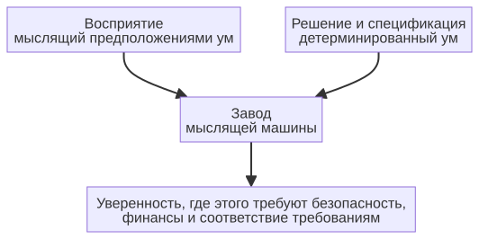

# Глава 15 --- Когда важна достоверность

## Там, где догадка является преступлением

Мы уже познакомились с двумя видами ума — догадчивым умом, который гибок, но достоверен лишь в отсутствии чего-либо, и вычислительным умом, который достоверен, но не склонен к импровизации. Мы видели, что догадчивый ум — это чудо для восприятия и языка, а вычислительный ум — единственный безопасный выбор там, где решение должно быть *известно* как правильный. Вопрос, на который отвечает эта глава, прост и решителен: **где именно в думающей фабрике решение должно быть достоверным?**

Ответ — «в большем числе мест, чем вы могли бы подумать», и именно концентрация этих мест делает шестую революцию отличной от предыдущих. Назову области, потому что в каждой из них вероятностная догадка не просто недостаточна, но опасна, и в каждой из них детерминированный ум — ум, который может *доказать* своё решение — является единственным приемлемым.

## Область безопасности

Рассмотрим промышленную систему управления, которая руководит роботизированным манипулятором, работающим рядом с человеком. Если решение о безопасности этого манипулятора принимается догадливой моделью, то в модели скрывается небольшая, но ненулевая вероятность того, что она ошибётся в суждении — что в утро с необычным светом или необычной позой она примет решение «безопасно», когда реальность есть «опасно», и человек будет ранен. Эта вероятность не обязана быть большой; ей достаточно быть большей нуля, и даже крошечная вероятность, применённая через миллионы решений по всей фабрике, становится реальным риском.

В критичных к безопасности системах ненулевая вероятность катастрофической догадки неприемлема. Решение должно быть *достоверным*: либо безопасно, либо опасно, доказательно, каждый раз. Именно поэтому детерминированный ум — ум, который вычисляет с помощью фиксированных правил и даёт гарантированный ответ — является единственным, которому можно доверить безопасность. Та же логика правит авиационной промышленностью, где поведение системы должно быть доказуемым для органа, который сертифицирует её перед тем, как единый пассажир будет допущен на борт. Достоверность не является роскошью в этих областях; это цена допуска.

Мир сертификации называет это требование точно, и эти названия стоят того, чтобы их знать. Функциональная безопасность — безопасность системы *вследствие её правильного поведения* — регулируется в промышленности такими стандартами, как **ISO 26262** (автомобильная промышленность) и **IEC 62443** (промышленное управление и автоматизация), которые требуют прежде всего, чтобы поведение системы было *предсказуемым, проверяемым и доказуемым*. Верностная модель не может этого удовлетворить: её поведение по своей природе не является полностью предсказуемым, и её нельзя доказать правильной. Детерминированная система может. Это не вопрос вкуса; это условие, при котором система, критичная к безопасности, вообще разрешена к эксплуатации.

## Область финансов

Вторая область — финансовая и бюрократическая. Фабрика — это не только место, где вещи производятся; это ещё и место, которое выставляет счета, сводит балансы, отчитывается перед налоговыми органами, обрабатывает контракты. В каждом из этих случаев догадка не просто недостаточна, но *ответственна*. Счёт с неверной цифрой не есть «вероятно правильно»; он неверен, и его нужно исправить, и он может повлечь за собой штрафы. Пункт контракта, истолкованный неправильно, не есть «вероятно правильно»; это спор, потеря, иск.

И здесь детерминированный ум является безопасным выбором, и здесь он проявляется в особенно интересной форме. Потому что правила бухгалтерского учёта, налогообложения, договорного права — в отличие от правил зрения или языка — *записаны и явны*, их можно закодировать и выполнить детерминированно. Решение, следующее фиксированным, проверяемым правилам, не есть догадка; это вычисление, которое можно проверить, воспроизвести и доказать правильным. Именно это детерминированный подход, который лаборатория за этой книгой применяет к офисной стороне фабрики, и именно это делает агента надёжным с деньгами и словами, которые компания не может себе позволить исказить. Финансовая область есть, в этом отношении, естественный дом вычислительного ума: правила уже записаны, так что задача не в том, чтобы их *научиться*, а в том, чтобы *применить* их точно.

## Область соответствия

Третья область — регулирующая — мир стандартов, сертификаций и аудита. Стандарты ISO, SOC 2, HIPAA и их промышленные родственники не спрашивают «было ли ваше решение вероятно правильным?». Они спрашивают «можете ли вы *доказать*, что ваше решение правильно, каждый раз, и отследить его обратно к его источнику?». Верностная модель не может ответить ни на один из этих вопросов, потому что модель, которая догадывается, не имеет доказуемого следа. Детерминированная система может ответить на все, потому что её решение выведено из проверенной спецификации через фиксированные правила, и весь след — от исходного кода до решения — прозрачен и воспроизводим.

Для фабрики в регулируемом секторе — медицинском, финансовом, аэрокосмическом, энергетическом — соответствие есть не форма, которую нужно заполнить; это условие существования. И лишь тот вид интеллекта, который может удовлетворить орган соответствия, есть тот, чьё поведение детерминировано, отслеживаемо и доказуемо. Именно поэтому детерминированный ум не является технической курьёзностью в этих секторах, но *требованием*.

## Отслеживаемый след

Есть ещё одна вещь, на которую орган соответствия на самом деле обращает внимание, и её стоит назвать, потому что она есть конкретная, физическая вещь за абстрактным словом «достоверность». Аудитор не спрашивает «вероятно ли ваша система правильна?»; они просят *показать след*. Они хотят наблюдать за единым решением, идущим назад, от ответа ко всему пути его происхождения, и хотят видеть, на каждом шаге, что шаг был *определён* — фиксирован, воспроизводим и свободен от усмотрения.

Это именно тот след, который детерминированный ум может произвести, и это тот след, который описан в предыдущей главе. Он идёт, неразрывно, от исходного кода до решения: исходный код производит сборку через *компиляцию* (детерминированный процесс), а сборка приводит к решению — будь то пользовательский интерфейс, сгенерированный API или вычисленный вердикт — через *фиксированную алгоритмическую трансформацию*. Каждый элемент можно отследить к его происхождению, и каждый шаг можно воспроизвести. Это соответствие между спецификацией и имплементацией есть, в мире сертификации, всё требование. Когда фронтенд выводится из проверенного бэкенда через детерминированные правила, соответствие между тем, что было специфицировано, и тем, что было построено, есть *свойственное и доказуемое* — не надежда, не результат теста, а логическая необходимость. Именно это ищет экзаменатор SOC 2 или рецензент HIPAA: не уверенность модели, а *отслеживаемость* модели.

## Четвёртая область: само тело

Есть четвёртая область, и это та, где ставки выше всех: тело человека. Современная медицина работает на программном обеспечении, чьё поведение должно быть *достоверным*. Инфузионная помпа, доставляющая лекарство с точно контролируемой скоростью; кардиостимулятор, стимулирующий сердце; инсулиновая помпа, решающая по моментам, сколько гормона высвободить; машина лучевой терапии, наводящая пучок. В каждом из этих случаев вероятностная догадка не есть малое несовершенствo; это прямая угроза человеческой жизни.

Рассмотрис искусственную поджелудочную железу — систему, которая непрерывно считывает уровень сахара в крови человека и решает автоматически, сколько инсулина доставить. Это прекрасная идея, и она уже реальна, но это также система, в которой неверное решение может, внутри минут, ввести человека в кому. Решения, которые она принимает, должны быть *достоверными* в своей арифметике, даже когда *чувствование* есть вероятностное (сенсор есть обученное приближение, и он может ошибаться). Искусство такой системы есть именно искусство шестой революции: использовать догадчивый ум, чтобы *воспринимать* (считывать сенсор), и детерминированный ум, чтобы *решать* (вычислять дозу по фиксированным, проверенным правилам, которые никогда не могут быть неверными). Два ума, каждый на своём месте, защищают тело, которое им доверяет.

Именно поэтому мир медицинских устройств регулируется стандартами столь же строгими, как любые в инженерии, и почему устройство, который «работает большую часть времени», не есть устройство вообще. Регулятор не спрашивает, *вероятно* ли машина быть безопасной; он спрашивает, *известно* ли машина быть безопасной, по всем входам, которые она когда-либо могла получить. Это родная земля детерминированного ума, и именно поэтому, в шестой революции, тело есть одно из мест, где достоверность не подлежит обсуждению.

## Короткая история инженерной достоверности

Требование достоверности в инженерии старше вычислений, и её история есть одна из самых поучительных во всей технологии. Прежде чем кто-либо написал строку программного обеспечения, инженеры обучались — часто через катастрофу — что система, которая летит с людьми через воздух, или удерживает мост, или содержит ядерную реакцию, не может быть построена на «кажется, работает».

Братья Райт, в начале 1900-х, есть небольшой, но показательный пример: они не просто построили летательную машину; они построили *ветряную туннель*, чтобы измерить точно и повторно силы на их крыльях, так что их дизайн опирался на измерение, а не на надежду. Из этой культуры выросло дисциплинирование авиационной безопасности, которое, после серии ужасных аварий в двадцатом веке, затвердело в набор стандартов, которые ничего не предполагают и требуют, чтобы всё было *доказано*. Это родство DO-178C, стандарта, с которым мы познакомились в предыдущей главе, и всей культуры проверки, которая правит полётами до сегодняшнего дня.

Вычисления унаследовали эту культуру и, поначалу, не соответствовали ей. Ранние десятилетия программного обеспечения были длинным уроком о стоимости *непроверенного* детерминизма — систем, которые делали ровно то, что были запрограммированы, и были ровно неверны. Из этих уроков выросло поле **формальных методов**: использование математического доказательства, чтобы показать, что поведение программы соответствует её спецификации, в каждом возможном случае. Формальные методы сложны, и они не используются повсюду, но они существуют, и они есть причина того, что программное обеспечение управления полётом современного самолёта может быть сертифицировано, а современная платёжная система может быть доверена миллиарду транзакций.

Урок этой истории, для шестой революции, в том, что достоверность не есть *дар* технологии; это *дисциплина*, которую нужно выбрать. Детерминированная система не автоматически есть *правильная* система — Therac-25 и Ariane 5 были оба детерминированными, и оба были катастрофически неверными. Достоверность требует, чтобы детерминизм был *проверен*: чтобы правила были проверены, допущения исследованы, вся цепь доказана. Когда шестая революция говорит, что решение должно быть достоверным, она означает именно это — не просто «машина будет делать ту же вещь каждый раз», но «машина была показана делающей *правильную* вещь каждый раз». Это более высокая планка, и это планка, которую требуют области безопасности, финансов, соответствия и медицины.

## Комбинированный интеллект

Важно, раз за разом, настаивать, что эта глава не аргументирует за *замену* догадчивого ума. Догадчивый ум остаётся незаменимым для восприятия, предсказания и языка — задач, где правильный ответ может быть показан, но не записан. Фабрика, которая думает, должна поэтому нести *оба* ума, и разворачивать каждый там, где это безопасно делать:

Слой чувствования — камера, которая видит царапину, датчик вибрации, который предсказывает сбой — есть догадчивый ум, и он идеален для его задачи. Но слой, который *решает*, что делать с чувствованием, который проверяет решение, который доказывает его правильным и отслеживает к источнику, есть детерминированный ум. Два объединены, каждый на своём месте, и именно это объединение делает фабрику надёжной в местах, где доверие не подлежит обсуждению.

## Честная линия

Давайте проведём линию честно, потому что честность есть вся добродетель детерминированного ума. Детерминированный ум превосходит там, где спецификация *полна* и правила *известны*: где вы можете компилировать решение в фиксированные правила, или вывести его из компилированной спецификации через точную трансформацию. В этих местах он не просто безопасен; он есть лучший выбор, потому что он достоверен, отслеживаем и доказуем. Догадчивый ум превосходит там, где мир хаотичен и правильный ответ может быть лишь *обучен из примеров*: распознавание, перевод, предсказание. В этих местах ни одна детерминированная система не могла бы работать, и догадчивый ум есть единственный вариант.

Фабрика, которая думает, не выбирает между достоверностью и гибкостью; она их *комбинирует*. Она догадывается там, где догадка есть единственный способ знать, и вычисляет там, где вычисление может быть достоверным. И мудро знать, прежде чем мы двинемся к офису, который задействует оба ума, точно, где проведена линия — потому что фабрика, которая догадывается о вещах, которые должны быть достоверными, есть фабрика, строящая на песке, независимо от того, насколько умны её машины.
