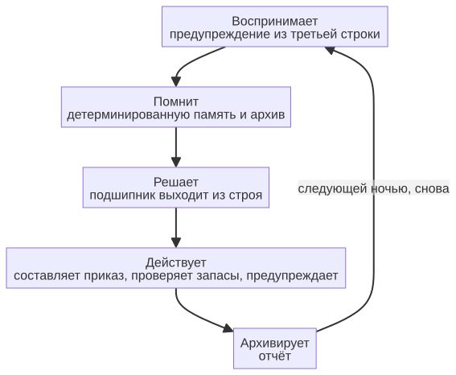

# Глава 16 --- Офис в полночь

## Свет гаснет

Существует особый род тишины, что нисходит на офис ночью, когда последний человек забрал последние свои ключи, а охранник завершил свой обход. Компьютеры остаются включёнными; серверы гудят; кофейная машина, выключенная из сети ради чайника, которого никогда нет, сохраняет своё небольшое тепло. И в этой тишине происходит то, что было бы невозможно десятилетие назад, и что по-прежнему невидимо для большинства людей, работающих в офисах днём. Работа не останавливается. Она просто перестаёт выполняться человеком.

Это видение, которое вводит данная глава, стоит сформулировать прямо, прежде чем мы погрузимся в механику, потому что оно является кульминацией всей цепи, что мы собирали. Интеллект, живущий на машине (Часть II), приватность, что удерживает данные внутри стен, и уверенность, что управляет решениями, которые должны быть уверены, — всё это сходится здесь, в офисе, чтобы сделать реальным одну поразительную возможность: офис, что продолжает работать после того, как погас свет, управляемый агентом, знающим бизнес не хуже любого сотрудника, и что никогда не спит, никогда не устаёт и никогда не протекает ваши данные.

## Различие между инструментом и сотрудником

До агента в офисе уже было множество инструментов. Были таблицы и текстовые редакторы, почтовые клиенты и базы данных, и — всё чаще — скрипты, автоматизирующие мелкие, конкретные задачи. Макрос мог оформить отчёт. Скрипт мог переместить файл из одной паки в другую. Это *инструменты*, и они полезны, но это инструменты в узком смысле: они делают ровно то, что им приказано, с документом или файлом, и ничего больше. У них нет памяти о бизнесе, нет понимания того, что работа *означает*, нет способности судить, когда задача выполнена, или приспосабливаться к неожиданному случаю.

Агент отличается по природе, и это различие стоит назвать. Агент — это не инструмент, делающий одну вещь; это *работник*, которому дана *цель* — «подготовить месячный отчёт», «свести эти счета», «предупредить менеджера, что подшипник на третьей линии выходит из строя» — и что сам выстраивает последовательность шагов, необходимых для достижения цели, используя данные ему инструменты, проверяя свою работу по ходу дела, и приспосабливаясь, когда что-то идёт не по плану. Это определяющая черта того, что называется *агентной* системой: она не просто исполняет команду; она *преследует цель с долей автономии*, планируя, действуя, наблюдая за результатом и корректируя.

И, что важно, агент за этой книгой — не безымянный, магазинный чат-бот, отвечающий на вопросы в окошке. Это система с самостойным размещением, что запускает знание *вашего* бизнеса — документы, системы, историю — на *вашем* оборудовании, удерживая это знание целиком по ту сторону стены. Это, в полном смысле, сотрудник, живущий в вашем здании и никогда не покидающий ваши пределы.

## Почему офис — последняя черта

Вы можете спросить, почему, в книге о машинах и облаках, мы тратим главу на офис. Ответ в том, что офис — это *последняя связка* в цепи, и он также — возможно, удивительно — место, где революция наиболее и наиболее заметно необходима. Десятилетиями промышленная революция преображала *цех*: физическую работу по созданию вещей. Но *офис* — работа по координации, документированию, вычислениям и общению — был почти целиком оставлен людям. Бухгалтер всё ещё считает; клерк всё ещё архивирует; менеджер всё ещё составляет; закупщик всё ещё пишет поставщикам. Эта офисная работа огромна, повторяема и всё более насыщена данными, и у неё, до сих пор, не было автоматизации, что выходит за пределы нескольких макросов.

Шестая революция достигает её. Достигает не безымянным чат-ботом, но агентом, что *привязан* к заводу — что читает телеметрию, идущую от машин, данные, удерживаемые в безопасности в приватном облаке, и решения, которые должны быть уверены — и что *доканчивает работу, которую те вещи требуют*. Агент — это точка, в которой интеллект завода становится продуктивностью офиса. Машина воспринимает; облако удерживает тайну; агент решает и действует. И работа, на которую он действует, часто есть работа офисная: бухгалтерия, право, закупки, отчётность, обслуживание клиентов.

## Любопытство: заводы, что уже продолжают работать в темноте

Прежде чем спуститься глубже в офис в полночь, стоит знать, что фраза не целиком нова для промышленности. Существует, в современном производстве, устоявшийся термин для завода, что работает сквозь ночь без единого человека в нём — *завод с выключенным светом*. Слово происходит от самого буквального из обстоятельств: в некоторых из этих заводов воздух настолько чист, а процесс настолько запечатан, что поддержание света было бы расточительством; машинам не нужно видеть, и потому им не нужен свет, и потому им не нужны люди, что иначе нуждались бы в свете, чтобы видеть. Полупроводниковая промышленность, в особенности, выстроила целые чистые комнаты, что работают без людей, потому что человек в чистой комнате сам по себе есть источник загрязнения — клетки кожи, волокна, тихое беспокойство выдыхаемого дыхания. Так завод научился, десятилетия назад, работать в темноте и в тишине, и измерять свой выпуск не в сменах своего персонала, а в непрерывном потоке единиц с линии.

Это любопытство, что стоит удержать, потому что оно делает нам две вещи сразу. Первая — показывает, что «офис в полночь» не мечта будущего, а логическое продолжение того, что уже существует на цехе: система, что продолжает производить, пока люди уходят домой. Вторая — проводит различие, что офис должен теперь научиться проводить для себя. *Завод с выключенным светом* работает ночью потому, что его работа физическая, запечатанная и измеримая — машинам не нужно читать частные контракты компании или отвечать на тревожное письмо клиента. Офис пока не знает, как погаснуть, потому что его работа не запечатана: она полна контекста, истории, точных и неповторимых фактов particularного бизнеса. Именно это агент и изменяет. Офис может, наконец, погаснуть, потому что агент — это первый работник, что не нуждается в том, чтобы видеть комнату, чтобы делать работу — ему нужен лишь собственный знания компании, удерживаемые в безопасности, и цель, достойная преследования.

## Море белоколлаковой работы

Существует один факт, что делает офис в полночь таким же большим, как он есть на самом деле, и это факт о *масштабе*, не только о технологии. Работа, что происходит в офисе — координация, документирование, вычисления, общение — в экономиках, что её выстроили, огромно больше работы цеха, и она росла без остановки. Само слово для офисного работника сравнительно молодо: «белоколлаковый» был выдуман в 1899 году американским журналистом и автором Уильямом Х. Уайтом, чтобы отличить клерка и продавца, что работали в помещении в рубашке и галстуке, от «синеколлакового» работника магазина и поля, что работали в комбинезоне. За сто двадцать лет с тех пор, как это слово было изобретено, белоколлаковая рабочая сила выросла на многие порядки. Если завод в 1920 году мог бы нанять сто мужчин у машин и горстку клерков у столов, то завод сегодня мог бы нанять сто мужчин у машин и несколько сотен клерков, вычислителей, архивариусов, планировщиков и корреспондентов у своих столов — и число последних продолжает расти, даже как бывшие механизированы.

Это великая ирония истории продуктивности двадцатого века: как машины взяли на себя *физическую* работу, *документарная* работа росла, а не убывала. Офис не сжался, чтобы заполнить пространство, что машины оставили; он переполнился. Бухгалтерская книга, когда-то вёденная в одной переплётной книге, теперь охватывает системы и регуляторов и налоговые кодексы; архивирование клерка, когда-то дело чернил и индекса, теперь охватывает документы и версии и точные слова разговора, состоявшегося три месяца назад; составление менеджера, когда-то письмо, теперь охватывает отчёты и котировки и точный язык соответствия дюжины юрисдикций. Это работа огромного, повторяемого, всё более насыщенного данными характера — и большую часть своей истории она не имела автоматизации, что выходит за пределы нескольких макросов. Шестая революция достигает её, потому что агент — это первый работник, что может читать всё это море документации так, как сделал бы опытный клерк, не уставая, не протекая, и не забывая единого слова из него.

## Офис в полночь, шаг за шагом

Чтобы увидеть, что это не только видение, но последовательность — реальная вещь, что происходит в реальном порядке — помогает понаблюдать за собственной ночью агента, нарисованной как небольшой поток, чтобы очертание работы было ясным. То, что делает агент в полночь, не одно действие, но цепь, и цепь та же, что управляет машиной: он воспринимает, он помнит, он решает, он действует, он архивирует.

Это офис в полночь, нарисованный в пяти шагах. Это не научная фантастика. Это естественное завершение цепи — и агент, что выполняет эту работу, со своим проприетарным памятью и песочницей, является предметом следующей главы. Но прежде чем спуститься в его детали, нам следует понять форму всей цепи, тем как машина, облако, агент и офис соединяются в один непрерывный круг. Эта форма — «граф Industry 7.0» — является предметом главы через одну. На теперь пусть офис в полночь стоит как предпросмотр того, что приходит.

## Реальный пример: ночная смена, что не заканчивается

Чтобы сделать это конкретным, давай понаблюдаем за конкретным офисом в полночь — не заводским офисом, но бухгалтерским офисом производителя среднего размера, того kind офиса, что существует почти в каждом городе с заводом, и что всегда, до сих пор, был местом, где дневная работа тихо просачивалась в следующий день. Годы бухгалтер на поздней смене прибывал в шесть вечера, и она делала то, что делает офис в конце дня: она закрывала книги по заказам дня, она сводила счета, что были выданы против поставок, что покинули склад, и она составляла отчёт, что менеджер прочитает в девять утра. Это была реальная работа, аккуратная работа, и была она, целиком, ручной. Если поставка была возвращена, или счёт не соответствовал его заказу, она останавливалась и преследовала расхождение вручную — по телефону, по письму, по перечитыванию бумаг. Работа не останавливалась, когда она уходила; она просто ждала её возвращения.

Теперь тот же офис работает в полночь, и работает без неё. Агент берёт за нить ровно так, как сделал бы опытный клерк. Он составляет отчёт по закрытию дня на собственном языке и стиле компании, и где человек угадал бы недостающую цифру, он *извлекает* точный Relevantный контекст — счёт, поставку, возврат — из собственного архива компании и её приватного облака, точно и без перевыведения. Где человек сделал бы одну таблицу вручную, агент может привести в движение ту же библиотеку таблиц, что использовала бы опытный клерк, строя рабочую книгу с данными, стилями и графиком на единой странице A4 и доставляя готовый файл. И где бухгалтер поздней с ранее преследовал расхождение по телефону до десяти вечера, агент проверяет склад на запасную деталь или недостающую цифру не посредством жёсткого запроса, а тем как опытный клерк — читая инвентарь, приспосабливаясь к неожиданному, и предупреждая менеджера в спокойных, простых словах. Он делает всё это без человека в здании, используя знание, что никогда не покидало компанию, и делает он это с той же надёжностью, что управляет машиной. Утром бухгалтер прибывает в девять; она не *делает* работу; она *проверяет* работу агента, и подписывает то, что верно. Это ночная смена, что не заканчивается, и это не научная фантастика.

## Собственные пределы агента

Было бы нечестно рисовать офисного агента как работника безграничного, и честность здесь ценнее энтузиазма, потому что пределы именно те, что делают агента безопасным для доверия. Агент за этой книгой — мощный работник, но он *ограниченный*, и границы эти намеренные.

Первый предел — песочница. Действия агента проходят через ограниченный периметр, встроенный в архитектуру, так что вызов инструмента не может выйти за его назначенную область; действия с файлами обратимы, благодаря версионности; и агенту дано, по замыслу, отсутствие возможностей исполнения кода, именно чтобы он не мог создавать или запускать код. Это предел, что неражный поставщик мог бы назвать отсутствующей функцией, а аккуратный — причиной, по которой агент можно вручить реальную бизнес-работу вообще.

Второй предел — знание. Агент знает лишь то, что ему было дано — документы компании, её историю, её архив — и он лишь так хорош, как тот материал. Компания с неорганизованным архивом питает неорганизованную память; компания с ясным архивом питает ясную. Агент — зеркало собственной упорядоченности компании, сделанное постоянным и извлекаемым, и он не может знать то, что никто ему не сообщил.

Третий предел — суждение. Агент предлагает; он не *отвечает*. Он может составить отчёт, проверить запас и предупредить менеджера, но он не может взять на себя ответственность за исход — то, как будет настаивать следующая часть книги, остаётся человеческим. Агент — работник, что делает дела; человек — тот, кто подписывает. И это разделение не слабость агента; это форма доверия.

## Почему офис был последним, что механизировали

Существует один вопрос, что стоит ответить прямо, потому что он делает видение яснее: почему, если цех был механизирован сто пятьдесят лет назад, офис так поздно пришёл к революции? Ответ в том, что офис не имел недостатка в инструментах; ему не хватало *контекста*. Десятилетиями офис был, если что, ещё тщательнее инструментирован, чем цех — таблицы, текстовые редакторы, базы данных, почтовые системы, корпоративные системы, что связывали счета с закупками со складом. То, чего у него никогда не было, так это работника, что мог бы реально *использовать* эти инструменты тем как делает это skilledый человек: читая контекст, помня историю, суждая, когда задача выполнена, и приспосабливаясь к неожиданному случаю. Макрос может оформить отчёт; скрипт может переместить файл из одной паки в другую; корпоративная система может вычислить счёт. Но ни один из них не может *знать бизнес* — клиентов, стиль, историю, невысказанные правила того, как именно эта компания делает свою работу. Ни один из них не может судить, что particularный счёт неверен, или что particularный клиент заслуживает исключения, или что particularный отчёт должен быть написан particularным образом.

Именно это агент и изменяет, и поэтому офис был последней чертой. Машина была механизирована первой потому, что её работа *физическая, запечатанная и измеримая* — шпинель либо вращается, либо нет, и датчики, что наблюдают за ней, не нуждаются в том, чтобы понимать компанию. Офис был механизирован последним потому, что его работа *контекстуальная, историческая и неповторимая* — она зависит от знания этой компании, её клиентов, её документов и её истории, и никакое количество написания макросов не могло бы поставить это знание. Шестая революция достигает офиса, наконец, не потому, что инструменты, наконец, прибыли, но потому, что *работник*, наконец, прибыл: агент, что знает бизнес, запущенный на вашем оборудовании, и что никогда не протекает ваши данные. И как только тот работник существует, офис в полночь перестаёт быть мечтой и становится, вполне просто, офисом, что работает.
