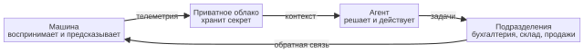

# Глава 18 --- Цепь: машина, облако и отдел

## Шаг назад, чтобы увидеть форму

Мы теперь прошли, кусок за куском, через каждый компонент шестой промышленной революции. Мы встретили машину, которая мыслит на чипе, облако, которое хранит его тайну, и агента, который знает ваше дело и никогда не забывает. По отдельности каждый из них впечатляет. Но причина, по которой этот момент — эта шестая революция — по-настоящему отличается от каждой революции до неё, в том, что компоненты не просто *присутствуют*; они *соединены* в один непрерывный цикл, в котором вывод одной становится входом для следующей, а последняя возвращается к первой. Эта глава — это шаг назад, который позволяет увидеть всю форму сразу, потому что видеть форму — это разница между кучей деталей и одной машиной.

Цикл имеет четыре стадии, и стоит удержать их в уме вместе перед тем, как мы расширим каждую:

Машина воспринимает свой мир и производит телеметрию. Приватное облако получает эту телеметрию и хранит её безопасно, согласованно и в доступе для поиска. Агент извлекает точный релевантный контекст из облака и из вашей базы знаний, решает, что делать, и действует. Его действие — это автоматизация работы отдела — бухгалтерии, склада, продаж, поддержки. А работа отдела, в свою очередь, генерирует новые требования и новые действия, которые возвращаются в машину и облако. Цикл замкнут. Завод есть, в полном смысле слова, *саморегулируемый*.

## Любопытство: слово для цикла

Стоит остановиться, в этой главе о цикле, чтобы задать простой вопрос — что мы на самом деле имеем в виду, когда называем эту форму «циклом», и откуда взялось это слово? Термин, который наиболее точно называет идею, которую мы используем, это **кибернетика**, придуманная в 1948 году американским математиком Норбертом Винером, когда он опубликовал книгу с таким названием. Слово старше дисциплины; оно приходит, без изменений, из древнегреческого *kubernan* — рулить кораблём, удерживать руль. *Кибернетес* был рулевым, тем, кто удерживал судно на курсе, постоянно читая разницу между тем, где находится корабль, и тем, куда он стремится, и корректируя эту разницу по мере того, как меняется море. Это, точно, делает наш цикл: он читает, непрерывно, разницу между состоянием завода и состоянием, в котором завод хочет быть, и корректирует эту разницу — через машину, через облако, через агента, через отделы — пока цикл замкнут.

Слово тихо несёт в себе целую философию управления. До кибернетики инженерная мысль в основном рассматривала машины как вещи, которые просто *делали* то, что им сказали, один раз. Кибернетика научила целую дисциплину мыслить вместо машин, которые *наблюдают, сравнивают и корректируют* — сервопривод, термостат, регулятор на паровой машине, водитель, который удерживает машину в полосе, постоянно поглядывая на дорогу и поворачивая руль на миллиметр. Цикл шестой революции принадлежит, по духу, этой традиции. Завод, который мыслит, есть завод, который *рулит сам собой*, и слово для этого — слово, которое мы использовали всё это время, знали мы об этом или нет.

## Офис, который уже был подключён

До шестой революции существовали реальные, задокументированные попытки сделать ровно то, что делает этот цикл — подключить машины завода к офису, который его запускает — и честно назвать их, потому что они показывают, насколько далеко пришла рынок и насколько далеко ему ещё идти. Родословная начинается, неожиданно, с учёта материалов. В 1950-х и 60-х годах человек по имени Джозеф Оликки, работавший над контролем запасов, дал рождение **MRP** — Планированию потребностей в материалах — способом вычисления, из спецификации материалов и расписания того, что должно быть построено, ровно того, какие материалы нужны и когда. В 70-х это выросло в **MRP II**, Планирование производственных ресурсов, которое взяло расписание завода, его запасы и его учёт затрат под одну интегрированную вычислительную систему. А в 80-х и 90-х годах идея расширилась за пределы заводских стен в **ERP** — Планирование ресурсов предприятия — великие интегрированные системы, которые пытаются запустить целую компанию, от её заказов до её выплат, как единый, согласованный набор чисел.

Это предшественник, который мы должны назвать, потому что шестая революция есть, в смысле, *следующий* шаг по той же дороге. ERP была революцией сама по себе — это было первое программное обеспечение, достаточно амбициозное, чтобы рассматривать компанию как один непрерывный систему, а не как совокупность рабочих мест. Но у неё была структурная граница, которую шестая революция преодолевает, и граница стоит того, чтобы её сформулировать, потому что это граница, которая делает внутреннее облако необходимым. Классическая ERP подключала *офис* к самому себе: счета к закупкам к складу. То, что она не подключала и не могла подключить, это *машина* — физическая реальность заводского пола, видимая через чип на шпинделе, в реальном времени. Это была офисная система, смотрящая внутрь, на бумажную работу; шестая революция есть офисная система, смотрящая *наружу*, на машину, а затем снова внутрь, в цикле. Цепь, которую мы нарисовали, есть брак тех двух родословных: интегрированная вычислительная система ERP, наконец, соединённая с живым восприятием машины и приватной памятью облака.

## Направление цикла

Не следует проходить мимо порядка этих стадий, потому что порядок значим. Цикл начинается с *физического* — машины, которая воспринимает, — потому что шестая революция по существу о том, чтобы принести интеллект в физический мир создания вещей, а не только о мире бумаги и данных. Интеллект не парит свободно; он *закреплён* за реальным состоянием завода. Затем он течёт *внутрь* — к приватному облаку, которое хранит его безопасно, — а затем *вверх* — к агенту, который рассуждает из него, и к отделам, которые действуют на него. Это направление ценности: от физической реальности машины, через безопасную память облака, к суждению агента, к действию офиса.

Заметьте также, что это намеренно *противоположно* старой модели. В старой модели интеллект жил в комнате, полной компьютеров, а машины на полу были глупыми приводами-рабами; интеллект приходил *вниз* на пол, плохо, как набор правил. В шестой революции интеллект *встроен в* машину, и он течёт *наружу* — через облако, которое контролирует компания, через агента, который знает дело, — чтобы автоматизировать работу, которая была, до сих пор, целиком человеческой. Направление обращено, и вместе с ним вся экономика завода.

## Ключевое слово: внутреннее облако

Есть одна фраза в схеме, которая заслуживает повторения, потому что это фраза, которая делает весь цикл политически и технически возможным: **внутреннее**, приватное облако. Каждая более ранняя попытка подключить машины компании к её офису проходила через *публичное* облако — гигантские, централизованные центры обработки данных, которые datagate доказал, могли быть прочиты или вынуждены быть прочитыми третьей стороной. Это сделка, которую не может сделать ни одна компания, ценящая своё будущее, потому что телеметрия, текущая из машины, есть ровно картина будущего компании, сделанная видимой. Публичное облако превратило бы этот самый чувствительный актив в чьи-то данные.

Внутреннее, приватное, облако с нулевым знанием — облако, удерживаемое внутри стен — есть то, что позволяет циклу замкнуться без предательства. Оно получает телеметрию машины, оно хранит её согласованно и в доступе для поиска по всей компании, и оно даёт агенту извлечь точный релевантный контекст — и во всём этом оно никогда не узнаёт содержимое, потому что компания хранит ключ. Цикл поэтому может непрерывно работать, безопасно и приватно, и это единственный вид цикла, который компания может доверить своему собственному будущему. Это тема Части III, повторяемая здесь, потому что это причина, по которой цикл вообще возможен.

## Цикл, измеренный в данных

Чтобы сделать цикл конкретным, помогает увидеть ровно то, что течёт через него, потому что цикл не абстракция — это поток конкретных вещей, движущихся в конкретном направлении, с конкретной скоростью. Внизу цикла машина воспринимает, и то, что она посылает *вверх*, это телеметрия: показания её датчиков, в реальном времени, зашифрованные по мере их путешествия, и удерживаемые безопасно в приватном облаке. Это данные о физическом состоянии завода — температура шпинделя, вибрация двигателя, энергия, которую машина потребляет — собранные не для того, чтобы наблюдать за машиной, а чтобы *предсказать* её. Из облака то, что течёт *вверх*, не сырые данные, а контекст: агент не тонет в потоке чисел; он извлекает точный, релевантный контекст из облака и из собственной базы знаний компании, и решает, что делать с этим контекстом. А её решение течёт *вверх* вновь, как действие — автоматизированная задача или спецификация — к отделу, который действует на него.

Теперь наблюдайте, как цикл замыкается, и замечайте, что течёт *назад*. Действие отдела — размещённый заказ, сверенный счёт, предупреждённый поставщик — генерирует новые требования и новые действия, и те возвращаются *вниз* к машине и облаку, информируя следующий цикл восприятия, следующий цикл памяти, следующий цикл решения и действия. Цикл не является трубопроводом, который несёт данные в одном направлении и останавливается; это замкнутая система, в которой вывод каждой стадии становится входом для следующей, непрерывно, без человека, передающего каждую часть работы рукой от одного рабочего места к следующему. Это значит «саморегулируемый» конкретно: не машина, которой *приказывают*, что делать, а система, чей собственный вывод приводит к собственному следующему входу, навсегда, пока цикл замкнут.

## Почему цикл не пирамида

Есть тонкое, но важное различие, которое стоит провести, потому что это различие между машиной, которая merely *исполняет*, и машиной, которая *саморегулируема*. Парамида есть иерархия: приказы теку вниз сверху, а отчёты теку вверх снизу, но ничего внизу не меняет то, что сверху — иерархия *стабильна* в смысле того, что сверху всегда решают, а внизу всегда повинуются. Цикл, напротив, не стабилен таким образом; он *динамичен*: вывод внизу возвращается вверх и меняет то, что решают сверху. Это разница между заводом, который *командуется*, и заводом, который *саморегулируем*.

Вот почему цикл так важен, и почему он есть сердце главы. Шесть предыдущих революций сделали машину более мощной, затем более связанной, затем более компьютеризированной, но ни в одной точке машина *не согласовывала сама себя*: ни в одной точке её собственный вывод не приводил к собственному следующему входу, непрерывно, без человека в цикле. Шестая революция есть первая, которая это делает.

## Задержка цикла

Есть одно свойство цикла, которое легко упустить и которое на практике решает, работает ли он: его *скорость*, и тот факт, что разные его части должны работать на разных скоростях. Единый цикл, который пытался бы работать на скорости самой медленной части, был бы бесполезен; цикл, который пытался бы работать на скорости самой быстрой части, был бы небезопасен. Шестая революция работает потому, что она сопоставляет каждое решение со своим собственным масштабом времени.

На **краю**, цикл работает в микросекундах. Машина, которая воспринимает свою собственную вибрацию и действует на неё — останавливает двигатель, корректирует путь, отбраковывает деталь — должна решить за то время, которое требуется для завершения физической задачи, часто в тысячных секунды. Это масштаб времени рефлекса, и поэтому интеллект должен жить на машине, на чипе, а не в комнате.

В **облаке**, цикл работает в секундах и минутах. Телеметрия суммируется и отправляется, приватное облако хранит её и делает доступной для поиска, и агент извлекает точный контекст и рассуждает о нём. Это масштаб времени памяти и суждения — достаточно быстрый, чтобы уловить тренд, достаточно медленный, чтобы мыслить — и поэтому приватное облако существует как отдельный слой, со своим собственным ритмом.

В **офисе**, цикл работает в часах и днях. Агент составляет приказ техобслуживания, склад заказывает деталь, бухгалтерия сверляет счёт, клиента информируют о дате доставки. Это масштаб времени работы, которую человек сделал бы за день, теперь завершённой ночью, и поэтому автоматизация офиса есть верх цикла, а не его низ.

Искусство шестой революции, в инженерных терминах, состоит в том, чтобы *сопоставить решение со временем*. Решение о безопасности, которое должно быть принято в миллисекунду, не может ждать облака; стратегическое решение, которое должно взвешивать год истории, не может быть принято на краю. Цикл работает потому, что каждый слой работает на скорости, которую требует его собственный вопрос — рефлекс, память, работа — и потому, что слои соединены, так что быстрый рефлекс и медленное суждение всё ещё могут быть частью одного целого.

## Цикл есть революция

Давайте завершим главу идеей, которая связывает её со всей книгой, потому что это идея, которую книга построена, чтобы передать. Шестая промышленная революция не есть машина, или облако, или агент, или автоматизация отделов. Это *цикл* — непрерывный, саморегулируемый поток от машины, через приватное облако, через агента, к отделам, и снова. Это момент, когда завод становится единой, саморегулируемой системой, а не совокупностью умных машин и умных офисов, которые просто сидят рядом друг с другом.

И есть человеческое измерение цикла, которое мы ещё не назвали, потому что это самое важное из них. Цикл, который мы нарисовали, есть цикл *машин и агентов*. Но это не цикл, который *заменяет* человека; это цикл, который *перемещает* человека, повышая его из последней ссылки в цепи к архитектору и дирижёру всего. Машина воспринимает; агент решает; человек *удерживает полномочие вето, судить о том, стоит ли решение того, чтобы на него действовать, и брать ответственность за результат*. Цикл не свободен от человека; он *возвышает* человека. Это возвышение — это движение от последней ссылки к дирижёру — есть человеческое содержимое шестой революции, и это предмет следующей части этой книги.

На данный момент пусть цикл стоит: машина, облако, агент и отдел, соединённые в один непрерывный, саморегулируемый систему. Следующая глава откроет отдел и покажет, что именно делает автоматизация в бухгалтерии, на складе, в продажах и в поддержке. А глава после этого даст всему циклу его имя и его форму, граф «Industry 7.0».
