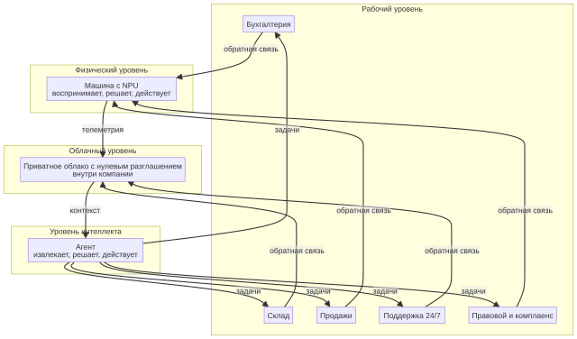

# Глава 20 --- Граф, связывающий всё

## Имя Целого

Мы последовательно прошли через каждый компонент шестой революции. Пришло время дать имя всему целому и показать его таким, каким оно является на самом деле: не как линию, а как *граф* --- набор соединений, в котором каждый узел питает каждый другой, образуя непрерывное, саморегулируемое целое. Это граф **Industry 7.0**, и именно такова форма будущего, которое эта книга описывает с первой страницы. Число "7.0" не произвольно. Предыдущие революции сделали машину более мощной, затем более связанной, затем более компьютеризированной. Седь же, в том обрамлении, которое принимает эта книга, --- это та, в которой сами машины становятся *периферией внутреннего ИИ*, а ИИ --- агентный, связанный с приватным облаком --- автоматизирует всё предприятие, от машины до каждого отдела.

Давайте нарисуем граф внимательно, потому что граф есть суть аргумента, и увидеть его целиком --- вот что отличает понимание шестой революции от простого восхищения её частями.

## Граф

## Любопытный факт: Семь мостов, и первый граф

Прежде чем читать граф, стоит знать, что слово "граф" в этом значении --- набор точек, соединённых линиями --- имеет удивительное и довольно игривое происхождение, потому что математика графов началась не с инженерии, а с головоломки. В прусском городе Кёнигсберге XVIII века (ныне Калининград, на реке Прегель) была река с двумя островами и семью мостами, соединяющими два берега и два острова. Жители забавляли себя вопросом: можно ли прогуляться так, чтобы пересечь каждый из семи мостов ровно по разу и вернуться в начальную точку? В 1736 году швейцарский математик **Леонард Эйлер** решил этот вопрос --- и решил его отрицательно, с доказательством столь чистым, что оно преподаётся и сегодня. Но это было больше, чем решение салонной игры: чтобы ответить на него, Эйлеру пришлось мыслить массами земли как *точками*, а мостами как *линиями*, и измерять их не по длине или материалу, а исключительно по *тому, как они соединены*. Тем самым он изобрёл то, что теперь называется теорией графов, и подарил нам сам словарь "узлов" и "рёбер", который мы используем для описания фабрики Industry 7.0.

Это любопытный факт, который стоит удержать, потому что прозрение Эйлера есть ровно то прозрение, на котором зависит наш граф. Граф Industry 7.0 не нарисован в масштабе; не имеет значения, насколько "длинным" является соединение между машиной и облаком или насколько "широким" является узел склада. Как показал Эйлер, имеет значение исключительно *как узлы соединены* --- какой узел питает какой, в каком порядке и как всё замыкается в петлю. Мапитает облако; облако питает агент; агент питает отделы; отделы возвращаются обратно. В этом всё аргумент, сведённый к соединениям. Сила графа не в узлах, а в *рёбрах*, и не только в рёбрах --- она в том, что рёбра, наконец, *замыкаются обратно*.

## Чтение графа

Давайте прочитаем граф снизу вверх, а затем увидим, как он замыкается обратно.

На **дне** находится физический слой: машина, оснащённая её интеллектуальным чипом, одноплатный компьютер с NPU, который воспринимает, решает и действует на одном безвентиляторном, дешёвом плате. Это слой, с которым мы встретились во Второй части --- машина, которая проснулась. Это ядро всего графа, потому что это точка, в которой интеллектуальность встречается с физическим миром изготовления вещей.

От машины вверх течёт поток **телеметрии**, зашифрованный в реальном времени. Этот поток не идёт в публичное облако; он идёт, на следующем уровне, в **приватное, доверяющее нулю, облако с нулевыми знаниями, удерживаемое внутри компании** --- облако Третьей части, которое принимает и хранит данные, никогда не имея возможности их прочесть, потому что компания держит ключ. Это память системы, согласованная и доступная для поиска по всей компании, и защищённая от любой третьей стороны.

Из этого облака агент --- **агентный ИИ** Пятой части --- извлекает точный, релевантный контекст как из облака, так и из собственной базы знаний компании. Агент решает, что делать, и действует. И его действием является **автоматизация отделов**: бухгалтерия, склад, продажи, маркетинг, поддержка клиентов, юридический отдел и соответствие требованиям. Это узлы на вершине графа --- работа, которую шестая революция наконец автоматизирует, офис, который продолжает работать после того, как выключили свет.

## Возврат в петлю

Теперь важнейшая часть, та, что делает его *графом*, а не merely пирамидой. Автоматизация отделов не заканчивает историю; она *возвращает её обратно*. Бухгалтерия, которая сводит счёты, генерирует новое требование. Склад, который заказывает запасную деталь, генерирует новую телеметрию. Продажи, которые анализируют рынок, генерируют новый план. И все эти требования, обратные связи и новые данные текут *обратно вниз* к машине и облаку, информируя следующий цикл восприятия, следующий цикл памяти, следующий цикл решения и действия. Граф замкнут. Система саморегулируема.

Вот что такое "7.0" в Industry 7.0: не новый вид машины, а новая *архитектура*, в которой машины становятся периферией внутреннего ИИ, а ИИ --- агентный, связанный с приватным облаком, знающий бизнес --- автоматизирует всё предприятие в непрерывной петле. Машина мыслит; облако помнит; агент решает; офис действует; и действие замыкается обратно, чтобы информировать следующее мышление. Целое больше суммы его частей, потому что целое есть *петля*, а петля сохраняет собственный импульс.

## Два вида интеллекта в графе

О последнее прочтение графа, потому что он возвращается ко Четвёртой части. Граф содержит оба вида интеллекта, с которыми мы встретились --- мыслящую догадку и детерминированную мыслящую --- и размещает каждую там, где она безопасна: **восприятие** на дне (машина, которая воспринимает) есть мыслящая догадка, идеальная для восприятия; **решение и спецификация** в агенте и облаке есть детерминированная мыслящая, уверенная и прослеживаемая. Граф не является единым интеллектом; это *сочетание*, каждая мыслящая в своём надлежащем месте, и именно это сочетание делает целое надёжным в тех местах, где надёжность не подлежит обсуждению.

## Целое в один вдох

Полезно, на графе, читать его как единое движение, чтобы форма была не только увиденной, но и пройденной. Давайте прочитаем всё целиком, от машины до офиса и обратно, в один вдох. На дне токарный станок на фабричном полу несёт чип, который воспринимает его мир --- температуру его подшипника, вибрацию его двигателя --- и предсказывает, исходя из этого восприятия, что подшипник выйдет из строя. Это предсечение течёт, зашифрованное, в приватное, доверяющее нулю, облако с нулевыми знаниями, удерживаемое внутри компании, которое принимает и хранит его, никогда не имея возможности прочесть, потому что компания держит ключ. Из этого облака агент извлекает точный, релевантный контекст --- историю машины, технические заметки компании, детерминированные решения, которые должны быть уверены --- и решает, что подшипник действительно выходит из строя, и размещает заказ на запасную деталь. Заказ течёт к складу, который теперь знает автоматически, и к бухгалтерии, которая сводит счёты, и к продажам и поддержке, которые знают дату доставки. И всё это --- заказ, счёты, доставка --- течёт *обратно* к машине и облаку, информируя следующий цикл восприятия, следующий цикл памяти, следующий цикл решения и действия. Граф замкнут. Система саморегулируема. Целое больше суммы его частей, потому что целое есть *петля*.

## Почему 7.0, а не 6.0

Стоит ответить plainly на вопрос, который поднимает название главы: почему "7.0", а не число, более близкое к остальной истории? Ответ в том, что число называет *архитектуру*, а не машину. Предыдущие революции сделали машину более мощной, затем более связанной, затем более компьютеризированной --- и каждый из этих шагов мог бы быть засчитан как "6.0" или "6.1", потому что это была та же революция, просто становящаяся сильнее и быстрее. Седь же, в том обрамлении, которое принимает эта книга, есть *другой вид вещи*: это революция, в которой сами машины становятся *периферией внутреннего ИИ*, а ИИ --- агентный, связанный с приватным облаком, знающий бизнес --- автоматизирует всё предприятие, от машины до каждого отдела. Не в том дело, что машины стали более мощными; в том, что они стали *чем-то новым* --- периферией ИИ, который мыслит, связывает и знает. Это новая архитектура, и она заслуживает нового числа. "7.0" не произвольно; она отмечает момент, когда фабрика перестала быть собранием умных машин, которые просто сидят рядом, и стала единой, саморегулируемой системой.

## Почему петля, а не цепь

Важнейшее в графе не то, что он имеет четыре слоя, а то, что он *замкнут*. И стоит понять, почему замыкание так важен, потому что старая фабрика тоже была своего вида графом --- *цепью* --- и разница между цепью и петлей есть разница между фабрикой, которую можно только приказывать, что делать, и фабрикой, которая может мыслить о том, что она делает.

Старая фабрика была цепью: сырьё входило с одного конца, а готовый продукт выходил с другого, и каждый шаг был звеном, передающим работу следующему. Линия сборки Тейлора, с которой мы встретились в хронологии, была чистейшим выражением цепи --- линейной последовательностью малых, повторяемых шагов, каждый из которых питает следующий, ни один из которых не огляывается назад. Цепь была блестяще эффективна в одной вещи: *делать то же самое, быстрее*. Но у неё была структурная слабость, которую никакая эффективность не могла вылечить. Она не могла *обучаться*, потому что ничего в цепи никогда не возвращалось обратно. Выход покидал фабрику, и фабрика никогда не слышала, что с ним случилось. Дефект, обнаруженный клиентом тремя неделями позже, не мог информировать машину, которая его сделала, потому что у цепи не было ребра, идущего назад.

Граф Industry 7.0 имеет это ребро. Отделы возвращаются обратно к машине и облаку, и эта обратная связь меняет следующий цикл. Дефект, обнаруженный клиентом, становится через агент новую требование, достигающее машины; закономерность в технических записях становится через ту же петлю новым предсечением, предотвращающим будущую поломку. Граф *обучается на своём собственном выходе*, а цепь никогда не могла. Вот почему петля, а не merely слои, есть суть седьмого поколения: это структура, позволяющая фабрике слышать себя мыслящей.

## Хрупкость цепи, устойчивость петли

Есть вторая, тишая причина, по которой петля побеждает цепь, и она о том, что происходит, когда что-то идёт не так. Цепь *хрока на своём самом слабом звене*: если любой одиночный шаг в линейной последовательности выходит из строя, весь продукт останавливается, потому что нет другого пути от сырья к готовому продукту. Вот почему линия сборки полностью замирает, когда одна станция заедает --- у цепи нет объезда, нет резервирования, нет альтернативного маршрута.

Петля более устойчива по той же причине, по которой интересны мосты Эйлера: имеет значение *как части соединены*. Потому что граф Industry 7.0 имеет несколько рёбер --- отделы питают и машину и облако, машина питает облако и получает из него --- сбой в одной точке не обязательно останавливает всю систему. Агент может обойти сбойный отдел; облако может обслуживать машину, у которой сосед выключен; машина может действовать локально даже когда облако на мгновение недоступно. Граф не *иммунен* к сбою, но он *распределён* против него, тем образом, в котором сеть более устойчива, чем одиночная дорога. Это тоже наследие Эйлера: форма соединений решает поведение целого, и граф с множеством рёбер не merely более мощен, чем цепь --- он более прочен.

## Имя Лаборатории

Было бы честно не называть работу за этим графом. Всё это --- машина, которая мыслит, приватное облако, агентный ИИ, автоматизированный офис --- строится, публикуется и совершенствуется небольшой исследовательской лабораторией, **AI Technology Graphene-Lab**, проекты которой вы встретили на протяжении всей этой книги: одноплатная интеллектуальность, доверяющее нулю и с нулевыми знаниями CloudServer, детерминированный ИИ UISupportBlazor и агентный AgentBridge, который знает ваш бизнес и никогда не забывает. Этот граф есть их видение фабрики седьмого поколения, и это видение, которое эта книга описывает с её первой страницы. Следующая часть книги обращается к человеческому лицу этого графа --- работнику, который не заменяется, а повышается, и работнику, который, в новом и буквальном смысле, наконец выходит на пол. На данный момент пусть граф стоит: машина, облако, агент и отдел, соединённые в единое саморегулируемое целое.
